# 🎥 15 — Multimodal AI: Text, Images, Audio and Video

[⬅️ Previous](14-ai-workflows-and-orchestration.md)

> Venkata Bhattaram (c) 2026

## 🎯 Learning Objectives

- Understand multimodal artificial intelligence.
- Learn how AI applications process text, images, audio, and video.
- Explore speech recognition, image understanding, and audio generation.
- Understand how multimodal components connect in one application.
- Build a practical plan for a multimodal AI project.

## 🌟 1. What Is Multimodal AI?

**Multimodal AI** refers to AI systems that work with more than one type of information, or modality.

Traditional text-based applications primarily process written language. Multimodal applications may accept a photograph, interpret spoken questions, analyze video frames, or generate speech from text.

Depending on the model and system design, inputs and outputs may include:

- 📝 Text
- 🖼️ Images
- 🎙️ Audio and speech
- 🎬 Video
- 📊 Structured information such as tables

Not every AI model supports every modality. Developers must check the selected model's input and output capabilities.

## 🧩 2. The Main Modalities

| Modality | Example task | Possible application |
|---|---|---|
| Text | Summarize or classify text | Document assistant |
| Images | Describe a photograph | Product catalog assistant |
| Audio input | Transcribe speech | Meeting transcription |
| Audio output | Generate spoken responses | Voice assistant |
| Video | Analyze selected frames or supported video input | Training-video summarizer |
| Text plus images | Answer questions about a picture | Visual learning assistant |

## 🏗️ 3. How a Multimodal Application Works

```mermaid
flowchart TD
    A["👤 User Input"] --> B{"🎭 Input Modality"}
    B --> C["📝 Text"]
    B --> D["🖼️ Image"]
    B --> E["🎙️ Audio"]
    B --> F["🎬 Video"]

    C --> G["🧠 Model or Processing Pipeline"]
    D --> G
    E --> H["🎧 Speech Recognition or Audio Model"]
    F --> I["🖼️ Frame and Audio Processing"]
    H --> G
    I --> G

    G --> J{"📤 Output Type"}
    J --> K["💬 Text Response"]
    J --> L["🔊 Generated Audio"]
    J --> M["📋 Structured Result"]

    classDef input fill:#DBEAFE,stroke:#2563EB,color:#1E3A8A
    classDef process fill:#EDE9FE,stroke:#7C3AED,color:#4C1D95
    classDef output fill:#DCFCE7,stroke:#16A34A,color:#14532D

    class A,B,C,D,E,F input
    class G,H,I,J process
    class K,L,M output
```

A multimodal pipeline may use a single model or several specialized components. For example, video summarization may combine speech transcription, frame selection, visual analysis, and text generation.

## 🖼️ 4. Image Understanding

An image-capable model can help with tasks such as:

- Describing objects and scenes.
- Answering questions about an image.
- Reading some visible text.
- Comparing product images.
- Extracting visual details for further review.

### Example scenario — AI product catalog

A store manager uploads a photograph of a backpack and asks:

> Describe the visible design and features for a product listing.

An image-capable model may describe the color, shape, pockets, and visible material. The application should not invent facts about brand, price, durability, or material composition when those facts cannot be established from the image.

## 🎙️ 5. Audio and Speech AI

Audio-related AI systems may support:

- **Speech-to-text:** Convert spoken language into text.
- **Text-to-speech:** Generate speech from text.
- **Audio understanding:** Analyze supported audio inputs.
- **Speech translation:** Convert speech from one language into another.
- **Voice interaction:** Combine audio input, model reasoning, and spoken output.

### Example scenario — Meeting assistant

A team uploads an authorized meeting recording. The application transcribes the speech, identifies the main discussion points, drafts a summary, and presents possible action items for review.

Transcription errors, overlapping speakers, accents, and background noise can affect the output. Important decisions should be checked against the original recording.

## 🎬 6. Video Understanding

Video contains a sequence of visual frames and may include audio, timestamps, subtitles, and other metadata.

A video-processing workflow might:

1. Validate the uploaded file.
2. Extract the audio track.
3. Transcribe speech when needed.
4. Sample or select relevant frames.
5. Analyze the selected visual content.
6. Combine the results into a summary.
7. Include timestamps or references where supported.

For long videos, processing every frame may be unnecessary or too expensive. Frame selection and segmentation should match the task.

## 🌍 7. Real-World Scenario — AI Learning Assistant

Imagine a student uploads a recorded lecture and asks:

> Summarize the lecture, explain the diagram shown at 12 minutes, and create five revision questions.

The application could:

1. Transcribe the lecture audio.
2. Extract timestamps.
3. Select a frame around the requested time.
4. Analyze the diagram with a vision-capable model.
5. Combine the transcript and visual findings.
6. Generate a summary and revision questions.
7. Allow the student to verify the result against the recording.

This workflow combines audio, video, image understanding, and text generation.

## 💻 8. Hands-On Project Plan

Build a small image-question-answering application.

**Step 1 — Create an input interface**

Allow users to upload a supported image and enter a question.

**Step 2 — Validate the upload**

Check file size, allowed formats, and whether the image can be decoded.

**Step 3 — Connect a vision-capable model**

Use a provider and model that explicitly support image input.

**Step 4 — Supply the image and question**

Send the authorized image content and prompt through the provider's supported API.

**Step 5 — Display the response**

Show the answer with an appropriate indication that AI-generated descriptions may contain mistakes.

**Step 6 — Test the application**

Try blurry images, unsupported formats, large files, ambiguous questions, and images without enough information to answer.

## 🔐 9. Privacy and Safety Considerations

- Obtain permission before processing recordings or personal images.
- Avoid uploading confidential material to unapproved services.
- Validate file type and size instead of trusting filenames.
- Remove unnecessary metadata when appropriate.
- Restrict access to uploaded media.
- Define retention and deletion policies.
- Treat OCR text, transcripts, and image content as untrusted input.
- Review generated descriptions before using them for important decisions.

## ⚠️ 10. Common Mistakes

- Assuming a text-only model can process images or audio.
- Treating speech transcription as perfectly accurate.
- Sending full-resolution images or long videos without considering cost.
- Inventing visual details not supported by the image.
- Ignoring timestamps and source references.
- Forgetting upload validation and privacy protections.
- Assuming one API supports all modalities in the same format.

## ✅ 11. Best Practices

- Select a model based on the required input and output modalities.
- Validate and preprocess media before inference.
- Use specialized components where they improve quality or cost.
- Preserve timestamps and source references for video and audio tasks.
- Test across realistic image quality, accents, languages, and file sizes.
- Measure latency and cost for the complete pipeline.
- Provide clear error messages and allow users to review results.

## 🔑 Key Takeaways

- Multimodal AI works with combinations of text, images, audio, and video.
- Applications can combine specialized models into a single pipeline.
- Modality support and file constraints vary by provider.
- Media processing requires privacy controls, input validation, and output evaluation.