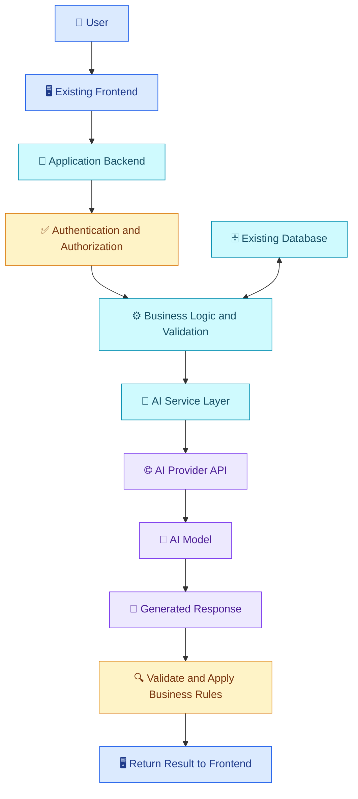
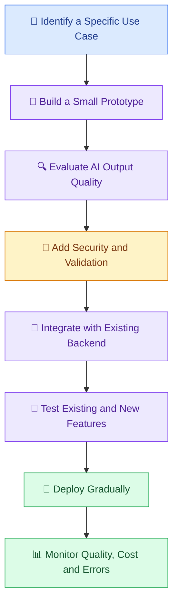

# 🔌 16 — Integrating AI into Existing Applications

[⬅️ Previous](15-multimodal-ai.md)

> Venkata Bhattaram (c) 2026

## 🎯 Learning Objectives

- Understand how to add AI capabilities to an existing application.
- Learn the roles of frontend, backend, AI services, and databases.
- Understand how to expose AI functionality through application APIs.
- Learn how to protect API credentials and user data.
- Plan an incremental integration without disrupting existing features.

## 🌟 1. What Does AI Integration Mean?

**AI integration** means adding AI-powered capabilities to software that already exists, or connecting AI services to other parts of an application.

A business does not always need to build a completely new application to benefit from AI.

Examples include:

- Adding an AI support assistant to an e-commerce website.
- Generating product descriptions in an inventory management system.
- Summarizing reports in a business dashboard.
- Adding natural-language search to a document portal.
- Creating meeting summaries inside a collaboration tool.
- Using AI to classify incoming support tickets.

The objective is to solve a specific problem while preserving the reliability and security of the existing system.

## 🏗️ 2. Typical Integration Architecture



The frontend should normally call your backend for privileged AI operations. The backend validates the request, applies business rules, securely accesses the provider, and returns an appropriate result.

## 🧩 3. Main Integration Components

| Component | Responsibility |
|---|---|
| Frontend | Collects user input and displays results |
| Backend API | Receives requests and coordinates application logic |
| Authentication | Identifies the user or service |
| Authorization | Determines permitted operations and data access |
| AI service layer | Encapsulates model-provider requests |
| Database | Stores application records and approved state |
| Validation layer | Checks input and output requirements |
| Monitoring | Records operational metrics and failures |

Separating the AI service layer from the rest of the application makes it easier to test, update prompts, and change model configuration.

## 🌍 4. Real-World Scenario — Adding AI to a Boutique Website

Suppose a boutique already has a website with a product catalog, inventory database, and manager dashboard.

The owner wants managers to generate draft product descriptions from product details.

Instead of rebuilding the website, the development team can add a feature to the existing dashboard:

1. A manager selects a product.
2. The frontend submits approved product details to the backend.
3. The backend checks the manager's permissions.
4. The AI service generates a draft description.
5. The application checks the response and displays it for review.
6. The manager edits and approves the description.
7. The existing catalog workflow saves the approved content.

The AI model should not independently change prices, inventory, or publish products unless a separate, authorized workflow explicitly permits those actions.

## 💻 5. Hands-On Example — Add an AI Endpoint with FastAPI

This example creates a small backend endpoint that an existing frontend could call.

### Step 1 — Install dependencies

```powershell
python -m pip install fastapi uvicorn openai python-dotenv
```

### Step 2 — Configure `.env`

```dotenv
OPENAI_API_KEY=your_api_key_here
OPENAI_MODEL=your_supported_model_name
```

Keep this file outside version control.

### Step 3 — Create `main.py`

```python
import os

from dotenv import load_dotenv
from fastapi import FastAPI, HTTPException
from pydantic import BaseModel, Field
from openai import OpenAI, APIError, APIConnectionError

load_dotenv()

api_key = os.getenv("OPENAI_API_KEY")
model = os.getenv("OPENAI_MODEL")

if not api_key or not model:
    raise RuntimeError(
        "Configure OPENAI_API_KEY and OPENAI_MODEL in .env."
    )

client = OpenAI(api_key=api_key)
app = FastAPI(title="AI Product Description API")


class ProductRequest(BaseModel):
    name: str = Field(min_length=1, max_length=120)
    category: str = Field(min_length=1, max_length=80)
    features: list[str] = Field(max_length=20)


class DescriptionResponse(BaseModel):
    description: str


@app.get("/health")
def health():
    return {"status": "ok"}


@app.post(
    "/generate-description",
    response_model=DescriptionResponse,
)
def generate_description(product: ProductRequest):
    details = (
        f"Product name: {product.name}\n"
        f"Category: {product.category}\n"
        f"Features: {', '.join(product.features)}"
    )

    try:
        response = client.responses.create(
            model=model,
            instructions=(
                "Write a concise product description for a boutique. "
                "Use only the supplied product details. "
                "Do not invent prices, brands, materials, or certifications. "
                "Return only the description."
            ),
            input=details,
        )

        description = response.output_text.strip()

        if not description:
            raise HTTPException(
                status_code=502,
                detail="The AI service returned an empty response.",
            )

        return DescriptionResponse(description=description)

    except APIConnectionError:
        raise HTTPException(
            status_code=503,
            detail="The AI service is temporarily unreachable.",
        )
    except APIError:
        raise HTTPException(
            status_code=502,
            detail="The AI service could not complete the request.",
        )
```

### Step 4 — Start the backend

```powershell
uvicorn main:app --reload
```

Open the local API documentation at:

`http://127.0.0.1:8000/docs`

Test the endpoint using a sample request:

```json
{
  "name": "Floral Summer Dress",
  "category": "Women's clothing",
  "features": [
    "Floral pattern",
    "Short sleeves",
    "Casual design"
  ]
}
```

The generated description will vary. The endpoint demonstrates model integration, request validation, and basic error handling. It does not include production authentication, authorization, rate limiting, or persistence.

## 🌐 6. Connect a Frontend

A JavaScript frontend can call the backend endpoint:

```javascript
async function generateDescription(product) {
  const response = await fetch(
    "/generate-description",
    {
      method: "POST",
      headers: {
        "Content-Type": "application/json",
      },
      body: JSON.stringify(product),
    }
  );

  if (!response.ok) {
    throw new Error(
      `Request failed with status ${response.status}`
    );
  }

  return response.json();
}
```

Example use:

```javascript
const result = await generateDescription({
  name: "Floral Summer Dress",
  category: "Women's clothing",
  features: [
    "Floral pattern",
    "Short sleeves",
    "Casual design",
  ],
});

console.log(result.description);
```

This assumes the frontend can reach the backend at the same origin or through an appropriately configured API base URL. If the frontend and backend run on different origins during development, configure CORS on the backend for the specific trusted frontend origin.

## 🔐 7. Security and Reliability Checklist

Before exposing the endpoint beyond local development:

- Add authentication and verify user permissions.
- Keep provider credentials exclusively on the server.
- Apply request-size and rate limits.
- Validate input lengths, types, and allowed fields.
- Avoid logging sensitive customer or product information unnecessarily.
- Handle provider timeouts and temporary failures.
- Monitor usage and configure cost alerts.
- Review generated descriptions before publication.
- Add automated tests for successful requests and failure conditions.

A production service should also configure timeouts, structured logging, deployment settings, and appropriate monitoring. Avoid returning raw provider error details to end users.

## 🔄 8. A Safe Integration Strategy



Integrate AI incrementally. Keep existing functionality working, and use feature flags or staged rollout where appropriate.

## ⚠️ 9. Common Mistakes

- Calling a privileged AI API directly from the browser.
- Rebuilding the entire application for one AI feature.
- Skipping authentication and authorization.
- Trusting generated content without review.
- Exposing internal provider errors to users.
- Ignoring rate limits and usage costs.
- Breaking existing functionality while integrating the new feature.
- Failing to test backend and frontend compatibility.

## ✅ 10. Best Practices

- Identify a measurable business problem first.
- Isolate provider-specific code in a dedicated service.
- Keep business rules and access checks in trusted application logic.
- Reuse existing databases and workflows where appropriate.
- Validate inputs and outputs.
- Add monitoring, rate limits, and appropriate error handling.
- Test integration and regression scenarios.
- Deploy gradually and evaluate real-world performance.

## 🔑 Key Takeaways

- AI can be integrated into existing software without rebuilding everything.
- A backend service layer is a practical way to protect credentials and coordinate requests.
- Authentication, authorization, validation, and human review remain essential.
- Production integration requires testing, monitoring, and cost management.