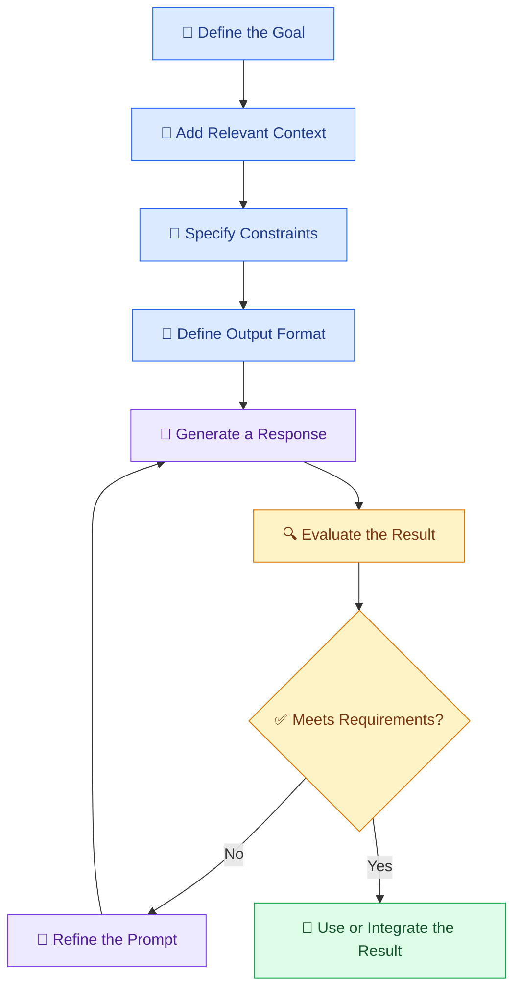

# ✍️ 05 — Prompt Engineering and Context Design

[⬅️ Back to Learning Modules](../README.md) · 

> Venkata Bhattaram (c) 2026

## 🎯 Learning Objectives

- Understand prompt engineering and context design.
- Learn how to write clear instructions for AI models.
- Use roles, context, examples, constraints, and output formats.
- Understand the difference between a prompt and a context window.
- Improve response quality through iterative testing.

## 🌟 1. What Is Prompt Engineering?

**Prompt engineering** is the process of designing instructions and inputs that guide an AI model toward a useful response.

Instead of asking an AI to perform a broad task with little guidance, a developer provides the goal, relevant context, constraints, and expected output.

### Example: Weak vs Improved Prompt

**❌ Weak prompt**

> Explain AI.

**✅ Improved prompt**

> Explain artificial intelligence to a first-year engineering student. Use simple English, include three everyday examples, explain one limitation, and finish with a five-point summary.

The second prompt defines the audience, scope, style, examples, and output structure.

## 🧩 2. Anatomy of a Good Prompt

A useful prompt can include these components:

| Component | Purpose | Example |
|---|---|---|
| Role | Establish the expected perspective | Act as a Python tutor |
| Goal | Describe the task | Explain a list comprehension |
| Context | Supply relevant information | The learner knows basic loops |
| Constraints | Define boundaries | Use no advanced libraries |
| Output format | Specify the result structure | Return an explanation and code |
| Examples | Demonstrate the desired pattern | Show one input and expected output |
| Validation criteria | Describe success | Code must run and include an example |

Not every prompt needs all seven components. Use only the detail needed for the task.

## 🏗️ 3. Prompt Design Workflow

## 🧠 4. What Is Context Design?

**Context design** is the process of deciding what information the model should receive to complete a task reliably.

Context can include:

- User instructions.
- Relevant conversation history.
- Reference documents.
- Retrieved information from databases.
- Tool results.
- Examples and output schemas.
- Application-specific rules.

A long prompt is not necessarily a good prompt. Irrelevant or contradictory context can make a response less reliable.

### Prompt vs Context

| Prompt | Context |
|---|---|
| Instructions or request given to the model | The broader information available for the task |
| Often tells the model what to do | Helps the model determine how to do it and what information to use |
| Example: Summarize this policy | The policy text, audience, previous clarifications, and summary requirements |

In practice, the prompt is often one part of the overall context.

## 🌍 5. Real-World Scenario — AI College Assistant

A college wants its AI assistant to answer questions about attendance rules.

**Poor instruction:**

> Answer questions about attendance.

**Improved instruction:**

> You are a college information assistant. Answer using only the supplied attendance policy. Give a concise answer and identify the relevant policy section when available. If the supplied information does not answer the question, say that the policy information provided is insufficient. Do not invent attendance percentages, exceptions, or penalties.

The improved version reduces unsupported answers by specifying the information source and what to do when evidence is missing. It does not guarantee correctness, so the application must still test responses.

## 💬 6. Prompt Patterns for Developers

### A. Role and goal

> Act as a beginner-friendly Python instructor. Explain functions using one simple example.

### B. Constraints

> Write a Python solution using the standard library only. Validate empty input and explain any assumptions.

### C. Structured response

> Return a summary with the headings `Overview`, `Key Points`, `Risks`, and `Next Steps`.

### D. Few-shot prompting

Few-shot prompting provides examples of the desired input-output pattern.

> Classify customer feedback as `Positive`, `Neutral`, or `Negative`.
>
> Example: “The delivery was fast and the product was excellent.” → `Positive`
>
> Example: “The package arrived today.” → `Neutral`
>
> Now classify: “The item arrived broken and support has not replied.” → Return the label and a one-sentence explanation.

### E. Grounded answering

> Answer using the supplied document. Separate facts stated in the document from any assumptions. If the answer is unavailable, say so.

## 🧪 7. Hands-On Exercise

Ask an AI coding assistant:

> Design a prompt for a student performance assistant. It receives a student's marks and returns a short summary of strengths, areas to improve, and practical study suggestions. Do not invent marks or make unsupported claims about the student's abilities. Return the result using clearly labeled sections.

Then test it with:

1. Complete marks data.
2. Missing subject marks.
3. Invalid scores.
4. Contradictory input.
5. A request to reveal another student's information.

Record whether the response meets your requirements. The last case should be handled by application-level authorization and privacy controls, not by prompt wording alone.

## ⚠️ 8. Common Mistakes

- Writing vague instructions.
- Supplying excessive, irrelevant context.
- Using conflicting requirements.
- Assuming a role description guarantees accurate behavior.
- Asking for a specific format without validating the result.
- Including confidential data unnecessarily.
- Trusting the model to enforce permissions or security rules.

## ✅ 9. Best Practices

- State the goal clearly and early.
- Specify the intended audience and output format.
- Supply only relevant, authorized context.
- Provide examples when the desired pattern is difficult to explain.
- Tell the model how to handle missing information.
- Test prompts with normal, ambiguous, and adversarial inputs.
- Version important prompts and measure changes against a test set.
- Enforce security and business rules in application code.

## 🔑 Key Takeaways

- Prompt engineering improves instructions; context design improves the information available to the model.
- Good prompts define goals, constraints, and expected outputs.
- More context is not always better.
- Prompts alone cannot guarantee factual accuracy or enforce security.
- Prompt quality should be evaluated through repeatable tests.

