# 🚀 06 — Building Your First AI Application

[⬅️ Previous](05-prompt-engineering.md) ·

> Venkata Bhattaram (c) 2026

## 🎯 Learning Objectives

- Understand the basic structure of an AI application.
- Connect a Python application to an AI model.
- Accept user input and display model-generated responses.
- Handle configuration and common API errors.
- Identify the steps needed to turn a prototype into a usable application.

## 🌟 1. What Is an AI Application?

An **AI application** is software that combines an AI model with application logic to perform a useful task.

For example, a study assistant may accept a question, send it to an AI model, and display an explanation. A production version might also authenticate users, retrieve college notes, maintain conversation history, and record errors.

A model call is only one part of the complete application.

## 🏗️ 2. Application Architecture

```mermaid id="firstai735"
flowchart LR
    A["👤 User"] --> B["🖥️ User Interface or CLI"]
    B --> C["⚙️ Python Application"]
    C --> D["🔐 Configuration and Validation"]
    D --> E["🌐 AI Provider API"]
    E --> F["🧠 AI Model"]
    F --> G["📨 Model Response"]
    G --> H["✅ Application Checks"]
    H --> I["💬 Display Result"]

    classDef user fill:#DBEAFE,stroke:#2563EB,color:#1E3A8A
    classDef app fill:#CFFAFE,stroke:#0891B2,color:#164E63
    classDef ai fill:#EDE9FE,stroke:#7C3AED,color:#4C1D95
    classDef result fill:#DCFCE7,stroke:#16A34A,color:#14532D

    class A user
    class B,C,D app
    class E,F ai
    class G,H,I result
```



## 🛠️ 3. Prepare the Project

If you completed Topic 03, reuse your existing `ai-developer-project` environment. Otherwise, create a new folder and virtual environment.

```powershell id="firstai735b"
mkdir first-ai-app
cd first-ai-app

py -3.13 -m venv .venv
.\.venv\Scripts\Activate.ps1

python -m pip install --upgrade pip
python -m pip install openai python-dotenv
```

Create these files:

```text id="firstai735c"
first-ai-app/
├── .venv/
├── .env
├── .gitignore
├── main.py
└── requirements.txt
```

Create `.env`:

```dotenv id="firstai735d"
OPENAI_API_KEY=your_api_key_here
OPENAI_MODEL=your_supported_model_name
```

Replace the placeholders with your actual API key and a model available to your account.

Create `.gitignore`:

```gitignore id="firstai735e"
.venv/
.env
__pycache__/
*.pyc
```

## 💻 4. Build a Simple AI Study Assistant

Create `main.py`:

```python id="firstai735f"
import os

from dotenv import load_dotenv
from openai import OpenAI, APIError, APIConnectionError, RateLimitError

load_dotenv()

api_key = os.getenv("OPENAI_API_KEY")
model = os.getenv("OPENAI_MODEL")

if not api_key or not model:
    raise RuntimeError(
        "Configure OPENAI_API_KEY and OPENAI_MODEL in your .env file."
    )

client = OpenAI(api_key=api_key)


def ask_ai(question: str) -> str:
    """Send a question to the configured AI model."""
    question = question.strip()

    if not question:
        raise ValueError("Please enter a question.")

    response = client.responses.create(
        model=model,
        instructions=(
            "You are a helpful study assistant. "
            "Explain concepts clearly for beginners. "
            "If a question needs information that you do not have, "
            "state your uncertainty rather than inventing facts."
        ),
        input=question,
    )

    return response.output_text


def main() -> None:
    print("🎓 AI Study Assistant")
    print("Type 'exit' to stop.\n")

    while True:
        question = input("You: ").strip()

        if question.lower() in {"exit", "quit"}:
            print("Goodbye!")
            break

        try:
            answer = ask_ai(question)
            print(f"\nAI: {answer}\n")
        except ValueError as error:
            print(f"Input error: {error}")
        except RateLimitError:
            print("The service limit or quota was reached. Check your account.")
        except APIConnectionError:
            print("Could not connect to the AI service. Check your network.")
        except APIError as error:
            print(f"The AI service returned an error: {type(error).__name__}")
        except Exception as error:
            # Do not print credentials or sensitive request contents.
            print(f"Unexpected error: {type(error).__name__}")


if __name__ == "__main__":
    main()
```

Run the application:

```powershell id="firstai735g"
python main.py
```

Example interaction:

```text id="firstai735h"
🎓 AI Study Assistant
Type 'exit' to stop.

You: Explain machine learning in simple words.

AI: Machine learning is a branch of AI that helps computers
learn patterns from examples and use those patterns to make
predictions or decisions.
```

The exact response will vary. A successful request also depends on API access, valid configuration, network connectivity, and available quota.

## 🔍 5. Understand the Code

| Component | Purpose |
|---|---|
| `load_dotenv()` | Loads local configuration from `.env` |
| `OpenAI(...)` | Creates the API client |
| `ask_ai()` | Validates the question and calls the model |
| `instructions` | Defines the assistant's expected behavior |
| `responses.create()` | Sends a request to the model |
| `response.output_text` | Retrieves the generated text |
| `try/except` | Handles common request and input failures |
| `main()` | Runs the interactive command-line loop |

This is a prototype. A public application would also need appropriate timeouts, request limits, authentication where required, monitoring, cost controls, and more comprehensive error handling.

## 🌍 6. Extend the Project

Once the basic application works, improve it gradually:

1. Add a React or HTML interface.
2. Expose a backend endpoint using FastAPI.
3. Add conversation history if the use case requires it.
4. Connect authorized documents using retrieval.
5. Validate outputs using a structured schema.
6. Add automated tests.
7. Deploy the application to an appropriate hosting platform.

Avoid adding all these features at once. Build and test one improvement before moving to the next.

## ⚠️ 7. Common Mistakes

- Using a placeholder API key or model identifier.
- Forgetting to activate the virtual environment.
- Committing `.env` to source control.
- Assuming every response will be factually correct.
- Treating an API error as proof that the Python code is broken.
- Allowing unlimited requests in a public interface.
- Logging full prompts containing sensitive information.

## ✅ 8. Best Practices

- Keep configuration separate from source code.
- Validate inputs before making API requests.
- Handle expected provider errors clearly.
- Use representative test prompts.
- Monitor latency, failures, and token usage.
- Add authentication and rate limiting before public deployment.
- Make the user aware of important AI limitations.

## 🔑 Key Takeaways

- An AI application connects user input, application logic, a model, and response handling.
- You can build a first prototype without training your own model.
- Secure configuration and error handling are essential from the beginning.
- Production readiness requires additional security, evaluation, and operational controls.