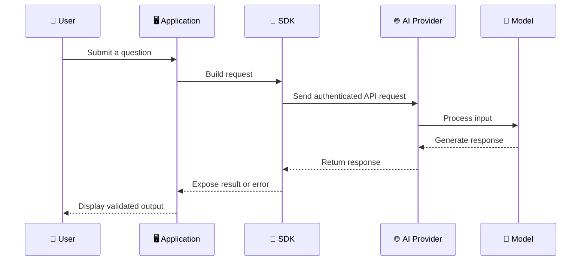
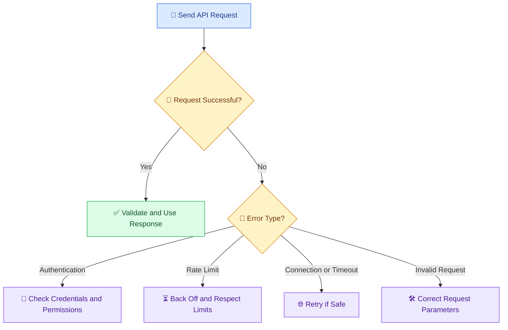

# 🔌 07 — Working with AI APIs and SDKs

[⬅️ Previous](06-first-ai-application.md) ·

> Venkata Bhattaram (c) 2026

## 🎯 Learning Objectives

- Understand APIs, SDKs, endpoints, and authentication.
- Learn how applications communicate with AI providers.
- Understand the request-response lifecycle.
- Explore API errors, rate limits, and usage costs.
- Build a small reusable AI service in Python.

## 🌟 1. What Is an API?

An **Application Programming Interface (API)** allows one software system to interact with another through defined operations and data formats.

For example, a college application may send a question to an AI service through an API and receive a generated response.

An API defines how the interaction works. It does not guarantee that the requested operation will always succeed.

## 🧰 2. What Is an SDK?

A **Software Development Kit (SDK)** is a collection of code libraries and tools that makes it easier to use a service from a particular programming language.

| API | SDK |
|---|---|
| Defines how a service can be accessed | Provides convenient code for interacting with that service |
| May be accessed through HTTP requests | Often wraps HTTP requests and response handling |
| Can be used with different languages | Usually designed for specific languages or runtimes |
| Requires handling protocol details when used directly | Can simplify authentication, serialization, and errors |

For example, you can call a compatible service through HTTP or use its official Python SDK. SDKs are usually more convenient, but developers still need to understand the underlying request, response, authentication, and error behavior.

## 🏗️ 3. How an AI API Request Works



Typical steps:

1. The user submits a request.
2. The application validates the input.
3. The application creates an API request.
4. Authentication identifies the permitted caller.
5. The provider processes the request using an available model.
6. The provider returns a response or error.
7. The application validates and displays the result.

## 🔐 4. API Keys and Authentication

An API key is a credential used by many services to identify and authorize API requests. Other services use OAuth, cloud identities, or different authentication mechanisms.

For local development, use environment variables or a `.env` file excluded from Git:

```dotenv id="api735a"
OPENAI_API_KEY=your_api_key_here
OPENAI_MODEL=your_supported_model_name
```

Do not expose secret API keys in frontend JavaScript, public repositories, screenshots, or client-side application bundles.

For a browser-based application, send the request through a backend that securely holds the credential. Add user authentication and authorization where needed.

## 💻 5. Create a Reusable AI Service

Install the required packages if they are not already installed:

```powershell id="api735b"
python -m pip install openai python-dotenv
```

Create `ai_service.py`:

```python id="api735c"
import os

from dotenv import load_dotenv
from openai import OpenAI, APIError, APIConnectionError, RateLimitError

load_dotenv()

api_key = os.getenv("OPENAI_API_KEY")
model = os.getenv("OPENAI_MODEL")

if not api_key or not model:
    raise RuntimeError(
        "Configure OPENAI_API_KEY and OPENAI_MODEL in .env."
    )

client = OpenAI(api_key=api_key)


def generate_text(prompt: str) -> str:
    """Generate text using the configured model."""
    if not prompt.strip():
        raise ValueError("Prompt cannot be empty.")

    response = client.responses.create(
        model=model,
        input=prompt,
    )

    return response.output_text


if __name__ == "__main__":
    try:
        print(generate_text("Explain APIs in three simple bullet points."))
    except RateLimitError:
        print("Request limit or quota reached. Check your provider account.")
    except APIConnectionError:
        print("Connection failed. Check your network.")
    except APIError as error:
        print(f"Provider error: {type(error).__name__}")
```

Run:

```powershell id="api735d"
python ai_service.py
```

This example uses the OpenAI Python SDK. Other providers may require different packages, authentication, request structures, and response-handling code.

## 🚦 6. Important API Concepts

| Concept | Meaning |
|---|---|
| Endpoint | Address or operation used to access a service |
| Request | Data sent to the API |
| Response | Data returned by the API |
| Authentication | Establishes the caller's identity or credential |
| Authorization | Determines what the caller is allowed to do |
| Rate limit | Restricts request frequency or volume |
| Timeout | Limits how long the application waits for a request |
| Retry | Attempts a failed request again under defined conditions |
| Streaming | Delivers response chunks as they become available |
| Usage metadata | Information that may help measure consumption and cost |

## ⚠️ 7. Handling API Failures



Important rules:

- Retry only errors that are likely to be temporary.
- Use bounded retries with exponential backoff and jitter.
- Respect any provider retry instructions.
- Avoid blindly retrying non-idempotent operations that may cause duplicate actions.
- Do not repeatedly retry authentication or invalid-request errors without correcting the cause.
- Set timeouts and report useful, non-sensitive error information.

## 💰 8. API Costs and Usage

AI API costs may depend on input tokens, output tokens, model choice, tools, image or audio processing, and other provider-specific factors.

For a rough text-generation estimate:

**Estimated cost = input usage cost + output usage cost + other applicable charges**

Always check current pricing and billing details with the provider. A request that fails may still incur charges in some circumstances.

Useful cost-control practices include:

- Limiting unnecessary context.
- Setting appropriate output limits.
- Choosing a model suited to the task.
- Caching results where safe and appropriate.
- Tracking usage and setting budget alerts.
- Preventing abusive or automated request spikes.

## 🌍 9. Real-World Scenario — AI Support System

An online store uses an AI model to draft responses to customer questions.

The application should authenticate the backend, send only relevant information, handle timeouts, validate the generated response, and require human approval for sensitive refunds or account changes.

The AI service should not receive unrestricted access to customer records simply because it is connected through an API.

## 🔑 Key Takeaways

- APIs define how services communicate; SDKs make that communication easier to implement.
- Authentication and authorization are different concepts.
- API calls can fail because of credentials, quotas, invalid requests, or network conditions.
- Retry logic must be bounded and appropriate to the operation.
- Secure credential handling, cost monitoring, and response validation are essential.
