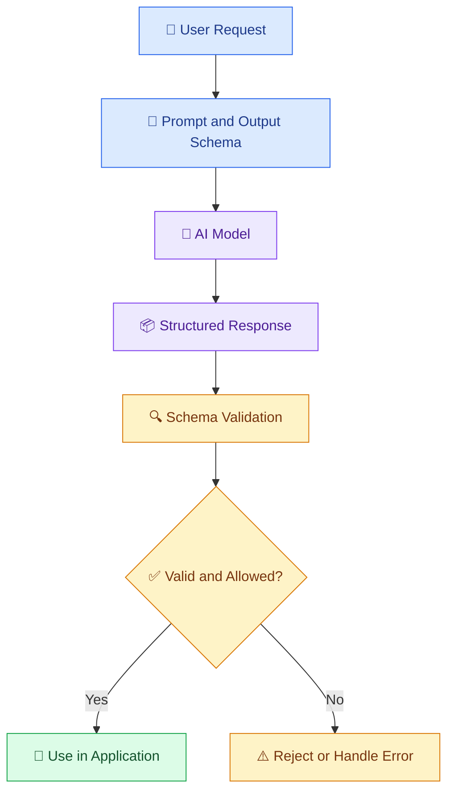
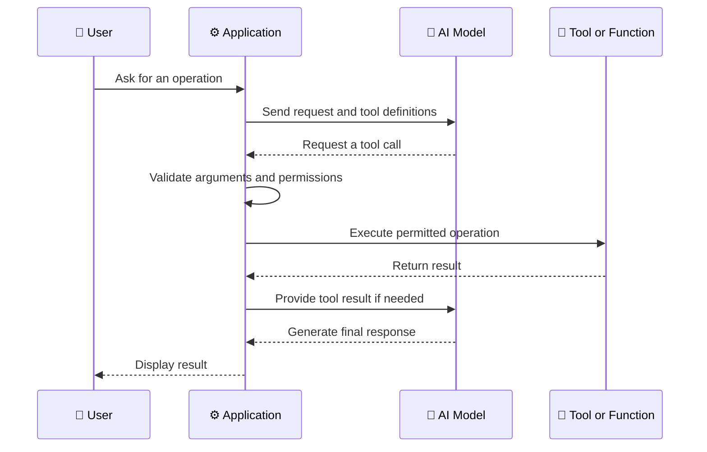

# 🧩 08 — Structured Outputs and Function Calling

[⬅️ Previous](07-ai-apis-and-sdks.md) ·

> Venkata Bhattaram (c) 2026

## 🎯 Learning Objectives

- Understand structured AI output and why it matters.
- Learn the difference between JSON output and schema-constrained output.
- Understand function or tool calling.
- Build a small example that converts a user request into structured data.
- Learn how to validate outputs and safely execute tools.

## 🌟 1. What Are Structured Outputs?

AI models often return natural-language text. That is useful for people, but applications frequently need predictable fields and data types.

**Structured outputs** allow an application to request information in a defined format, such as JSON that follows a schema.

For example, a customer support system may need:

```json id="structured735a"
{
  "category": "delivery",
  "priority": "medium",
  "summary": "The customer wants an update on a delayed package."
}
```

This structure makes the information easier to validate, store, display, and process.

**Important:** Valid JSON is not automatically correct or trustworthy. The application must still check field values and enforce business rules.

## 🏗️ 2. How Structured Output Works



A typical workflow is:

1. Define the required fields and data types.
2. Send the task and schema to a model using a supported structured-output feature.
3. Receive the response.
4. Validate the returned data.
5. Apply business rules and permissions.
6. Use the result only if it passes the required checks.

## 📋 3. JSON vs Schema-Constrained Output

| Approach | What it provides | Limitation |
|---|---|---|
| Free-form text | Flexible, readable responses | Harder to parse reliably |
| JSON requested in a prompt | Asks the model to return JSON | May contain invalid JSON or unexpected fields |
| JSON mode, where supported | Helps ensure syntactically valid JSON | Does not necessarily enforce your complete schema |
| Schema-constrained output, where supported | Restricts output to a supported schema | Still does not guarantee factual correctness or business-rule compliance |

Always check the selected provider's current structured-output capabilities and schema restrictions.

## 💻 4. Example — Extract Support Ticket Details

Install the packages if necessary:

```powershell id="structured735c"
python -m pip install openai python-dotenv pydantic
```

Create `ticket_extractor.py`:

```python id="structured735d"
import os

from dotenv import load_dotenv
from openai import OpenAI
from pydantic import BaseModel, Field

load_dotenv()

api_key = os.getenv("OPENAI_API_KEY")
model = os.getenv("OPENAI_MODEL")

if not api_key or not model:
    raise RuntimeError(
        "Configure OPENAI_API_KEY and OPENAI_MODEL in .env."
    )

client = OpenAI(api_key=api_key)


class SupportTicket(BaseModel):
    category: str = Field(
        description="A short category such as delivery, payment, or product"
    )
    priority: str = Field(
        description="One of low, medium, or high"
    )
    summary: str = Field(
        description="A concise summary of the customer's request"
    )


def extract_ticket(message: str) -> SupportTicket:
    response = client.responses.parse(
        model=model,
        input=[
            {
                "role": "system",
                "content": (
                    "Extract support ticket details from the message. "
                    "Use only information supported by the message. "
                    "Choose low, medium, or high priority based on urgency."
                ),
            },
            {
                "role": "user",
                "content": message,
            },
        ],
        text_format=SupportTicket,
    )

    ticket = response.output_parsed

    if ticket is None:
        raise ValueError("The model did not return a parsed ticket.")

    if ticket.priority not in {"low", "medium", "high"}:
        raise ValueError("Unexpected priority value.")

    return ticket


if __name__ == "__main__":
    message = (
        "My package is two days late. Please tell me when it will arrive."
    )

    result = extract_ticket(message)
    print(result.model_dump_json(indent=2))
```

Run the script:

```powershell id="structured735e"
python ticket_extractor.py
```

The exact category and priority may vary according to the prompt and model. The example uses the OpenAI Python SDK's parsing interface, so verify that your installed SDK and selected model support the feature.

## 🔧 5. What Is Function Calling?

**Function calling**, also called tool calling, lets a model request that an application execute a defined operation.

Examples include:

- Looking up an order.
- Checking the weather through a weather service.
- Searching an approved document collection.
- Calculating a total using application code.
- Creating a calendar event after authorization.

The model does not automatically execute a function merely by describing it. In a typical tool-calling workflow, the model requests a tool call, the application validates and executes it, and the result is returned to the model or displayed to the user.

## 🏗️ 6. Tool-Calling Workflow



## 💻 7. Safe Function-Calling Example

The following simplified example demonstrates how an application can allow an AI model to request a read-only order lookup.

```python id="structured735g"
import json
import os

from dotenv import load_dotenv
from openai import OpenAI

load_dotenv()

api_key = os.getenv("OPENAI_API_KEY")
model = os.getenv("OPENAI_MODEL")

if not api_key or not model:
    raise RuntimeError("Configure OPENAI_API_KEY and OPENAI_MODEL.")

client = OpenAI(api_key=api_key)

# Example data only. A real application must use an authorized database.
ORDERS = {
    "ORD-1001": {"status": "Shipped"},
    "ORD-1002": {"status": "Processing"},
}


def get_order_status(order_id: str) -> dict:
    """Return an example order status."""
    order = ORDERS.get(order_id)

    if order is None:
        return {"found": False, "message": "Order not found."}

    return {
        "found": True,
        "order_id": order_id,
        "status": order["status"],
    }


tools = [
    {
        "type": "function",
        "name": "get_order_status",
        "description": "Look up an order status using its order ID.",
        "parameters": {
            "type": "object",
            "properties": {
                "order_id": {
                    "type": "string",
                    "description": "The order ID, such as ORD-1001",
                }
            },
            "required": ["order_id"],
            "additionalProperties": False,
        },
        "strict": True,
    }
]


def answer_order_question(question: str) -> str:
    response = client.responses.create(
        model=model,
        instructions=(
            "Help users check order status. "
            "Use get_order_status for order lookups. "
            "Do not claim that an order was found unless the tool confirms it."
        ),
        input=question,
        tools=tools,
    )

    # The model may return a tool request. The application decides whether
    # it is permitted to execute that request.
    for item in response.output:
        if item.type != "function_call":
            continue

        if item.name != "get_order_status":
            raise ValueError("Unsupported tool requested.")

        arguments = json.loads(item.arguments)
        order_id = arguments.get("order_id")

        if not isinstance(order_id, str):
            raise ValueError("Invalid order ID.")

        # Demonstration allowlist. Real applications must authorize the
        # current user against the requested order before returning data.
        if order_id not in ORDERS:
            tool_result = {
                "found": False,
                "message": "Order not found or not available.",
            }
        else:
            tool_result = get_order_status(order_id)

        follow_up = client.responses.create(
            model=model,
            previous_response_id=response.id,
            input=[
                {
                    "type": "function_call_output",
                    "call_id": item.call_id,
                    "output": json.dumps(tool_result),
                }
            ],
        )

        return follow_up.output_text

    return response.output_text


if __name__ == "__main__":
    print(answer_order_question("Check order ORD-1001."))
```

This example illustrates the tool-call lifecycle for a single tool call. It is not a complete production implementation: robust applications should handle multiple tool calls, malformed arguments, API failures, authorization, and bounded execution loops. Verify the exact SDK interface and supported model capabilities for your environment.

## 🔐 8. Security Rules for Tool Calling

- Allow only explicitly registered tools.
- Validate every argument before execution.
- Apply user authorization independently of model instructions.
- Restrict tools to the minimum permissions required.
- Require confirmation for consequential actions such as sending money, deleting data, or issuing refunds.
- Treat tool output and retrieved documents as untrusted data.
- Log permitted operations without unnecessarily recording sensitive content.
- Never allow arbitrary model-generated code or commands to execute without a carefully designed sandbox and security review.

## 🌍 9. Real-World Scenario — Customer Support Automation

A customer asks:

> Can you check the status of order ORD-1001?

The AI model identifies that an order lookup is needed and requests the registered tool. The application validates the order ID, checks whether the authenticated user is authorized to access that order, and performs a read-only lookup. The model then explains the confirmed result.

For a request such as “Cancel my order and refund the payment,” the application should use a separate authorized workflow with explicit policy checks and any required user confirmation. A tool call is not itself permission to perform an action.

## ⚠️ 10. Common Mistakes

- Assuming valid JSON guarantees correct information.
- Parsing free-form text without validation.
- Executing every requested tool call automatically.
- Trusting the model to enforce access permissions.
- Exposing powerful tools without safeguards.
- Forgetting to handle missing or malformed arguments.
- Assuming every model supports the same structured-output or tool-calling features.

## ✅ 11. Best Practices

- Define clear schemas and validate returned values.
- Separate model decisions from application execution.
- Apply authentication and authorization before accessing private data.
- Use read-only tools when possible.
- Require confirmation for consequential actions.
- Add timeouts, bounded retries, and execution limits.
- Test incorrect arguments, unauthorized requests, and tool failures.
- Review provider-specific API documentation before implementation.

## 🔑 Key Takeaways

- Structured outputs help applications consume model responses predictably.
- Schema validity does not guarantee factual accuracy.
- Function calling connects a model to application-defined tools.
- The application, not the model, controls whether and how a tool executes.
- Validation, authorization, and safe execution are essential for reliable AI systems.
