# 🧠 01 — Introduction to AI Development

[⬅️ Back to Learning Modules](../README.md) · 

> Venkata Bhattaram (c) 2026

## 🎯 Learning Objectives

By the end of this topic, you will understand:

- What AI development means and why it matters.
- How AI developers build intelligent applications.
- The difference between traditional software and AI-powered software.
- The tools, technologies, and skills used in AI development.
- How to plan your first AI-powered application.

## 🌟 1. What Is AI Development?

**AI Development** is the process of building software applications that use artificial intelligence to understand information, recognize patterns, generate content, answer questions, make predictions, or assist with decisions.

Traditional software generally follows predefined rules written by developers. AI-powered software can also use trained models to interpret inputs and produce outputs that are not individually programmed for every possible situation.

### 🌍 Everyday Examples

| Application | How AI helps |
|---|---|
| Smart assistants | Understand questions and generate responses |
| Email applications | Detect spam and suggest replies |
| Shopping platforms | Recommend relevant products |
| Medical imaging systems | Help identify potentially abnormal images |
| Education platforms | Explain concepts and personalize learning |
| Business dashboards | Summarize trends and explain data |
| Customer support | Answer questions using approved information |

## ⚖️ 2. Traditional Software vs AI-Powered Software

| Traditional software | AI-powered software |
|---|---|
| Primarily follows explicit rules | Can use trained models to interpret inputs |
| Predictable for defined conditions | Outputs can vary for similar inputs |
| Developers specify decision logic | Developers combine model capabilities with application logic |
| Often uses fixed templates | Can generate context-sensitive content |
| Tested against expected rules | Also evaluated for accuracy, consistency, safety, and relevance |

**Example:** A traditional FAQ page displays predefined answers. An AI-powered FAQ assistant can interpret a student's question in different words and generate an answer using approved college documents.

AI does not replace all traditional programming. Reliable AI applications use both conventional code and AI models.

## 🏗️ 3. How an AI Application Works

```mermaid
flowchart LR
    A["👤 User Request"] --> B["🖥️ Application Interface"]
    B --> C["⚙️ Application Logic"]
    C --> D["🧠 AI Model"]
    D --> E["📄 Generated or Predicted Output"]
    E --> F["✅ Validation and Safety Checks"]
    F --> G["📱 Result Shown to User"]

    classDef user fill:#DBEAFE,stroke:#2563EB,color:#1E3A8A
    classDef app fill:#CFFAFE,stroke:#0891B2,color:#164E63
    classDef ai fill:#EDE9FE,stroke:#7C3AED,color:#4C1D95
    classDef result fill:#DCFCE7,stroke:#16A34A,color:#14532D

    class A user
    class B,C app
    class D ai
    class E,F,G result
```

For a real application, additional components may include a database, authentication, document retrieval, external APIs, logging, and human review.

## 🧩 4. Important Areas of AI Development

- **Generative AI:** Creates text, images, audio, code, or other content.
- **Machine Learning:** Learns patterns from data to make predictions or classifications.
- **Natural Language Processing (NLP):** Works with human language.
- **Computer Vision:** Analyzes images and video.
- **AI Agents:** Use models, tools, and workflows to pursue defined objectives.
- **Retrieval-Augmented Generation (RAG):** Combines information retrieval with generation to answer questions using external knowledge.

These areas overlap. An application may combine several of them.

## 🌍 5. Real-World Scenario — AI College Assistant

Imagine a college wants to create an assistant that answers questions about attendance, examinations, scholarships, and campus facilities.

### How the AI developer builds it

1. Collect approved college documents.
2. Build a simple chat interface.
3. Connect the application to an AI model.
4. Retrieve relevant documents for each question.
5. Generate an answer grounded in those documents.
6. Display references where available.
7. Test incorrect, ambiguous, and unsupported questions.
8. Deploy the application with authentication and monitoring where needed.

### Example interaction

**Student:** What documents are required for scholarship renewal?

**AI assistant:** I can help you find the renewal requirements. Based on the approved scholarship guidelines, the required documents are listed below. Please check the cited guideline for the current academic year's requirements.

The assistant should not invent requirements when the relevant information is missing.

## 🛠️ 6. Technologies Used by AI Developers

| Category | Examples | Purpose |
|---|---|---|
| Programming | Python, JavaScript, TypeScript | Application logic |
| AI providers | OpenAI, Anthropic, Google | Access hosted AI models |
| AI frameworks | Hugging Face Transformers, LangChain, LlamaIndex | Build model-powered workflows |
| Data handling | Pandas, NumPy, SQL | Prepare and manage data |
| Backend | FastAPI, Flask, Node.js | Expose application services |
| Frontend | React, HTML, CSS | Build user interfaces |
| Storage | PostgreSQL, object storage, vector databases | Store records, files, or embeddings |
| Deployment | Docker, cloud platforms, CI/CD tools | Run and maintain applications |

You do not need to learn every technology before building your first project. Start with a programming language, one AI provider, and a small application.

## 💬 7. Practice Prompt for an AI Coding Assistant

Try this prompt in your preferred AI coding tool:

> Build a beginner-friendly AI college assistant using Python and FastAPI. Create an endpoint that accepts a student's question and calls an AI model through a configurable API provider. Keep API credentials in environment variables. Return a clear response, handle missing configuration and API failures, and include a README with installation and execution instructions. Do not invent college policies; explain how approved college documents can be integrated in a later version.

Review the generated code, install its dependencies in a virtual environment, configure the required API credentials, and test it before extending the application.

## ⚠️ 8. Common Mistakes

- Assuming AI-generated answers are always correct.
- Sending confidential information to an AI service without authorization.
- Hardcoding API keys in source code.
- Building an elaborate application before validating a small prototype.
- Ignoring latency, usage limits, and API costs.
- Skipping testing because the application appears to work.
- Treating a model response as trusted executable code.

## ✅ 9. Best Practices

- Begin with a clearly defined problem.
- Choose the simplest model and architecture that meet the requirements.
- Validate model outputs before using them in important workflows.
- Keep application logic separate from model-specific code.
- Store secrets in environment variables or a suitable secrets manager.
- Test normal, ambiguous, adversarial, and failure scenarios.
- Measure quality, latency, and cost throughout development.

## 🔑 Key Takeaways

- AI development combines software engineering with AI capabilities.
- A successful AI application requires more than an API call.
- Data quality, security, evaluation, and user experience all matter.
- Start with a small, measurable use case and improve it iteratively.
