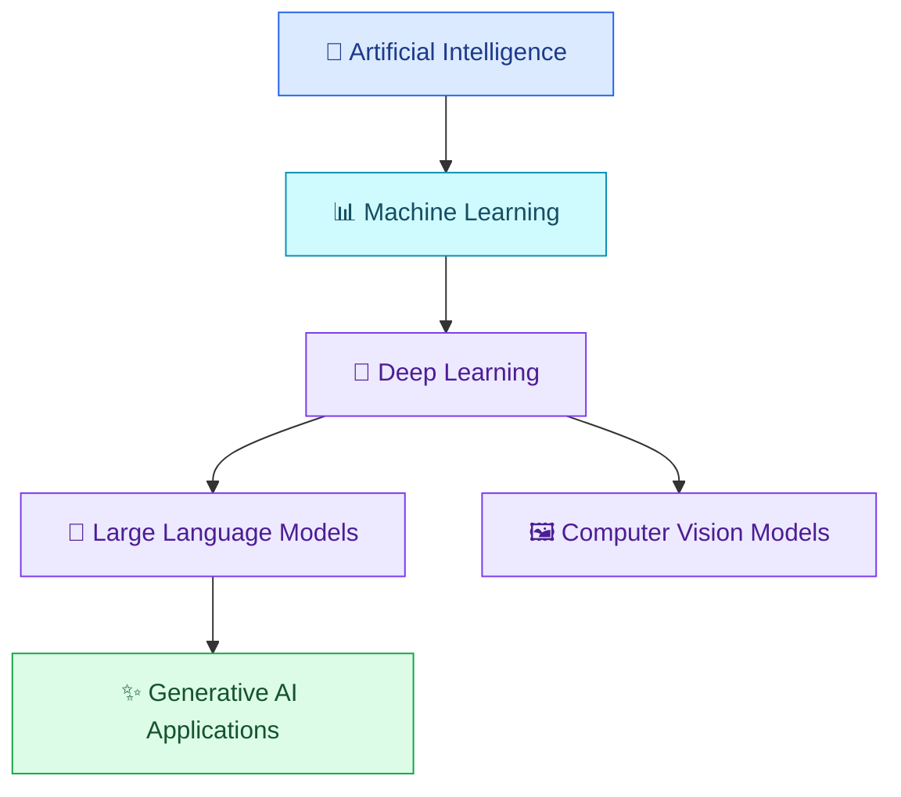
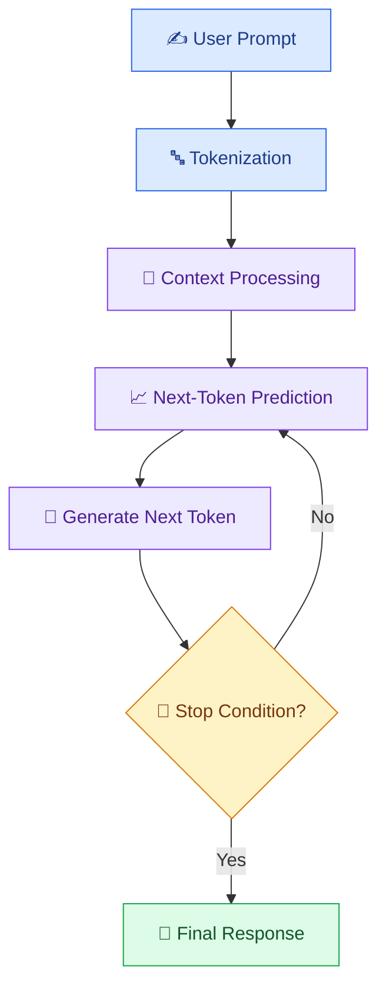

# 🧠 02 — How AI and Large Language Models Work

[⬅️ Previous](01-introduction-to-ai-development.md) ·

> Venkata Bhattaram (c) 2026

## 🎯 Learning Objectives

- Understand AI, machine learning, deep learning, and generative AI.
- Learn what a large language model (LLM) does.
- Understand tokens, context windows, and model responses.
- Learn why AI can make mistakes.
- Understand how a user request becomes an AI-generated response.

## 🌟 1. Understanding the AI Family

Artificial intelligence is a broad field. Machine learning is one approach within AI, and deep learning is a type of machine learning that uses multilayer neural networks.

This diagram is a simplified learning model. Generative AI is not limited to LLMs or to only one model architecture.

## 🔍 2. What Is a Large Language Model?

A **Large Language Model (LLM)** is an AI model trained on large amounts of text and other permitted training data to learn statistical patterns in language. Modern LLMs commonly use transformer-based neural network architectures.

An LLM can perform tasks such as:

- Answering questions.
- Summarizing documents.
- Explaining code.
- Translating languages.
- Extracting structured information.
- Generating drafts, stories, and programming examples.

An LLM does not automatically know your private files, current business records, or the latest information. Those may need to be supplied through prompts, retrieval systems, tools, or other integrations.

## ⚙️ 3. How an LLM Produces Text

Consider the request:

> Explain cloud computing to a beginner in three sentences.

A simplified process is:

1. **Input processing:** The system receives the user's request.
2. **Tokenization:** The text is divided into tokens, which may be words, word fragments, punctuation, or other units.
3. **Context processing:** The model processes the tokens and their relationships.
4. **Next-token prediction:** The model estimates likely next tokens based on the input and learned parameters.
5. **Generation:** Tokens are generated successively until a stopping condition is reached.
6. **Application response:** The application presents the resulting text.

This is a conceptual overview; actual inference includes more technical operations, and some models use additional mechanisms.

## 🔤 4. What Are Tokens?

Tokens are the units a language model processes. A token is not necessarily one complete word.

For example, a sentence may be divided into whole words, parts of words, punctuation, and spaces, depending on the tokenizer.

Why tokens matter:

- API usage may be priced using input and output tokens.
- Model context limits are generally measured in tokens.
- Long documents may need to be divided into smaller sections.
- Large prompts can increase cost and processing time.

**Practical tip:** Keep prompts focused. Include the information needed to complete the task rather than repeatedly supplying irrelevant context.

## 🧠 5. What Is a Context Window?

The **context window** is the amount of input and generated content a model can process in a single request, subject to the model's specific limits and provider rules.

Imagine asking an AI assistant to summarize a 700-page handbook. If the entire document does not fit into the usable context, the application may need to split it into sections, retrieve relevant passages, and combine the results.

A larger context window is useful, but it does not guarantee perfect recall, accuracy, or reasoning over every detail.

## 🎯 6. Training vs Inference

| Concept | Meaning | Example |
|---|---|---|
| Training | Model parameters are learned or adjusted from training data | Developing a language model |
| Fine-tuning | Further training adapts a model to a task or behavior | Adapting a model to a specific support style |
| Inference | A trained model is used to generate a prediction or response | Asking a model to summarize a report |
| Retrieval | Relevant external information is found for use in a response | Searching a college handbook |
| Prompting | Instructions and context are supplied to guide the response | Requesting a three-point summary |

Calling an AI API usually performs inference, not model training.

## 🌍 7. Real-World Scenario — AI Study Assistant

A student uploads lecture notes and asks:

> Explain the main concepts in simple language and create five practice questions.

The application can:

1. Extract text from the notes.
2. Divide long content into manageable sections.
3. Supply relevant sections and instructions to an LLM.
4. Ask the model for explanations and practice questions.
5. Validate the output format.
6. Display the result for the student to review.

If the notes do not cover a requested topic, the application should distinguish between information found in the notes and general knowledge.

## ⚠️ 8. Why AI Sometimes Makes Mistakes

An AI model may generate a plausible-sounding but incorrect answer. This is commonly called a **hallucination**.

Possible causes include:

- The required information is missing.
- The question is ambiguous.
- The model has limited or outdated knowledge.
- The model is asked to make unsupported assumptions.
- The response requires precise calculations or external facts.
- The prompt encourages a definitive answer despite uncertainty.

### How developers reduce errors

- Supply reliable reference material.
- Use RAG when responses must be grounded in documents.
- Request citations or supporting evidence when available.
- Validate calculations with conventional code.
- Use schemas to validate structured outputs.
- Test against known questions and expected answers.
- Provide a clear fallback when the answer is unknown.

## 💬 9. Practice Prompt

> Explain how a large language model works to a beginner. Use a real-world example, distinguish training from inference, explain tokens and context windows, and describe three reasons an AI response might be incorrect. Avoid claiming that an LLM understands information exactly as a human does.

## 🔑 Key Takeaways

- AI is a broad field that includes machine learning and deep learning.
- LLMs generate responses by processing context and predicting tokens.
- Tokens affect cost, input limits, and output length.
- Training and inference are different processes.
- AI responses need validation when correctness matters.

