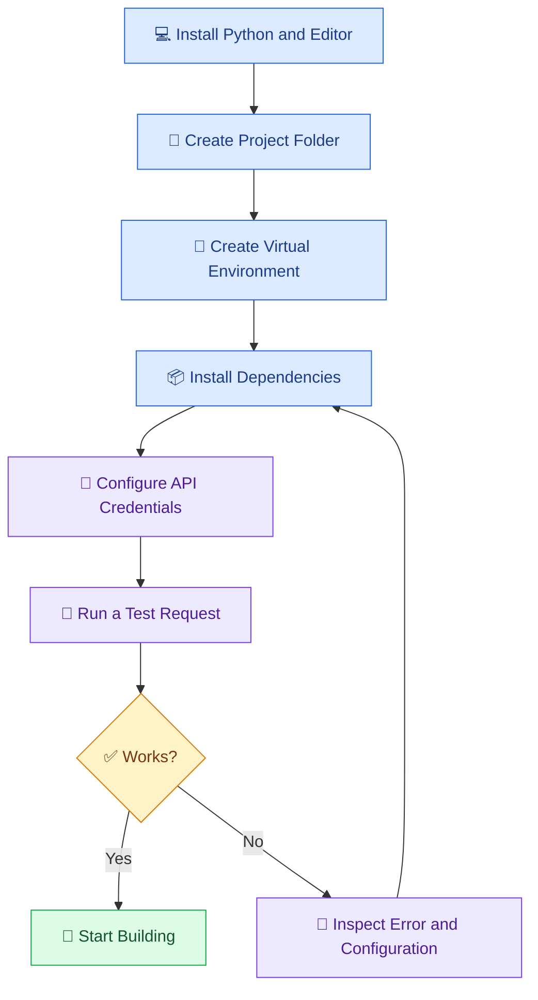

# 🛠️ 03 — Setting Up the AI Development Environment

[⬅️ Previous](02-how-ai-and-llm-work.md) ·

> Venkata Bhattaram (c) 2026

## 🎯 Learning Objectives

- Identify the tools needed to build AI applications.
- Set up a Python development environment.
- Create and activate a virtual environment.
- Install the libraries required for an AI API example.
- Configure API credentials securely.
- Run and troubleshoot your first AI script.

## 🌟 1. What Is an AI Development Environment?

An **AI development environment** is the collection of software, libraries, credentials, and configuration used to build and test AI applications.

A beginner's setup may include:

| Tool | Purpose |
|---|---|
| Python | Write AI application logic |
| VS Code | Edit and manage source code |
| Python virtual environment | Isolate project dependencies |
| `pip` | Install Python packages |
| AI provider SDK | Communicate with an AI service |
| `.env` file | Store local configuration and secrets |
| Git | Track source-code changes |
| Terminal | Run commands and inspect errors |

You can begin with a hosted AI model. A dedicated GPU is not required for basic API-based AI development.

## 🏗️ 2. Environment Setup Workflow



## 🐍 3. Create a Python Project

Open PowerShell or the VS Code terminal and run:

```powershell
mkdir ai-developer-project
cd ai-developer-project

py -3.13 -m venv .venv

.\.venv\Scripts\Activate.ps1

python --version
python -m pip install --upgrade pip
```

These commands assume Python 3.13 is installed and registered with the Windows Python launcher. If you have a different supported Python version, use the version recommended by your chosen SDK.

If PowerShell blocks activation, you can use this command in the current terminal session:

```powershell
Set-ExecutionPolicy -Scope Process -ExecutionPolicy RemoteSigned
.\.venv\Scripts\Activate.ps1
```

A successful activation generally shows `(.venv)` at the beginning of the terminal prompt.

## 📦 4. Install the Required Packages

For an example using the OpenAI Python SDK:

```powershell
python -m pip install openai python-dotenv
```

Save your project dependencies:

```powershell
python -m pip freeze > requirements.txt
```

For a real project, keep a reviewed dependency list rather than blindly freezing unrelated packages from an existing environment.

## 📁 5. Recommended Folder Structure

```text
ai-developer-project/
│
├── .venv/
├── .env
├── .gitignore
├── requirements.txt
├── main.py
└── README.md
```

Create a `.gitignore` file:

```gitignore
.venv/
__pycache__/
.env
*.pyc
```

Never commit API keys to GitHub, even in a private repository, unless an approved secrets-management workflow explicitly requires a different approach.

## 🔐 6. Configure an API Key

Create a `.env` file in the project root:

```dotenv
OPENAI_API_KEY=your_api_key_here
OPENAI_MODEL=your_supported_model_name
```

Replace the placeholder values with credentials and a model name available to your account.

Keep `.env` out of source control. Do not paste your API key into public prompts, screenshots, logs, or source files.

## 💻 7. Build Your First AI API Script

Create `main.py`:

```python
import os

from dotenv import load_dotenv
from openai import OpenAI

load_dotenv()

api_key = os.getenv("OPENAI_API_KEY")
model = os.getenv("OPENAI_MODEL")

if not api_key:
    raise RuntimeError(
        "OPENAI_API_KEY is missing. Configure it in your .env file."
    )

if not model:
    raise RuntimeError(
        "OPENAI_MODEL is missing. Configure a model supported by your account."
    )

client = OpenAI(api_key=api_key)


def main() -> None:
    response = client.responses.create(
        model=model,
        input="Explain artificial intelligence to a beginner in three bullet points."
    )

    print("\nAI Response:\n")
    print(response.output_text)


if __name__ == "__main__":
    main()
```

Run it:

```powershell
python main.py
```

The script sends a request to the configured model and prints the generated response. A successful run requires valid credentials, network access, API availability, sufficient quota, and access to the selected model.

## 🔍 8. Common Errors and Fixes

| Error | Possible cause | What to check |
|---|---|---|
| `ModuleNotFoundError` | Package installed in a different environment | Activate `.venv` and use `python -m pip install ...` |
| Missing API key | `.env` missing or incorrectly named | Check file location and variable name |
| Authentication error | Invalid, expired, or unauthorized key | Verify credentials in the provider's official dashboard |
| Model not found | Incorrect model identifier or missing access | Configure a model available to your account |
| Rate limit or quota error | Request limits or insufficient credits | Check provider limits, usage, and billing |
| Network error | Connectivity, proxy, or service issue | Verify connectivity and provider status |

Do not print secrets when debugging. Log useful error information without exposing credentials or sensitive user content.

## ⚠️ 10. Best Practices

- Use a separate virtual environment for every project.
- Pin and review dependencies for reproducible installations.
- Keep credentials outside source code.
- Set reasonable request timeouts and handle API errors in production.
- Avoid logging sensitive prompts or personal data unnecessarily.
- Review provider pricing, rate limits, and data-handling terms before using a service.
- Keep a README with setup, execution, and troubleshooting instructions.

## 🔑 Key Takeaways

- A reliable environment makes AI development easier to reproduce and debug.
- A hosted AI API is sufficient for a first AI application.
- Virtual environments prevent many dependency conflicts.
- Credentials and model configuration should be managed separately from code.
- Successful installation does not guarantee API access; credentials, quota, and model permissions also matter.