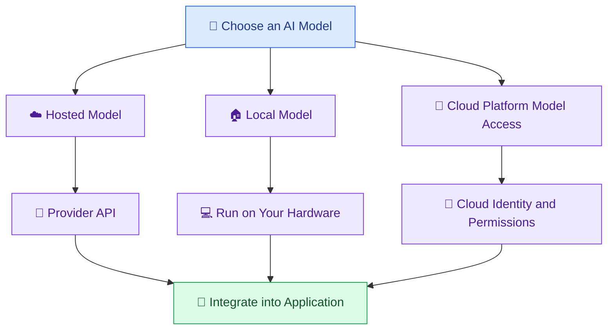
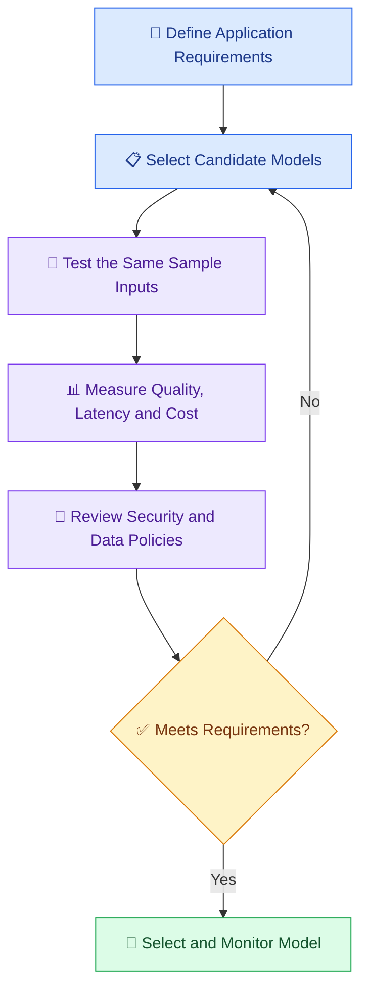

# 🤖 04 — Understanding AI Models and Model Providers

[⬅️ Previous](03-setting-ai-env.md) ·

> Venkata Bhattaram (c) 2026

## 🎯 Learning Objectives

- Understand the difference between an AI model and an AI provider.
- Explore hosted, open-weight, and locally run models.
- Learn how to choose a model for a particular task.
- Compare quality, latency, cost, context limits, and supported capabilities.
- Understand why changing a model may require application changes.

## 🌟 1. What Is an AI Model?

An **AI model** is a trained computational system that performs tasks such as generating text, classifying information, recognizing images, transcribing speech, or creating embeddings.

Different models have different capabilities. A model optimized for fast, inexpensive text generation may not be the best choice for complex reasoning, image understanding, or speech processing.

## 🏢 2. What Is an AI Model Provider?

An **AI model provider** is an organization or service that gives developers access to AI models.

Examples include:

- OpenAI
- Anthropic
- Google
- AWS, which provides access to AI capabilities through its cloud services
- Providers and communities offering open-weight models

The exact models, access conditions, pricing, and supported features vary by provider and change over time.

### Model vs Provider

| Model | Provider or access method |
|---|---|
| A specific GPT model | OpenAI API |
| A specific Claude model | Anthropic API |
| A specific Gemini model | Google AI services |
| An open-weight language model | A compatible hosted service or local runtime |

The provider offers a way to access a model; the model performs the AI task.

## 🧭 3. Types of Model Access



### Hosted models

Your application sends requests to a provider's service.

**Advantages:** Fast to get started, access to managed infrastructure, and no need to download large model weights.

**Trade-offs:** Network dependency, usage charges or quotas, provider-specific policies, and data-handling considerations.

### Locally run models

The model runs on your own computer or infrastructure using a compatible runtime.

**Advantages:** More control over deployment and data flow, and possible offline use after setup.

**Trade-offs:** Hardware requirements, memory limits, setup effort, model quality differences, and ongoing maintenance.

### Cloud platform access

Organizations may use a cloud platform to access, govern, monitor, and integrate models into broader systems. Permissions, networking, compliance, and costs become important parts of the design.

## 🧩 4. Model Selection Depends on the Task

| Task | What to prioritize |
|---|---|
| Simple chatbot | Quality, latency, and cost |
| Complex reasoning | Reasoning performance and reliability |
| Document question answering | Retrieval support, context handling, and grounded answers |
| Image analysis | Image input support and visual accuracy |
| Speech transcription | Supported languages, word accuracy, and latency |
| Embeddings and semantic search | Embedding quality, vector dimensions, and compatibility |
| Code generation | Code correctness, tool support, and evaluation results |
| Private or restricted workloads | Deployment control, access restrictions, and data-handling requirements |

Do not choose a model based on its name or size alone. Evaluate it against representative examples from your actual application.

## ⚖️ 5. How to Compare Models

Use a small evaluation dataset with representative tasks.

| Criterion | Question to ask |
|---|---|
| Quality | Does it produce correct and useful results? |
| Latency | How long does a response take? |
| Cost | What is the cost at expected input and output volumes? |
| Context | Can it handle the required amount of information? |
| Modalities | Does it support the necessary text, image, audio, or video inputs? |
| Tool use | Can it call tools or produce the required structured outputs? |
| Reliability | How does it behave during errors, load, or repeated requests? |
| Privacy | Does the service meet the application's data-handling requirements? |
| Portability | How difficult is it to switch providers or models? |

### A simple evaluation workflow



## 🌍 6. Real-World Scenario — Choosing a Model for a College Assistant

A college wants an AI assistant to answer questions using policy documents.

The development team has three broad options:

1. A hosted model accessed through an API.
2. A locally deployed model.
3. A model accessed through the college's approved cloud platform.

The team should compare answer accuracy against the policy documents, response time, estimated usage costs, security requirements, maintenance effort, and the consequences of incorrect answers.

For example, a hosted model may be suitable for a quick prototype, while a regulated deployment may require stricter controls or a different hosting arrangement. The choice depends on the institution's actual requirements and provider terms.

## 💻 7. Make Your Application Easier to Adapt

Avoid scattering model names and provider-specific settings throughout the code.

A simple configuration pattern is:

```python
import os

AI_PROVIDER = os.getenv("AI_PROVIDER", "openai")
AI_MODEL = os.getenv("AI_MODEL", "your-supported-model-name")
```

Then isolate provider-specific client creation and response handling in a dedicated module, such as `ai_service.py`.

This makes configuration easier to manage. However, **a shared configuration variable does not make all providers interchangeable**: authentication, SDKs, message formats, tool calling, and model capabilities can differ.

## ⚠️ 8. Common Mistakes

- Assuming every provider supports the same models and features.
- Choosing solely by the lowest advertised price.
- Using an outdated or unavailable model identifier.
- Ignoring input and output token costs.
- Selecting a model without testing real application examples.
- Assuming a locally run model automatically guarantees privacy.
- Switching providers without testing prompts, structured outputs, and tool integrations.

## ✅ 9. Best Practices

- Define measurable requirements before choosing a model.
- Evaluate candidate models with the same representative test set.
- Keep model names and provider settings in configuration.
- Separate provider-specific integration code from business logic.
- Track quality, latency, failures, and cost in production.
- Review official provider documentation for current capabilities and limits.
- Re-evaluate model selection when requirements or service offerings change.

## 🔑 Key Takeaways

- A model performs the AI task; a provider supplies a way to access it.
- Hosted, local, and cloud-platform deployments have different trade-offs.
- No single model is best for every application.
- Quality, latency, cost, security, and capabilities should all influence selection.
- A maintainable application separates configuration from provider-specific implementation.

