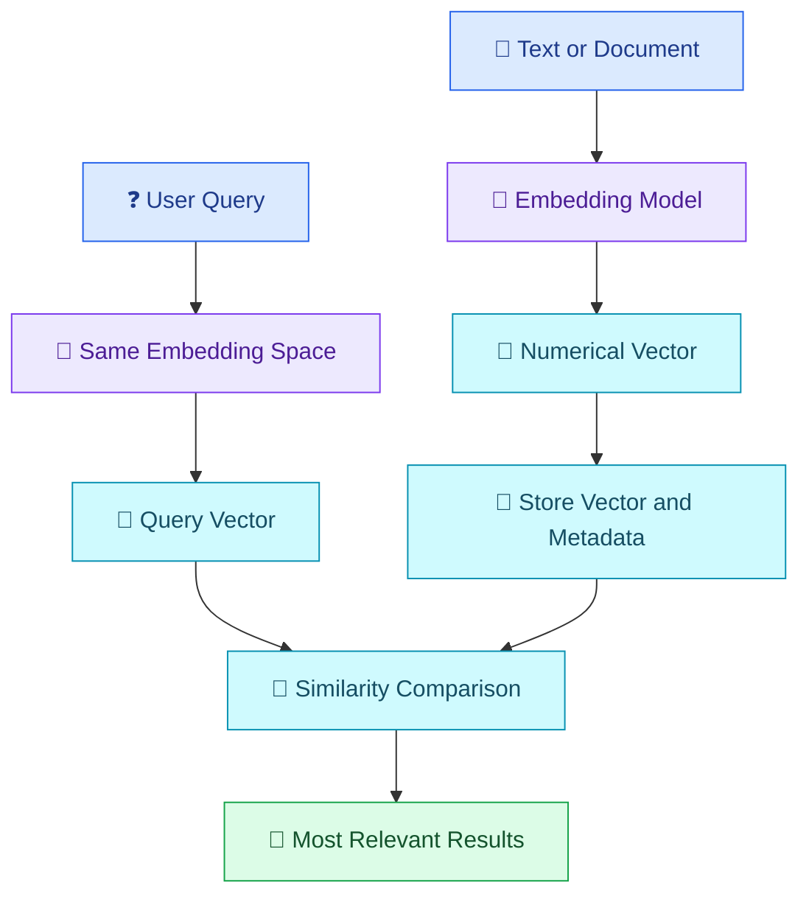

# 🔎 09 — Embeddings and Semantic Search

[⬅️ Back to Learning Modules](../README.md) · 

> Venkata Bhattaram (c) 2026

## 🎯 Learning Objectives

- Understand what embeddings are and how they represent meaning.
- Learn the difference between keyword search and semantic search.
- Understand vectors, similarity, and vector databases.
- Explore how AI applications retrieve relevant information.
- Build a basic semantic search prototype.

## 🌟 1. What Are Embeddings?

An **embedding** is a numerical representation of information, such as text, that captures aspects of its meaning in a mathematical vector.

Instead of comparing sentences only by their exact words, an embedding-based system can compare their representations to identify related content.

For example:

- "How can I reset my password?"
- "I forgot my login credentials."

These sentences use different words but express related intentions. A suitable embedding model may represent them as nearby vectors.

Embeddings are used in search engines, recommendation systems, document retrieval, clustering, and Retrieval-Augmented Generation (RAG).

## 🧩 2. How Embeddings Work



A typical process involves:

1. Preparing text or other supported content.
2. Passing it through an embedding model.
3. Receiving a vector of numerical values.
4. Storing the vector with its source text and metadata.
5. Embedding a new query using a compatible model.
6. Comparing the query vector with stored vectors.
7. Returning the most relevant results.

The vector dimensions and numerical values depend on the selected embedding model.

## 🔤 3. Keyword Search vs Semantic Search

| Feature | Keyword search | Semantic search |
|---|---|---|
| Main approach | Matches words or terms | Compares vector representations |
| Synonyms | May miss differently worded content | Can find semantically related wording |
| Exact identifiers | Often very effective | May need to be combined with exact matching |
| Numerical meaning | Depends on search implementation | Similarity does not guarantee factual correctness |
| Typical use | Product codes, names, exact phrases | Questions, concepts, related passages |

**Example:** A student searches for "financial assistance for students."

A keyword search may prioritize documents containing those exact words. Semantic search may also find documents discussing scholarships, fee waivers, or educational grants.

The results still depend on the embedding model, document quality, indexing strategy, and search configuration.

## 📐 4. What Is Vector Similarity?

A vector database or search system can rank embeddings using similarity measures.

One common measure is **cosine similarity**, which compares the direction of two vectors:

\[
\operatorname{cosine}(A,B)=
\frac{A\cdot B}{\|A\|\|B\|}
\]

For nonzero vectors, a value closer to 1 indicates a more similar direction; a value closer to 0 indicates approximate orthogonality. Negative values are also possible in general.

Similarity scores are not probabilities that a result is correct. Their interpretation depends on the model and the retrieval task.

## 🗄️ 5. What Is a Vector Database?

A **vector database** stores embeddings and supports similarity-based retrieval. Applications commonly store the original text or a reference to it, along with metadata such as source, date, category, and access permissions.

Examples include:

- FAISS — a vector similarity search library.
- Chroma — a vector database designed for AI applications.
- Pinecone — a managed vector database service.
- PostgreSQL with pgvector — vector search within PostgreSQL.
- Other databases that support vector indexing and similarity search.

The best choice depends on data size, deployment needs, filtering, latency, and operational requirements. A dedicated vector database is not always necessary for a small prototype.

## 🌍 6. Real-World Scenario — College Policy Search

A college stores documents about attendance, scholarships, examinations, and hostel rules.

A student asks:

> Can I receive financial support for my college fees?

A semantic search system can:

1. Convert the question into an embedding.
2. Search the college's indexed documents.
3. Retrieve passages about scholarships and fee assistance.
4. Return those passages with their source information.

This retrieval process finds relevant information. An LLM can use the passages to generate a readable answer, which leads to RAG in the next topic.

## 💻 7. Hands-On Example Using Embeddings

Install the required packages:

```powershell
python -m pip install openai python-dotenv numpy
```

Configure `.env`:

```dotenv
OPENAI_API_KEY=your_api_key_here
OPENAI_EMBEDDING_MODEL=your_supported_embedding_model
```

Create `semantic_search.py`:

```python
import os

import numpy as np
from dotenv import load_dotenv
from openai import OpenAI

load_dotenv()

api_key = os.getenv("OPENAI_API_KEY")
model = os.getenv("OPENAI_EMBEDDING_MODEL")

if not api_key or not model:
    raise RuntimeError(
        "Configure OPENAI_API_KEY and OPENAI_EMBEDDING_MODEL."
    )

client = OpenAI(api_key=api_key)

documents = [
    "Scholarships may provide financial assistance to eligible students.",
    "The examination timetable lists dates and examination sessions.",
    "Hostel residents must follow campus accommodation rules.",
    "Students can contact the library for access to reference books.",
]


def embed_texts(texts: list[str]) -> np.ndarray:
    response = client.embeddings.create(
        model=model,
        input=texts,
    )
    return np.array(
        [item.embedding for item in response.data],
        dtype=np.float32,
    )


def cosine_similarity(query_vector, document_vectors):
    query_norm = np.linalg.norm(query_vector)
    document_norms = np.linalg.norm(
        document_vectors, axis=1
    )

    if query_norm == 0 or np.any(document_norms == 0):
        raise ValueError("Cannot compare zero-length vectors.")

    return (
        document_vectors @ query_vector
    ) / (document_norms * query_norm)


def main():
    document_vectors = embed_texts(documents)

    question = input("Ask a question: ").strip()
    if not question:
        print("Please enter a question.")
        return

    query_vector = embed_texts([question])[0]
    scores = cosine_similarity(
        query_vector, document_vectors
    )

    ranked_indices = np.argsort(scores)[::-1]

    print("\nMost relevant documents:\n")
    for index in ranked_indices[:3]:
        print(f"Score: {scores[index]:.4f}")
        print(documents[index])
        print()


if __name__ == "__main__":
    main()
```

Run it:

```powershell
python semantic_search.py
```

Try questions such as:

- "What financial help can students receive?"
- "When are the exams?"
- "Where can I borrow books?"

The script compares a query embedding with four document embeddings. It is a small in-memory demonstration, not a production search service. Similarity scores should be evaluated against known relevant results before the system is used for important decisions.

## ⚠️ 8. Common Mistakes

- Assuming embeddings always identify the correct answer.
- Comparing vectors produced by incompatible embedding models.
- Forgetting to update embeddings when source documents change.
- Ignoring access permissions during retrieval.
- Using semantic search alone for exact IDs or codes.
- Embedding entire long documents without considering chunking.
- Treating similarity scores as confidence probabilities.

## ✅ 9. Best Practices

- Use a compatible model for indexing and querying.
- Preserve the source text, metadata, and document identifiers.
- Split long documents into meaningful chunks.
- Combine semantic and keyword search when appropriate.
- Filter results by permissions and relevant metadata.
- Evaluate retrieval quality using representative queries.
- Monitor embedding costs, search latency, and stale documents.

## 🔑 Key Takeaways

- Embeddings represent information as numerical vectors.
- Semantic search finds conceptually related content even when wording differs.
- Vector similarity supports ranking but does not establish correctness.
- Metadata, access controls, and retrieval evaluation are important parts of a reliable search system.