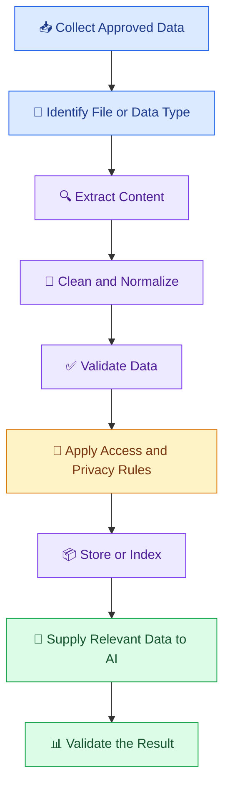
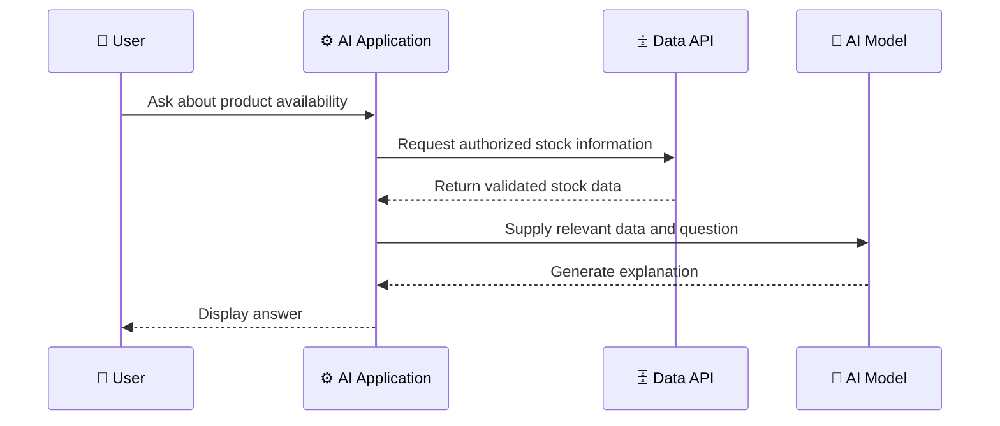

# 📂 11 — Working with Documents and External Data

[⬅️ Previous](10-retrieval-augmented-generation.md) .

> Venkata Bhattaram (c) 2026

## 🎯 Learning Objectives

- Understand how AI applications consume documents and external data.
- Learn the basics of extracting, cleaning, and preparing information.
- Work with text files, PDFs, CSV files, and JSON data.
- Understand database and API integration.
- Learn how document processing supports RAG and enterprise AI applications.

## 🌟 1. Why Do AI Applications Need External Data?

AI models are useful for general language tasks, but many applications need information specific to an organization, user, or current situation.

Examples include:

- A company assistant that searches internal policies.
- A financial assistant that analyzes authorized CSV reports.
- A student assistant that uses lecture notes.
- A support assistant that checks product manuals.
- An inventory assistant that retrieves current stock from a database.

**External data** is information supplied by systems outside the model itself, including files, databases, APIs, and approved knowledge repositories.

## 📄 2. Common Data Sources

| Source | Example | Typical processing |
|---|---|---|
| TXT and Markdown | Notes and documentation | Read and clean text |
| PDF | Reports and handbooks | Extract text and inspect layout |
| DOCX | Policies and proposals | Extract paragraphs and tables |
| CSV | Sales and student performance data | Parse rows and columns |
| JSON | API responses and configuration | Parse structured fields |
| SQL database | Customer or inventory records | Execute authorized queries |
| External APIs | Weather, payments, or CRM services | Authenticate and process responses |
| Images | Scanned documents | OCR or vision-based extraction |

Different file types require different extraction strategies. For example, a scanned PDF may require OCR, while a table-heavy PDF may need layout-aware processing.

## 🏗️ 3. Data Processing Pipeline



A reliable pipeline checks data quality and permissions before using content in an AI request.

## 🧹 4. Extracting and Cleaning Documents

Document preparation may include:

1. Reading the file using a suitable parser.
2. Extracting text, tables, headings, and metadata.
3. Removing unnecessary formatting artifacts.
4. Preserving meaningful document structure.
5. Detecting empty, corrupted, or unsupported files.
6. Identifying sensitive information.
7. Recording the document source and version.

Do not remove all formatting indiscriminately. Headings, table relationships, and section boundaries may be important for interpreting the information correctly.

## 💻 5. Hands-On Example — Read a CSV File

Install Pandas:

```powershell
python -m pip install pandas
```

Create a file named `sales.csv`:

```csv
product,units_sold,revenue
Notebook,120,6000
Pen,200,4000
Backpack,35,14000
```

Create `read_sales.py`:

```python
import pandas as pd

df = pd.read_csv("sales.csv")

required_columns = {"product", "units_sold", "revenue"}

if not required_columns.issubset(df.columns):
    raise ValueError("The CSV is missing required columns.")

df["units_sold"] = pd.to_numeric(
    df["units_sold"], errors="raise"
)

df["revenue"] = pd.to_numeric(
    df["revenue"], errors="raise"
)

if df[["units_sold", "revenue"]].isna().any().any():
    raise ValueError("Missing numeric values were found.")

print("Sales Data:\n")
print(df)

print("\nTotal Units Sold:", df["units_sold"].sum())
print("Total Revenue:", df["revenue"].sum())

print("\nRevenue by Product:")
print(
    df[["product", "revenue"]]
    .sort_values("revenue", ascending=False)
)
```

Run:

```powershell
python read_sales.py
```

Expected totals:

- Total units sold: `355`
- Total revenue: `24000`

This example uses conventional Python calculations to produce exact totals. An AI model can subsequently summarize the validated results, but it should not replace deterministic calculations when exact arithmetic is required.

## 🔌 6. Connecting External APIs

An AI application may need current or organization-specific data from another service.

For example, an inventory assistant could retrieve current stock levels through an authorized backend API.



The application should validate the API response, check authorization, and distinguish current retrieved information from model-generated explanation.

## 🔐 7. Data Security and Privacy

Before sending external data to an AI service, ask:

- Is this data approved for this purpose?
- Does the user have permission to access it?
- Does the provider's data-handling policy meet the requirements?
- Can unnecessary personal or confidential fields be removed?
- How long should the data and logs be retained?
- Can the data be exposed through prompts, retrieved passages, or generated answers?

Use least-privilege access, secure credentials, appropriate retention controls, and approved data-processing arrangements.

## 🌍 8. Real-World Scenario — AI Sales Analyst

A retail team uploads a monthly sales CSV and asks:

> Which products generated the highest revenue, and what should we investigate next?

A well-designed application can:

1. Validate the CSV columns and data types.
2. Calculate revenue totals using Python or SQL.
3. Generate a summary table.
4. Supply the verified results to an LLM.
5. Ask the model to explain patterns and suggest follow-up questions.
6. Display the calculations alongside the explanation.

The model should not claim that a product is profitable when only revenue, and not cost, is available.

## ⚠️ 9. Common Mistakes

- Assuming every PDF contains extractable text.
- Ignoring missing values and inconsistent data types.
- Sending entire datasets when only a few fields are needed.
- Trusting external API responses without validation.
- Mixing data from different users without permission checks.
- Losing source information during extraction.
- Asking an LLM to perform calculations that should be done deterministically.

## ✅ 10. Best Practices

- Validate data before processing.
- Preserve source identifiers, timestamps, and document versions.
- Use suitable parsers for each file type.
- Handle missing, corrupted, and oversized inputs.
- Minimize sensitive data sent to AI services.
- Apply access control before retrieving private records.
- Use Python or SQL for deterministic calculations.
- Keep source data and AI-generated interpretations distinguishable.

## 🔑 Key Takeaways

- External data connects AI applications to relevant real-world information.
- Extraction and validation must happen before generation.
- Different file types need different processing approaches.
- APIs and databases can supply current information to AI applications.
- Data quality, permissions, privacy, and provenance are essential.