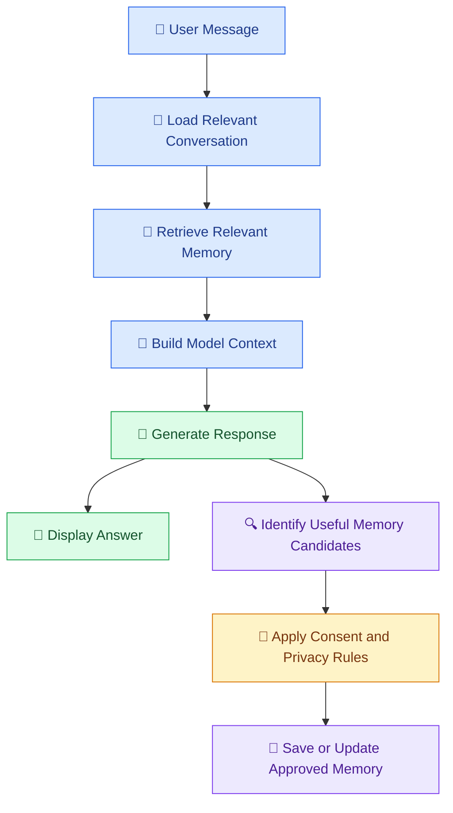

# 🧠 12 — Conversation History and AI Memory

[⬅️ Previous](11-documents-and-data.md) .

> Venkata Bhattaram (c) 2026

## 🎯 Learning Objectives

- Understand conversation history and AI memory.
- Learn the difference between short-term context and persistent memory.
- Explore how chat applications preserve previous messages.
- Understand summarization, user preferences, and retrieval-based memory.
- Learn how to design memory with privacy and user control.

## 🌟 1. What Is Conversation History?

**Conversation history** is the collection of messages exchanged during an interaction.

Consider this conversation:

**User:** I am learning Python.

**AI:** Great! Would you like to start with variables or loops?

**User:** Explain loops with a simple example.

If the application includes the earlier messages in the model's context, the assistant can respond more naturally because it has information about the learner's situation.

Without the relevant history, the last message may be ambiguous.

## 🧩 2. What Is AI Memory?

**AI memory** is a system for retaining and reusing selected information across interactions.

Examples include:

- A user's preferred explanation style.
- A project’s technology stack.
- The current stage of a multi-step task.
- Previously approved settings.
- Summaries of earlier conversations.
- Information retrieved from an authorized knowledge store.

Memory does not mean that a model automatically remembers every conversation. The application must implement the relevant storage and retrieval behavior, unless a platform provides a suitable memory feature.

## ⚖️ 3. Conversation History vs AI Memory

| Feature | Conversation history | Persistent memory |
|---|---|---|
| Main purpose | Preserve the current conversation | Retain selected useful information across sessions |
| Typical content | Recent user and assistant messages | Preferences, summaries, or relevant facts |
| Lifetime | Often limited to a session or configured retention period | Can persist across sessions |
| Storage | In-memory state, database, or conversation service | Database, memory store, or managed service |
| Context usage | Can become large as messages accumulate | Often retrieves a smaller selection of relevant information |
| Main challenge | Context limits and irrelevant old messages | Accuracy, privacy, updates, and deletion |

Persistent memory is not automatically better. It should retain only information that is useful, authorized, and appropriate for the application.

## 🏗️ 4. How AI Memory Works



A memory-enabled application commonly:

1. Loads the current conversation.
2. Retrieves relevant stored information.
3. Builds the context sent to the model.
4. Generates a response.
5. Determines whether new information should be retained.
6. Applies privacy and retention rules before saving it.

Not every message should become a permanent memory.

## 🗂️ 5. Types of AI Memory

### A. Short-term memory

Keeps recent messages or task details available during a conversation.

**Example:** The assistant remembers the question a user asked a few messages earlier.

### B. Persistent memory

Stores selected information across sessions.

**Example:** An application remembers that a user prefers concise explanations, if the user has agreed to that behavior.

### C. Summary memory

Compresses a long conversation into a shorter summary.

**Example:** A project assistant retains the agreed requirements, completed tasks, and outstanding issues instead of including hundreds of old messages in every request.

### D. External knowledge memory

Retrieves information from a database, document collection, or vector store.

**Example:** A college assistant searches the latest approved examination policy.

External knowledge retrieval and personal memory are related but different. A policy document should generally be managed as a source of knowledge, not stored as a personal fact about a user.

## 📏 6. Why Not Send Every Previous Message?

Conversation history consumes context and may include outdated, irrelevant, or sensitive information.

Common approaches include:

- Keeping only the most recent messages.
- Summarizing older conversation turns.
- Retrieving only messages relevant to the current task.
- Storing structured task state separately from chat messages.
- Separating user preferences from source documents.
- Applying retention and deletion policies.

The right approach depends on the task, context limits, latency, and privacy requirements.

## 💻 7. Hands-On Example — Simple Conversation History

This example demonstrates short-term conversation history with the OpenAI Python SDK. It keeps recent turns in memory while the program is running.

Configure the `.env` file as in earlier topics, with `OPENAI_API_KEY` and `OPENAI_MODEL` set.

Create `chat_memory.py`:

```python
import os

from dotenv import load_dotenv
from openai import OpenAI

load_dotenv()

api_key = os.getenv("OPENAI_API_KEY")
model = os.getenv("OPENAI_MODEL")

if not api_key or not model:
    raise RuntimeError(
        "Configure OPENAI_API_KEY and OPENAI_MODEL in .env."
    )

client = OpenAI(api_key=api_key)

history = []
MAX_TURNS = 5


def chat(user_message: str) -> str:
    if not user_message.strip():
        raise ValueError("Message cannot be empty.")

    history.append({
        "role": "user",
        "content": user_message,
    })

    # Retain the most recent turns for this simple demonstration.
    recent_history = history[-(MAX_TURNS * 2):]

    response = client.responses.create(
        model=model,
        instructions=(
            "You are a helpful learning assistant. "
            "Use relevant conversation history when answering. "
            "Do not invent facts that are not available."
        ),
        input=recent_history,
    )

    answer = response.output_text

    history.append({
        "role": "assistant",
        "content": answer,
    })

    return answer


if __name__ == "__main__":
    print("Chat with the AI. Type 'exit' to stop.\n")

    while True:
        message = input("You: ").strip()

        if message.lower() in {"exit", "quit"}:
            break

        try:
            print("\nAI:", chat(message), "\n")
        except Exception as error:
            print(f"Request failed: {type(error).__name__}")
```

Run:

```powershell
python chat_memory.py
```

Try the following sequence:

1. Say: "I am learning Python."
2. Ask: "What programming language am I learning?"
3. Ask another unrelated question.
4. Continue chatting and observe how recent messages are included.

This is only an in-memory demonstration. It loses history when the program stops, and it does not implement durable storage, user isolation, token-aware summarization, or consent-based persistent memory. A production implementation should also handle failed requests without accidentally storing an incomplete turn.

## 🏢 8. Designing Persistent Memory

For a real application, a database might contain records such as:

| Field | Purpose |
|---|---|
| `user_id` | Associates memory with an authorized user |
| `memory_type` | Identifies a preference, summary, or task state |
| `content` | Stores the approved information |
| `created_at` | Records when it was created |
| `updated_at` | Tracks changes |
| `expires_at` | Supports expiration when required |
| `source` | Records where the information originated |

These fields are illustrative. A real schema should reflect the application's requirements and data-retention policy.

Important design rules:

- Retrieve only memories belonging to the authenticated user.
- Store only useful and permitted information.
- Update stale facts rather than blindly appending duplicates.
- Provide a way to review and delete retained information.
- Use appropriate encryption and access controls.
- Define retention and expiration behavior.
- Avoid storing credentials, sensitive information, or unnecessary personal details.

## 🌍 9. Real-World Scenario — AI Project Assistant

A developer uses an AI assistant over several days to build an application.

The assistant may need to retain:

- The project's agreed technology stack.
- The current implementation stage.
- Decisions already made.
- Outstanding errors.
- The next planned development task.

At the start of a new session, the application can retrieve a concise project summary rather than sending the entire conversation history.

For example:

> Project: Student performance dashboard. Frontend: React. Backend: FastAPI. Completed: CSV upload and basic validation. Pending: chart filtering and automated tests.

This summary is useful task memory. The assistant should still verify the actual repository state before claiming that a feature has been implemented.

## ⚠️ 10. Common Mistakes

- Assuming the model automatically remembers all previous sessions.
- Including the entire conversation in every request.
- Saving every user message permanently.
- Retrieving one user's memory for another user.
- Treating outdated memory as current fact.
- Failing to support deletion or expiration.
- Confusing conversation memory with an authoritative database.
- Allowing memory content to override security policies.

## ✅ 11. Best Practices

- Define exactly what the application should remember.
- Separate short-term history, persistent preferences, task state, and external knowledge.
- Retrieve only relevant information.
- Summarize long conversations when appropriate.
- Keep memory associated with the correct authorized user.
- Let users review or remove retained information where appropriate.
- Establish retention, expiration, and update rules.
- Validate important project facts against authoritative sources.

## 🔑 Key Takeaways

- Conversation history provides context within an interaction.
- Persistent memory retains selected information across sessions.
- Summaries can reduce the amount of history sent to the model.
- External document retrieval is different from personal memory.
- Secure memory requires access control, data minimization, retention policies, and user control.