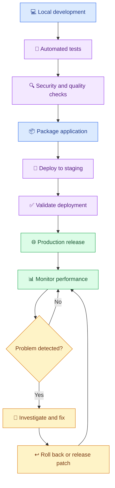
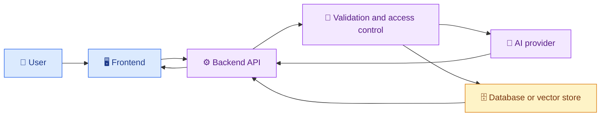
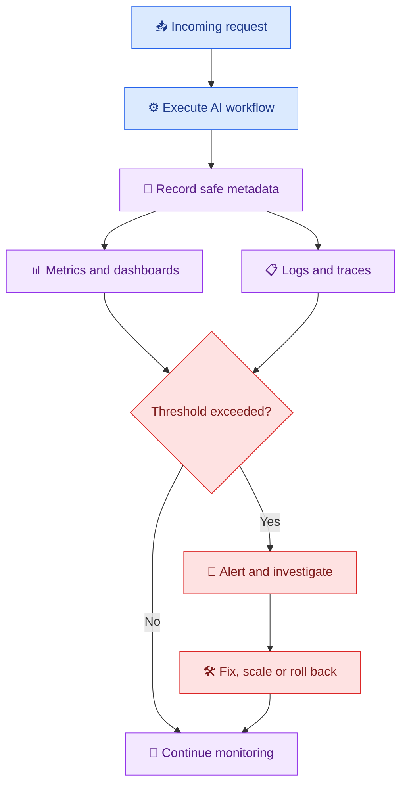

# 🚀 19. Deploying, Monitoring and Optimizing AI Applications

[⬅️ Previous](18-ai-security-and-responsible-development.md)

> 🎯 **Goal:** Learn how to deploy an AI application, configure production environments, monitor performance, manage failures, and optimize latency and cost.

## 🌍 1. From Local Development to Production

An AI application running on a developer's laptop is not automatically ready for real users.

A production application needs reliable hosting, secure configuration, error handling, monitoring, scaling, and a process for updates.

### 🧭 Development lifecycle



## 🏗️ 2. Common Deployment Architectures

| Architecture | Suitable for |
|---|---|
| Local CLI | Learning, prototypes, personal tools |
| Web application with API backend | React, Vue, or other frontend applications |
| Containerized service | Consistent environments and cloud deployment |
| Serverless API | Event-driven or variable workloads |
| Background workers | Long-running document processing and batch jobs |
| Managed AI platform | Applications that need hosted model access and platform features |

For a typical AI web application, a useful starting point is a frontend, a backend API, a hosted model provider, and optional persistent storage.



Keep model credentials on the server. A browser frontend should call your backend rather than exposing a provider API key directly.

## ⚙️ 3. Prepare a FastAPI Application

Install dependencies:

```powershell
python -m pip install fastapi "uvicorn[standard]" openai python-dotenv
```

Create `main.py`:

```python
import os
import logging
from contextlib import asynccontextmanager

from dotenv import load_dotenv
from fastapi import FastAPI, HTTPException
from pydantic import BaseModel, Field
from openai import AsyncOpenAI, APIConnectionError, APIStatusError

load_dotenv()

logging.basicConfig(level=logging.INFO)
logger = logging.getLogger(__name__)

API_KEY = os.getenv("OPENAI_API_KEY")
MODEL = os.getenv("OPENAI_MODEL")

if not API_KEY or not MODEL:
    raise RuntimeError(
        "Configure OPENAI_API_KEY and OPENAI_MODEL."
    )


@asynccontextmanager
async def lifespan(app: FastAPI):
    app.state.client = AsyncOpenAI(
        api_key=API_KEY,
        timeout=30.0,
        max_retries=2,
    )
    yield
    await app.state.client.close()


app = FastAPI(
    title="AI Production Demo",
    version="1.0.0",
    lifespan=lifespan,
)


class GenerateRequest(BaseModel):
    prompt: str = Field(min_length=1, max_length=4000)


class GenerateResponse(BaseModel):
    answer: str


@app.get("/health")
async def health():
    # This is a process-level health check, not proof that
    # the model provider or all dependencies are available.
    return {"status": "ok"}


@app.post("/generate", response_model=GenerateResponse)
async def generate(request: GenerateRequest):
    try:
        response = await app.state.client.responses.create(
            model=MODEL,
            input=request.prompt,
        )

        answer = response.output_text.strip()

        if not answer:
            raise HTTPException(
                status_code=502,
                detail="The AI provider returned an empty response.",
            )

        return GenerateResponse(answer=answer)

    except HTTPException:
        raise

    except APIConnectionError:
        logger.warning("AI provider connection failure")
        raise HTTPException(
            status_code=503,
            detail="The AI service is temporarily unavailable.",
        )

    except APIStatusError as exc:
        # Do not expose raw provider errors or credentials.
        logger.error(
            "AI provider status failure: %s",
            exc.status_code,
        )
        raise HTTPException(
            status_code=502,
            detail="The AI provider could not complete the request.",
        )

    except Exception:
        logger.exception("Unexpected generation failure")
        raise HTTPException(
            status_code=500,
            detail="An unexpected server error occurred.",
        )
```

Create a `.env` file with your credentials and supported model name, and ensure it is excluded from version control.

Run locally:

```powershell
python -m uvicorn main:app --reload
```

Open:
- API documentation: `http://127.0.0.1:8000/docs`
- Health endpoint: `http://127.0.0.1:8000/health`

**Production note:** The sample demonstrates API structure and error handling. Before public deployment, add authentication, authorization, rate limiting, usage limits, request IDs, appropriate CORS rules, and production logging. Configure timeouts and retries carefully to avoid multiplying latency or cost.

## 📦 4. Containerize the Application

Containers help make the runtime environment consistent across development, testing, and deployment.

Create `requirements.txt`:

```text
fastapi
uvicorn[standard]
openai
python-dotenv
```

For a production deployment, pin and regularly update tested dependency versions.

Create `Dockerfile`:

```dockerfile
FROM python:3.13-slim

ENV PYTHONDONTWRITEBYTECODE=1
ENV PYTHONUNBUFFERED=1

WORKDIR /app

COPY requirements.txt .
RUN pip install --no-cache-dir -r requirements.txt

COPY main.py .

RUN useradd --create-home appuser
USER appuser

EXPOSE 8000

CMD ["uvicorn", "main:app", "--host", "0.0.0.0", "--port", "8000"]
```

Build and run:

```powershell
docker build -t ai-production-demo .
docker run --rm -p 8000:8000 `
  -e OPENAI_API_KEY `
  -e OPENAI_MODEL `
  ai-production-demo
```

The environment variables must already be set in the shell or supplied securely by your deployment platform. Do not bake `.env` or credentials into the image.

## ☁️ 5. Choose a Hosting Platform

Typical options include:
- Container hosting services.
- Virtual machines or cloud application platforms.
- Serverless functions.
- Managed Kubernetes for more complex workloads.

The best choice depends on traffic, budget, scaling requirements, data residency, and operational expertise.

Before deploying:
1. Run automated tests.
2. Verify required environment variables.
3. Check the build and dependency versions.
4. Configure secrets through the platform.
5. Set appropriate resource and request limits.
6. Verify the health endpoint.
7. Test both successful and failing requests.
8. Confirm logs and alerts work.

## 📊 6. Monitor AI Applications

Traditional service monitoring tracks whether a service is up. AI monitoring must also track the quality, cost, and behavior of model interactions.

| Metric | Why it matters |
|---|---|
| Request count | Measures demand |
| Error rate | Identifies failures |
| Latency percentiles | Shows typical and slow requests |
| Token usage | Helps explain provider costs |
| Cost per request | Supports budgeting |
| Rate-limit events | Reveals provider capacity constraints |
| Empty or malformed responses | Detects output problems |
| Evaluation scores | Tracks answer quality |
| Safety incidents | Helps identify misuse or policy failures |

### 📈 Observability loop



Avoid recording full prompts and responses by default. Store only what is needed for operations and evaluation, and protect any retained data with suitable access controls and retention rules.

## ⚡ 7. Optimize Latency

A response may be slow because of network delays, model generation, large prompts, retrieval, or serial tool calls.

Useful techniques:
- Reduce unnecessary prompt and context length.
- Retrieve the most relevant document chunks instead of entire files.
- Use a model appropriate for the task's complexity.
- Stream responses when the user experience benefits.
- Run independent tasks concurrently where safe.
- Cache reusable results when the data and permissions allow it.
- Set realistic timeouts and bounded retries.
- Measure performance before optimizing.

Do not select a smaller or faster model solely on speed. Verify that quality remains acceptable on your evaluation dataset.

## 💰 8. Optimize Cost

A simplified estimate is:

\[
\text{Request cost} =
\frac{\text{Input tokens}}{10^6}\times
\text{Input price per million}
+
\frac{\text{Output tokens}}{10^6}\times
\text{Output price per million}
\]

Actual billing can vary by model, provider, cached tokens, tools, image or audio usage, and other features. Use current provider pricing for your estimate.

Example: if an illustrative model price is $2 per million input tokens and $8 per million output tokens, a request with 2,000 input tokens and 500 output tokens would cost approximately:

- Input: \(2000/10^6 \times \$2 = \$0.004\)
- Output: \(500/10^6 \times \$8 = \$0.004\)
- Total: **$0.008 per request**, before other charges.

These prices are examples, not a statement of current provider pricing.

Ways to reduce unnecessary spend:
- Set per-user and per-request limits.
- Prevent repeated or accidental loops.
- Use concise prompts and focused context.
- Cache eligible repeated results.
- Choose models based on measured quality and cost.
- Monitor usage by feature and application version.
- Set budget alerts where available.

## 🔁 9. Reliability and Failure Handling

AI services may experience timeouts, rate limits, unavailable models, invalid credentials, or temporary network problems.

Design controlled fallback behavior:
- Validate input before calling the provider.
- Apply bounded retries with backoff where appropriate.
- Respect provider retry guidance and rate limits.
- Avoid retrying permanent failures such as invalid credentials.
- Use a safe user-facing error message.
- Prevent duplicate execution of consequential actions.
- Provide a non-AI fallback when feasible.
- Use circuit breakers or queueing for workloads that require them.

Retries are not a replacement for rate limiting or idempotency. Repeating a request that triggers an external action can cause duplicate effects if the application is not designed carefully.

## 🔄 10. CI/CD and Safe Releases

A deployment pipeline can automatically test and package each change.


Use environment-specific configuration and keep a known-good release available for rollback. For important systems, consider canary releases or gradual traffic shifting.

## ⚠️ 11. Common Mistakes

❌ Deploying without authentication or usage limits.

❌ Exposing provider credentials in frontend code.

❌ Monitoring uptime but ignoring AI answer quality.

❌ Logging sensitive prompts without a clear purpose.

❌ Retrying every failure indefinitely.

❌ Choosing a model without measuring quality and cost.

❌ Assuming a successful health check means all dependencies are working.

## 🏆 12. Practice Challenge

Deploy your FastAPI AI application to a hosting platform of your choice.

Add:
- A health endpoint.
- Request and error metrics.
- Token-usage or cost estimates.
- Input-size and request limits.
- A controlled provider-failure response.
- A repeatable test command.
- A documented rollback procedure.

Record baseline latency and cost, make one optimization, and compare the results while checking answer quality.

## 🎯 Key Takeaways

- Production readiness requires more than making the model API work.
- Keep credentials server-side and configure them securely.
- Monitor latency, reliability, usage, cost, and answer quality.
- Optimize based on measured results rather than assumptions.
- Release safely, test failures, and prepare a rollback plan.

**Next:** Apply the complete learning path by building an end-to-end AI application.