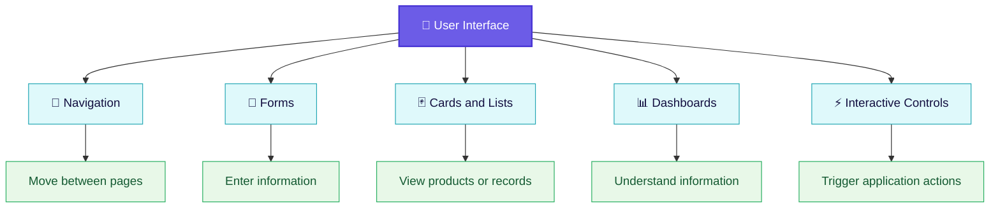
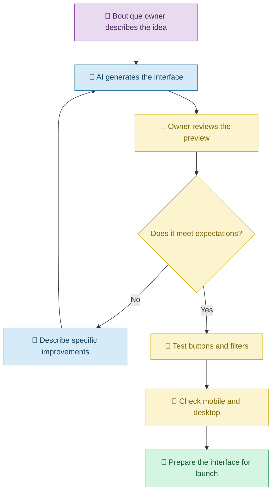

# 🎨 Building User Interfaces with Vibe Coding
[⬅️ Back to Learning Modules](../README.md) ·

> Turn your ideas into beautiful, interactive applications by describing what you want to an AI coding assistant.
 
## 📋 1. Introduction

A user interface (UI) is the part of an application that people see and interact with. It includes buttons, menus, images, forms, charts, navigation bars, and other visual elements.

Imagine opening a shopping application. You see product pictures, prices, a search box, and an Add to Cart button. All these elements form its user interface.

Traditionally, developers manually write code to create these elements. With **Vibe Coding**, you can describe the interface in everyday language and ask an AI coding assistant to generate the code.

For example, instead of writing code to create a product card, you can say:

> Create a modern product card with a clothing image, product name, price, available sizes, and an Add to Cart button. Use rounded corners, subtle shadows, and a responsive layout.

The AI generates the interface, and you can continue refining it through conversation.

## 🧠 2. What Is a User Interface?

A user interface is the visual and interactive layer through which people use an application.

| UI component | Everyday example |
|---|---|
| Button | A Book Appointment button |
| Form | A customer registration form |
| Navigation bar | Home, Products, About and Contact |
| Card | A product displayed with its image and price |
| Dashboard | A screen showing sales and inventory |
| Modal | A confirmation window before deleting a record |
| Search box | A field used to find a product |
| Chart | A graph showing monthly sales |

### 🧩 The main parts of a web application interface

## 💡 3. How Vibe Coding Helps Build Interfaces

You do not need to know every detail of HTML, CSS, or JavaScript before you begin.

You can ask an AI coding assistant to:

- Create an initial page from a description.
- Change colors, fonts, spacing, and layouts.
- Make the application responsive on mobile and desktop.
- Add buttons, forms, filters, and interactive components.
- Improve accessibility and readability.
- Explain the generated code and help correct visual problems.

However, AI-generated interfaces still require human review. A page may look attractive while containing broken buttons, inaccessible controls, or incorrect behavior.

## 🛍️ 4. Real-Life Scenario: Building an Online Boutique

### The problem

A small boutique owner sells dresses and accessories through social media. Customers repeatedly ask for product images, prices, sizes, and availability.

The owner wants a simple website to display the catalog but has no programming experience.

### Step 1: Describe the desired interface

The owner gives this prompt to an AI coding assistant:

**Example prompt**

> Build a modern online boutique homepage. Add a header with the boutique name, Home, Collections, About, and Contact links. Display clothing products in a responsive grid with images, names, prices, sizes, and View Details buttons. Use an elegant cream background, dark text, and subtle rose-colored accents. Make it work on mobile and desktop.

### Step 2: Review the generated page

The AI creates an initial interface. The owner reviews it and notices that the product images are too small and the buttons are difficult to see.

### Step 3: Improve the interface through conversation

The owner asks:

> Increase the product image size, make the product names easier to read, and use a contrasting color for the View Details buttons. Keep the existing layout and ensure that it still works on mobile screens.

The AI updates the interface.

### Step 4: Add interactivity

The owner then requests:

> Add category filters for Dresses, Tops, and Accessories. When a customer selects a category, display only products belonging to that category. Show a helpful message if no products match.

The AI generates the necessary interaction logic.

### 🔄 The Vibe Coding workflow

## 🧰 5. Important UI Concepts

### 5.1 Layout and spacing

Layout determines where components appear on the screen. Spacing controls the distance between them.

**Vibe Coding prompt:**

> Arrange the product cards in a three-column grid on desktop, two columns on tablets, and one column on small mobile screens. Keep consistent spacing between cards.

### 5.2 Colors and typography

Colors and fonts affect readability, visual hierarchy, and the application's personality.

**Vibe Coding prompt:**

> Use a consistent color palette with a light background, dark readable text, and one accent color for primary actions. Make headings visually distinct from descriptions.

### 5.3 Responsive design

Responsive design allows the interface to adapt to different screen sizes.

**Vibe Coding prompt:**

> Review the entire page at desktop, tablet, and mobile widths. Prevent horizontal scrolling, overlapping text, clipped buttons, and distorted images.

### 5.4 Interactive components

Interactive components respond to user actions.

Examples include search fields, dropdowns, tabs, sorting controls, and buttons.

**Vibe Coding prompt:**

> Make the search field filter products as the user types. Display a clear message when there are no matches, and provide a button to clear the search.

### 5.5 Accessibility

Accessibility helps people with different abilities use an application.

**Vibe Coding prompt:**

> Improve accessibility by adding labels to form fields, meaningful alternative text for product images, visible keyboard focus, and sufficient contrast between text and backgrounds.

## ⚠️ 6. Common Mistakes

| Mistake | Better approach |
|---|---|
| Asking for a beautiful UI without describing the purpose | Explain the intended users, content, and actions |
| Requesting the entire application in one enormous prompt | Build and refine the interface in manageable stages |
| Changing every color and layout element at once | Request focused visual changes |
| Assuming buttons work because they look clickable | Test every important interaction |
| Ignoring mobile screens | Test multiple viewport sizes |
| Using unreadable text or low contrast | Request accessible typography and colors |
| Replacing existing code without checking its impact | Ask AI to inspect the current structure and preserve working features |

## ✅ 7. Best Practices

1. Describe the user and the problem before choosing a design.
2. Specify the required components and their expected behavior.
3. Use screenshots or reference images when appropriate and when you have permission to use them.
4. Improve one or two aspects at a time.
5. Test the actual behavior, not just the visual appearance.
6. Check accessibility and responsive behavior.
7. Ask AI to explain significant changes before accepting them.

## 🎯 8. Key Takeaways

- A UI is the part of an application people see and interact with.
- Vibe Coding allows people to generate and refine interfaces through natural-language instructions.
- Clear prompts produce more targeted results.
- A good interface must be usable, responsive, accessible, and functional.
- Human review remains important throughout the process.