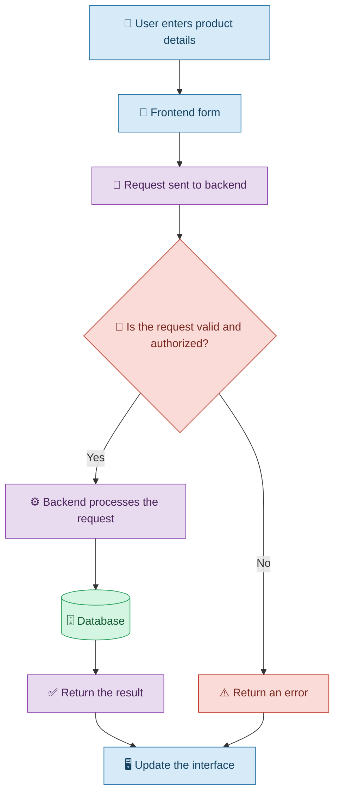
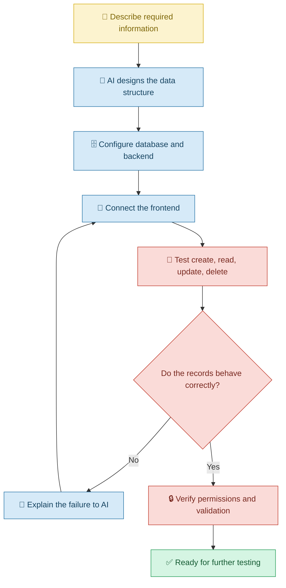

# 🗄️ Connecting Data and Backends with Vibe Coding

[⬅️ Previous:](05-user-interface.md) ·

> Turn a visual application into a useful system that can save, retrieve, update, and manage information.

## 📋 1. Introduction

Imagine creating a beautiful inventory application for a small shop. You can add a product name and price, but after refreshing the page, the information disappears.

The interface may look complete, but the application cannot reliably remember what you entered.

To solve this problem, many applications need **data storage and a backend**.

With Vibe Coding, you can explain what information your application must manage and ask an AI coding assistant to implement the required data handling, storage, and backend logic.

For example:

> Update my inventory application so product details are stored persistently. Allow authorized users to add, edit, search, and delete products. Show an appropriate message when a product is saved successfully or when an operation fails.

The AI can help generate the implementation, but you must verify that data is actually stored, permissions work correctly, and errors are handled.

## 🧠 2. Understanding Frontend, Backend, and Database

These three parts have different responsibilities.

| Component | Simple explanation | Example |
|---|---|---|
| Frontend | What the user sees and interacts with | Product entry form |
| Backend | Processes requests and applies rules | Checks stock updates and user permissions |
| Database | Stores information for later use | Product names, prices, and quantities |

### 🏗️ How the components work together

## 💡 3. What Can You Build with Vibe Coding?

You can ask an AI coding assistant to help implement:

- Forms that save user information.
- Product catalogs and inventory systems.
- Registration and login workflows.
- Search, filtering, and sorting.
- Dashboards that retrieve real records.
- Data validation and error messages.
- Database operations and backend APIs.
- Role-based access to information.

The exact implementation depends on the chosen technology, database, hosting environment, and application requirements.

## 🛒 4. Real-Life Scenario: A Small Shop's Inventory System

### The problem

A shop owner tracks products in a notebook. They frequently lose track of remaining stock and spend time calculating inventory manually.

The owner decides to use Vibe Coding to build an inventory application.

### Step 1: Describe the data

The owner asks:

> Create an inventory application for my shop. Each product should have a name, product code, category, price, and available quantity. I should be able to add new products, update existing quantities, search by product name, and remove discontinued products.

### Step 2: Request persistent storage

> Connect the application to a suitable database so that product records remain available after refreshing the page or signing in from another authorized device. Explain the storage approach and any setup required.

This instruction is important because temporary browser state is not the same as persistent, shared storage.

### Step 3: Add business rules

> Prevent negative stock quantities and invalid prices. When a product's stock falls below five units, show a low-stock warning. Ask for confirmation before deleting a product.

### Step 4: Test the result

The owner adds a product with ten units, reduces its quantity to four, and checks that the warning appears. They refresh the page to confirm that the data persists.

They also test invalid prices, unauthorized changes, and attempts to delete products.

### 🔄 The development workflow

## 🔧 5. Important Concepts

### 5.1 CRUD operations

CRUD describes four basic ways to manage records.

| Operation | Meaning | Inventory example |
|---|---|---|
| Create | Add a record | Add a new dress |
| Read | Retrieve a record | View available dresses |
| Update | Change a record | Correct the price |
| Delete | Remove a record | Remove a discontinued item |

**Prompt example:**

> Implement CRUD operations for inventory items. Validate every request, display clear success and error messages, and ensure that only authorized staff can modify inventory.

### 5.2 Data validation

Validation checks whether submitted information meets the application's rules.

For example, a quantity should be a valid non-negative number, and a product price should not be negative.

**Prompt example:**

> Validate product names, prices, and quantities on both the frontend and backend. Do not rely only on browser-side validation. Return clear messages when data is invalid.

### 5.3 Authentication and authorization

Authentication checks who a user is. Authorization determines what that user may do.

For example, a shop employee may update stock, while an owner may also view financial reports.

**Prompt example:**

> Add secure login and role-based permissions. Enforce permissions on the backend, not only by hiding buttons in the interface. Prevent users from accessing records or actions outside their assigned role.

### 5.4 Persistent storage

Persistent storage keeps data available beyond the current page session.

Depending on the application, this may involve a database service, a local database, or another suitable storage mechanism.

**Prompt example:**

> Explain which data is currently stored temporarily and which data is saved persistently. Recommend a storage approach suitable for multiple authorized users and implement it without exposing database credentials in frontend code.

### 5.5 Handling errors

Applications must respond sensibly when a database is unavailable, a request fails, or a record cannot be found.

**Prompt example:**

> Handle database connection failures and unsuccessful save operations. Show a clear message to the user, avoid silently losing changes, and log appropriate diagnostic information without exposing secrets.

## ⚠️ 6. Common Mistakes

| Mistake | Better approach |
|---|---|
| Assuming a form automatically saves data | Specify where and how records must be stored |
| Storing shared business records only in temporary browser state | Use suitable persistent storage |
| Trusting all incoming data | Validate data on the backend |
| Hiding administrative buttons without protecting backend operations | Enforce authorization on the server |
| Putting database credentials in frontend code | Keep secrets in appropriate server-side configuration |
| Ignoring failed requests | Add error handling and recovery behavior |
| Testing only with sample success cases | Test invalid inputs, missing records, and unauthorized requests |

## 🎯 8. Key Takeaways

- The frontend, backend, and database serve different purposes.
- Vibe Coding can help build data-driven applications through natural-language instructions.
- CRUD operations are fundamental to many business applications.
- Persistent storage, validation, and authorization must be explicitly addressed.
- AI-generated data-handling logic must be tested before real data is used.
