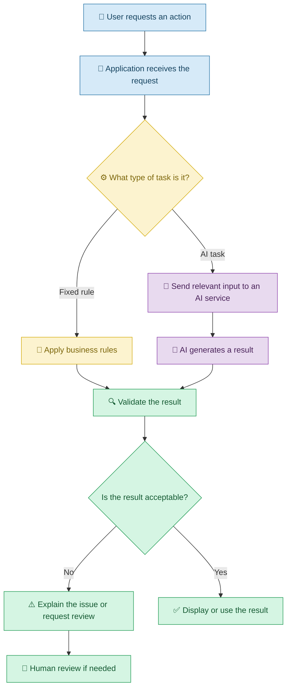
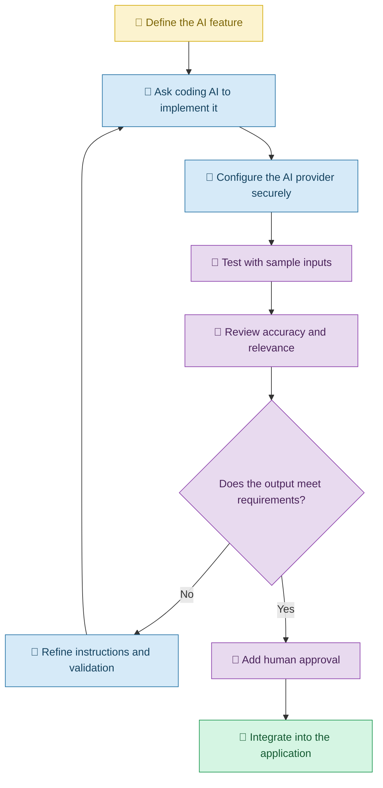

# 🤖 Adding AI Features and Automation with Vibe Coding

[⬅️ Previous:](06-connect-data-and-backend.md) ·

> Build applications that can understand requests, generate useful content, and automate repetitive tasks.

## 📋 1. Introduction

Many applications do more than display information or store records. They can summarize documents, answer questions, categorize messages, generate descriptions, and perform routine tasks automatically.

For example, an online store might need product descriptions for hundreds of products. Writing each description manually takes time.

With Vibe Coding, the store owner can ask an AI coding assistant to add a feature that generates product descriptions from product names, specifications, and other relevant information.

The coding assistant helps build the feature, while an AI service integrated into the application performs the actual text generation when the feature is used.

**Important distinction:** An AI coding assistant helps you build the application. An AI model integrated into your application helps your application perform AI-powered tasks. These may be different systems.

## 🧠 2. Understanding AI Features and Automation

An AI feature uses an AI model to perform tasks such as generating text, interpreting language, or summarizing information.

Automation makes a process happen automatically when a particular event or condition occurs.

The two can work together, but they are not the same.

| Concept | Meaning | Example |
|---|---|---|
| AI feature | Uses a model to perform an intelligent task | Generate a product description |
| Rule-based automation | Follows predefined conditions | Notify staff when stock is low |
| AI-powered automation | Uses AI within an automated workflow | Categorize incoming customer messages |
| Chatbot | Responds to conversational requests | Answer questions about store policies |
| AI agent | Can select tools and perform multiple steps toward a goal | Prepare a sales report using authorized data |

### 🔄 How an AI-powered workflow operates

## 💡 3. What Can You Build?

With Vibe Coding, you can ask AI to help implement:

- Website chatbots.
- Product description generators.
- Email and document summarizers.
- Frequently asked question assistants.
- Text classification and sentiment analysis.
- Automated report generation.
- Notification workflows.
- AI-powered search.
- Document question-answering systems.
- Multi-step workflows that use AI and external tools.

Some features require a separate AI provider, API credentials, data access, and additional configuration. Generating the code does not automatically supply those services.

## 🛍️ 4. Real-Life Scenario: AI Product Description Generator

### The problem

A boutique sells dresses, tops, bags, and accessories. Each product needs a clear, attractive description for its website.

The manager spends hours writing descriptions manually and wants to speed up the process.

### Step 1: Describe the feature

**Example Vibe Coding prompt**

> Add an AI-powered product description generator to my existing boutique management application. The manager should enter a product name, category, material, color, and available sizes. Generate a concise, attractive product description using only the supplied facts. Allow the manager to review and edit the description before saving it. Preserve all existing product management features.

### Step 2: Configure the AI service

The coding assistant may generate the integration code, but the application also needs a suitable AI provider and configuration.

The manager or developer must configure the required credentials securely, understand the provider's usage limits, and verify that product data is handled appropriately.

### Step 3: Review generated descriptions

The manager enters:

- Product: Cotton floral dress
- Material: Cotton
- Color: Blue and white
- Sizes: S, M, L

The AI might produce a short description based on these facts.

The manager checks that the text does not invent properties such as waterproof fabric, guaranteed durability, or unavailable sizes.

### Step 4: Add approval before saving

**Follow-up prompt**

> Show the generated description in an editable text area. Add Regenerate, Save, and Cancel buttons. Do not publish the description automatically. Display an error if generation fails and preserve the manager's existing edits.

### 🔄 Feature development workflow

## 🧰 5. Important Concepts

### 5.1 AI prompts inside applications

The prompt sent by an application to its AI service influences the response.

For example, a customer-support assistant needs clear instructions about which questions it can answer and what sources it should use.

**Example prompt for your coding assistant:**

> Implement a customer-support chatbot that answers questions using the store's approved return and delivery policies. If the answer cannot be found in those policies, clearly say that the information is unavailable and provide a way to contact a human representative.

### 5.2 AI integrations and API keys

An API allows an application to communicate with an external service.

Some AI services require API keys or other authentication credentials. The application must handle these securely, typically through server-side configuration.

**Example prompt:**

> Integrate a suitable AI text-generation service through a backend endpoint. Read the API key from a server-side environment variable. Never expose the secret in frontend code, source control, browser responses, or application logs.

### 5.3 Rule-based automation

Not every task needs AI.

For example, the rule "send a low-stock notification when quantity falls below five" is predictable and can be implemented with ordinary program logic.

**Example prompt:**

> When inventory quantity drops below five, create a low-stock alert. Avoid generating duplicate alerts for the same stock condition, and allow authorized staff to mark an alert as resolved.

### 5.4 Human approval

AI-generated content or actions may be incorrect. A human approval step is valuable when mistakes could affect customers, money, or important records.

**Example prompt:**

> Before sending AI-generated emails or changing inventory records, display a preview and require explicit approval from an authorized user. Record the outcome and handle failures without repeating the action unintentionally.

### 5.5 Monitoring and cost management

AI calls may incur costs, have rate limits, or fail. Applications need suitable error handling and usage controls.

**Example prompt:**

> Handle AI service timeouts, rate limits, and unsuccessful responses. Show a useful error message, limit repeated requests, and record usage metrics without logging API keys or unnecessary personal information.

## ⚠️ 6. Common Mistakes

| Mistake | Better approach |
|---|---|
| Assuming the coding AI and application AI are automatically connected | Configure and test the actual AI service |
| Trusting every generated answer | Validate results and use human review where appropriate |
| Sending unnecessary personal information to an AI provider | Minimize data and review provider privacy practices |
| Hardcoding API credentials | Use secure server-side configuration |
| Using AI for simple deterministic rules | Prefer ordinary program logic when it is sufficient |
| Ignoring rate limits or usage costs | Set budgets, quotas, and appropriate request limits |
| Letting an AI workflow perform unrestricted actions | Apply permissions, limits, and approval steps |
| Treating an AI-generated result as guaranteed fact | Verify important claims against reliable sources |

## 🎯 8. Key Takeaways

- Vibe Coding helps you create applications with AI capabilities through natural-language instructions.
- AI-powered features and ordinary automation solve different types of problems.
- An application often needs an external AI service and secure configuration to provide AI functionality.
- AI output can be inaccurate, so validation and human oversight matter.
- Security, cost, reliability, and privacy should be considered from the beginning.
