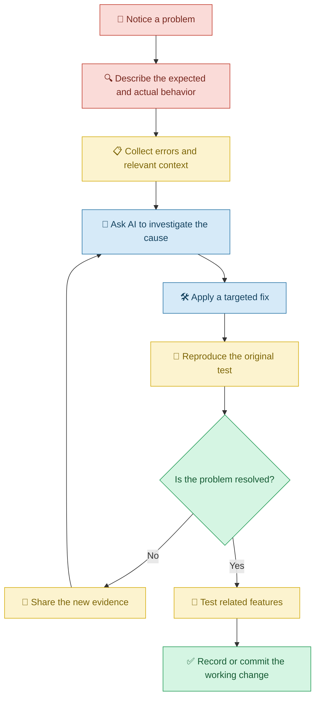
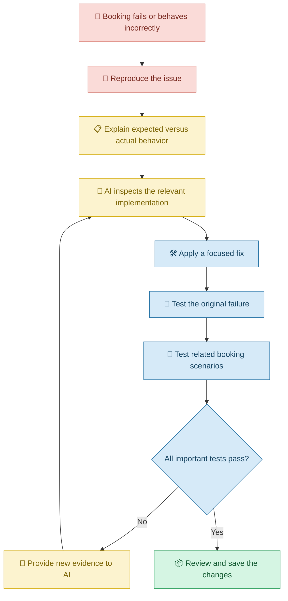

# 🛠️ Debugging and Iteration with Vibe Coding

[⬅️ Previous:](07-adding-ai-and-automation.md) ·

> Turn application errors into opportunities to improve your software through clear instructions, investigation, and repeated testing.

## 📋 1. Introduction

Suppose you ask an AI coding assistant to build a booking application. The application looks correct, but clicking the Book Appointment button does nothing.

What should you do?

You do not necessarily need to start from scratch. You can explain the problem to the AI coding assistant, share the relevant error message, and ask it to investigate the cause.

This process involves two important concepts:

- **Debugging:** Finding and correcting the cause of a problem.
- **Iteration:** Improving an application through repeated cycles of changes, feedback, and testing.

Vibe Coding relies heavily on iteration. The first version of an application is a starting point, not a guarantee that everything will work perfectly.

## 🧠 2. Understanding Debugging and Iteration

Debugging focuses on identifying why something is not working as expected. Iteration is the broader process of improving the application over time.

| Situation | What you do |
|---|---|
| A button does nothing | Investigate its event handler and related errors |
| A form accepts invalid data | Add or correct validation |
| A page looks broken on mobile | Inspect the responsive layout |
| A saved record disappears | Investigate persistence and data flow |
| An existing feature breaks after an update | Identify the regression and restore correct behavior |

### 🔄 The debugging cycle

## 💡 3. How Vibe Coding Helps with Debugging

An AI coding assistant can help you:

- Interpret error messages in simple language.
- Identify files and functions that may be involved.
- Suggest likely causes and ways to verify them.
- Generate targeted code fixes.
- Explain why a particular change may solve the problem.
- Add tests that reproduce the issue.
- Review whether a fix might affect existing functionality.

However, AI may guess incorrectly about the cause. A good debugging process uses evidence, controlled changes, and repeatable tests instead of accepting the first suggested fix.

## 📅 4. Real-Life Scenario: Fixing a Salon Booking Application

### The problem

A salon owner uses an AI-generated booking application. Customers select a date, choose a time slot, and submit an appointment request.

The owner discovers three problems:

1. Some customers can book a time slot that is already occupied.
2. The confirmation message sometimes shows the wrong date.
3. The booking button continues to look active while a request is being submitted.

The owner wants AI to fix these problems without rebuilding the entire application.

### Step 1: Explain the problem precisely

A vague prompt such as "Fix my booking app" does not provide enough evidence.

A better prompt is:

> My salon booking application has three issues. First, two customers can book the same time slot. Second, the confirmation sometimes shows a different date from the selected date. Third, the Book Appointment button remains active while the request is processing. Investigate the existing implementation, identify the likely causes, and propose targeted fixes. Preserve the current design and other working features.

### Step 2: Investigate before changing code

Ask the coding assistant:

> Inspect the booking flow from the date and time selection through the backend save operation and confirmation response. Explain the cause of each problem and identify the relevant files before editing them.

This encourages investigation rather than unnecessary changes across the whole project.

### Step 3: Fix the double-booking issue

The application should check availability on the backend and use suitable database constraints or transaction handling to prevent conflicting bookings. A frontend-only check is not sufficient because two customers may submit requests simultaneously.

**Follow-up prompt:**

> Prevent conflicting bookings on the backend. Ensure that concurrent requests cannot successfully reserve the same unavailable time slot. Return a clear message if another customer books it first.

### Step 4: Fix the date and button behavior

**Follow-up prompt:**

> Investigate the date conversion between the selected date, backend storage, and confirmation display. Preserve the intended appointment date across the entire flow. Also disable the submit button while a booking request is in progress, prevent duplicate submissions, and restore the button if the request fails.

### Step 5: Test the fixes

The owner verifies that:

- Two attempts to book the same slot cannot both succeed.
- The displayed confirmation matches the selected appointment.
- The button cannot accidentally submit the same booking repeatedly.
- A failed request produces a useful message.
- Other appointment features continue to work.

### 🧭 The Vibe Coding troubleshooting process

## 🧰 5. Important Debugging Techniques

### 5.1 Describe expected versus actual behavior

A useful bug report states what should happen and what happens instead.

**Example:**

- Expected: Clicking Save stores the new product.
- Actual: The interface displays success, but the product disappears after refreshing.

**Prompt:**

> Investigate why the interface reports success when the product does not persist. Trace the save request and database response. Do not assume that a successful button click means the record was saved.

### 5.2 Share error messages and logs

Error messages often contain clues about the failing file, function, request, or dependency.

**Prompt:**

> Explain this error in simple language. Identify what the error establishes, what remains uncertain, and which file or operation should be investigated first. Recommend a minimal fix and a test to verify it.

Include the relevant error text and surrounding context. Remove passwords, API keys, personal information, and other secrets before sharing logs.

### 5.3 Make targeted changes

Large, unrelated rewrites make it harder to understand what fixed the problem and may introduce new errors.

**Prompt:**

> Fix only the issue affecting product filtering. Preserve existing component names, layout, routes, and working features. Explain the changes and list the tests that should be run.

### 5.4 Use regression testing

A regression occurs when a change breaks something that worked previously.

For example, a redesigned login page might look better but accidentally prevent users from logging out.

**Prompt:**

> After fixing the login issue, review the existing authentication flow. Test login, logout, protected routes, and role-based access to confirm that the change has not broken existing functionality.

### 5.5 Use version control to recover from mistakes

Before substantial changes, commit the current working state using Git. If a change causes problems, compare versions and restore the appropriate code rather than making uncontrolled edits.

**Prompt:**

> Review the changes made since the last working version. Identify unrelated modifications and explain how to restore the affected feature without losing other valid changes.

## ⚠️ 6. Common Mistakes

| Mistake | Better approach |
|---|---|
| Asking AI to fix an error without sharing its details | Include the error, relevant context, and expected behavior |
| Accepting the first proposed cause as fact | Ask for evidence and test the hypothesis |
| Regenerating the entire application for a small bug | Request a targeted investigation and fix |
| Making many changes simultaneously | Change one logical area at a time |
| Testing only whether the page loads | Test the actual behavior that failed |
| Ignoring previously working features | Run regression tests |
| Pasting secrets into debugging prompts | Remove sensitive values from logs |
| Continuing to patch a poorly understood implementation | Ask AI to explain the code path and underlying cause |

## 🎯 8. Key Takeaways

- Debugging is about identifying and correcting the cause of a problem.
- Iteration improves an application through repeated feedback and testing.
- Clear evidence helps AI produce more relevant fixes.
- Targeted changes are generally easier to review than complete rewrites.
- Every fix should be tested, and related functionality should be checked for regressions.
- Vibe Coding does not eliminate debugging; it changes how people collaborate with AI to perform it.