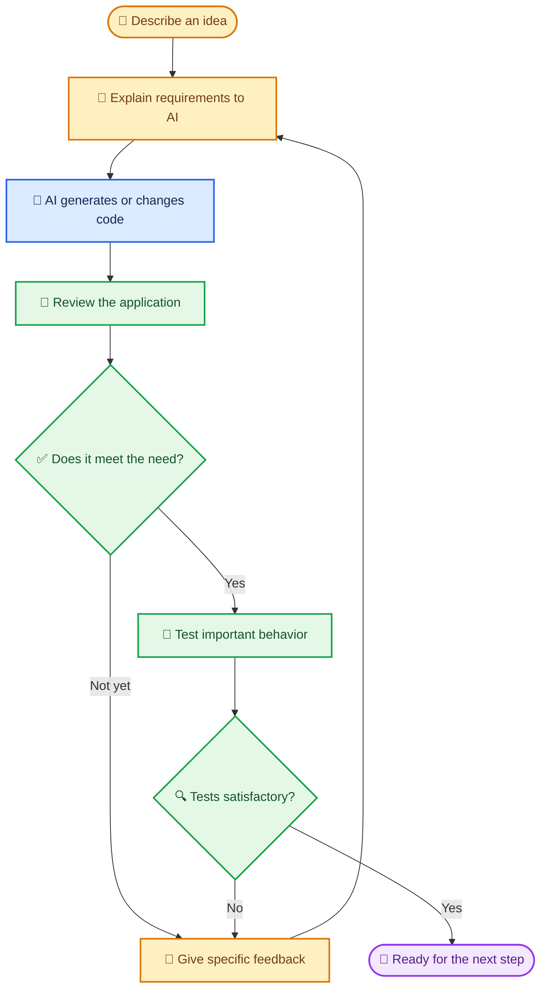

# 🎨 Introduction to Vibe Coding

> Turn an idea into a working application by describing what you want, reviewing what AI creates, and improving it step by step.

[⬅️ Back to Learning Modules](../README.md) · 

---

## 🎯 Learning Objectives

By the end of this topic, you should be able to:

- Explain **Vibe Coding** in everyday language.
- Describe how a person and an AI coding assistant work together.
- Recognize suitable tasks, benefits, and limitations.
- Follow a simple idea-to-application workflow.
- Understand why human review and testing remain essential.

## 💡 1. What Is Vibe Coding?

**Vibe Coding is a way of building or changing software by explaining your idea in natural language and working with an AI tool that generates or edits code.** You focus on the problem, the desired experience, and the improvements you want. The AI helps translate those instructions into software.

Imagine explaining to a designer what you want a room to look like, looking at the first design, and asking for changes. In Vibe Coding, you do something similar with an application: describe the goal, inspect the result, and ask for refinements.

Vibe Coding does **not** mean that software builds itself perfectly or that you never need to understand the result. You still make decisions, check the output, test important behavior, and protect users' information.

## 🧩 2. How Is It Different from Traditional Coding?

| Traditional coding approach | Vibe Coding approach |
|---|---|
| A developer often writes much of the code directly. | A person describes requirements and asks AI to generate or modify code. |
| Progress may involve manually implementing each detail. | AI can draft an initial version quickly, which the person then reviews and refines. |
| The developer diagnoses issues using programming knowledge and tools. | The person can explain symptoms to AI and ask for help investigating them, while still checking the fix. |
| Programming knowledge is central to writing the implementation. | Clear communication is especially important, though technical understanding is still useful for review and safety. |

These approaches can also be combined. A developer may use AI for a first draft and then edit the code directly.

## 🔄 3. The Vibe Coding Loop

**The key idea:** Vibe Coding is a cycle of instruction, generation, review, and improvement—not just a single prompt.

## 🧁 4. Real-Life Scenario: A Local Bakery Website

### The situation

Priya runs a small bakery. Customers often message her to ask what cakes are available, how much they cost, and how to place an order. She wants a simple website but has never written code.

### How she uses Vibe Coding

1. **Describe the goal:** Priya tells an AI coding assistant she needs a bakery website with cake photos, names, prices, opening hours, and contact details.
2. **Request a first version:** The assistant generates a basic page.
3. **Review the result:** Priya notices that the text is too small and the order button is hard to find.
4. **Ask for specific changes:** She asks for larger text, clearer product cards, a visible order button, and a layout that works on phones.
5. **Test the result:** She opens the site on a phone and computer, checks the links, and confirms that prices and contact details are correct.
6. **Prepare for publishing:** Before making it public, she checks hosting, privacy, and whether any form or order data is stored securely.

### Example prompt

> Create a beginner-friendly website for a local bakery. Include a welcoming home section, a cake catalog with product names and prices, opening hours, location, and a clear contact button. Use a warm visual style, readable text, and a responsive layout for phones and computers. Use sample cake information for now, and tell me what I need to replace before publishing.

### What makes this Vibe Coding?

Priya is not merely using an existing website. She is directing an AI tool to **create and refine the website**, reviewing the result, and deciding which changes are needed.

## 🧰 5. What Can You Build with Vibe Coding?

- 🧑‍🎓 **Education:** a study planner, quiz app, or student progress dashboard.
- 🛍️ **Small business:** a product catalog, inventory tracker, or appointment form.
- 🏠 **Personal use:** a household budget tool, meal planner, or task list.
- 📊 **Data work:** a dashboard that visualizes information from a spreadsheet.
- 🤖 **AI-assisted workflows:** a document summarizer or customer FAQ assistant.

The best starting projects have a clear purpose and manageable scope. Apps that handle money, health information, private records, or other high-impact decisions need more rigorous review.

## 🌟 6. Benefits and Limitations

### Benefits

- **Faster first draft:** AI can create a starting point from a written description.
- **Lower barrier to experimentation:** people can explore ideas before mastering a programming language.
- **Easy iteration:** requests such as “make the buttons clearer” can guide refinements.
- **Learning by doing:** the process can introduce users to application structure and technical concepts.

### Limitations

- **AI can be wrong:** generated code may contain bugs or misunderstand requirements.
- **Vague instructions create vague results:** important details may be missing.
- **Testing is still necessary:** an attractive screen does not prove that its features work.
- **Security cannot be assumed:** authentication, data access, and secret handling need review.
- **Costs can grow:** AI usage, APIs, databases, and hosting may have ongoing fees.
- **Complexity still matters:** larger systems require planning, maintenance, and sometimes experienced developers.

## 🔑 Key Takeaways

- Vibe Coding lets people guide software creation using natural-language instructions and AI coding tools.
- The human provides goals, context, feedback, and judgment; AI assists with implementation.
- Good results come from clear requirements, small iterations, and testing.
- AI-generated code should not be trusted automatically, especially when security or sensitive data is involved.
