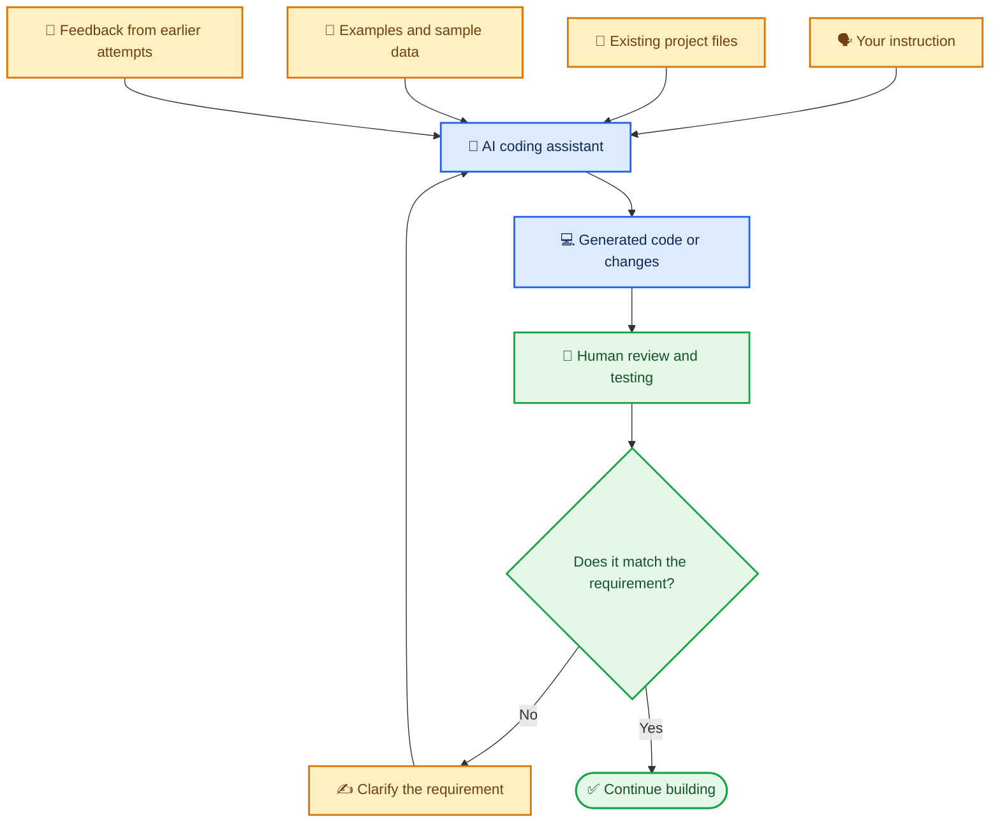
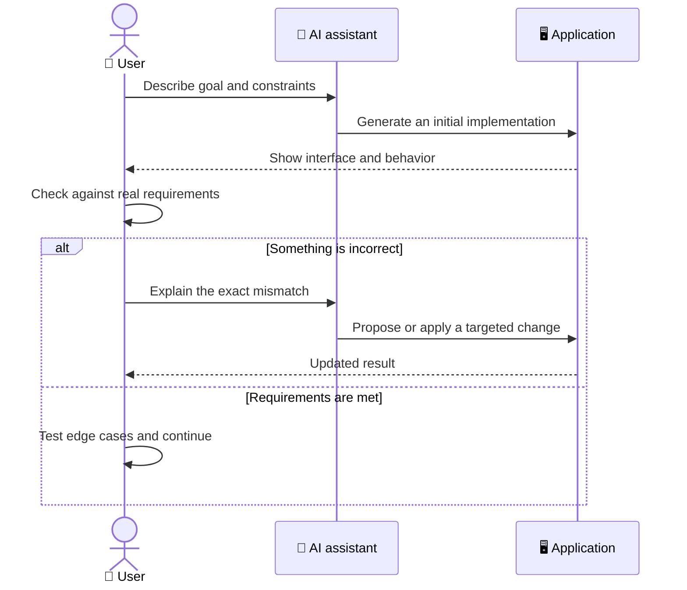

# 🧠 How AI Understands Your Ideas

> Learn how AI coding assistants turn descriptions, examples, and feedback into application code—and why context matters.

[⬅️ Previous: Introduction to Vibe Coding](01-introduction-to-vibe-coding.md) ·

---

## 🎯 Learning Objectives

- Understand, at a high level, how an AI coding assistant produces code.
- Recognize the roles of instructions, context, examples, and feedback.
- Learn why an AI tool may misunderstand an idea.
- Practice improving a result by explaining the intended behavior clearly.

## 💬 1. What Does It Mean for AI to “Understand” an Idea?

When you describe an application to an AI coding assistant, the tool uses patterns learned during training, the instructions you provide, and any available project context to generate a likely implementation. It does not understand your business exactly as a person who works in it would. It can make reasonable guesses—but those guesses can be incorrect.

Think of asking a new helper to organize a shop. If you say “make the shop better,” the helper must guess what you mean. If you say “put the most popular products near the entrance, label prices clearly, and keep the checkout area easy to find,” the task becomes clearer.

AI works similarly in practice: **specific goals and useful context reduce guesswork.**

## 🧩 2. Four Inputs That Shape the Result

- 🗣️ **Instructions:** what the application should do and how it should behave.
- 📁 **Project context:** files, components, and conventions that the tool can actually access.
- 🧾 **Examples:** sample inputs, expected outputs, sketches, or screenshots.
- 🔁 **Feedback:** what was wrong with the previous result and what should change.

Not every tool automatically sees every file or remembers every detail. If a requirement is important, confirm that the assistant has the relevant context.

## 🧪 3. Example: A Family Expense Tracker

### The situation

A family wants a small app to track monthly spending. They need to enter expenses, group them by category, and see how much of their monthly budget remains.

### A vague instruction

> Make an expense tracker.

This leaves many unanswered questions: What counts as an expense? Which currency should be used? Should records be saved? How is the remaining budget calculated?

### A clearer instruction

> Build a simple monthly expense tracker. Let the user set a monthly budget, add an expense amount, date, description, and category, and view total spending by category. Show the remaining budget as monthly budget minus all expenses in the selected month. Use sample data initially and make the interface work on mobile and desktop. Explain how records are stored before adding real personal data.

### How the assistant can use the details

1. It can create fields that match the requested expense details.
2. It can group expenses by category.
3. It can use the stated formula for the remaining budget.
4. It can generate a first interface and ask for missing decisions if needed.
5. The user can check the totals using a few known expenses.

## 🔍 4. Why AI Can Get Things Wrong

| Cause | Everyday example | Helpful response |
|---|---|---|
| Ambiguous wording | “Show recent expenses” could mean the last week or the current month. | Specify the intended date range. |
| Missing context | AI does not know that the family uses Indian rupees. | State the currency and number format. |
| Incorrect assumption | AI assumes data can be stored only in the browser. | Ask how storage works and whether records should be available across devices. |
| Limited project context | The tool edits a screen without seeing the related backend code. | Provide the relevant files or use a tool that can inspect the project. |
| Overly broad request | One prompt asks for login, reports, payments, and notifications. | Break the work into smaller stages. |
| No verification | A chart looks convincing but adds totals incorrectly. | Compare it against known sample calculations. |

## 🔄 5. The Clarify–Generate–Verify Cycle

The diagram describes a common workflow; the exact interaction depends on the AI coding tool. Some tools edit files directly, while others suggest code for you to apply.

## 🗨️ 6. How to Give Useful Feedback

Instead of saying:

> It doesn't work. Fix it.

Try a report that includes four parts:

- **Action:** what you did.
- **Expected result:** what you thought would happen.
- **Actual result:** what happened instead.
- **Constraint:** what must remain unchanged.

Example:

> When I add an expense of ₹500, the monthly total does not change. I expect the total to increase by ₹500 immediately. Please inspect the calculation and state update, fix the smallest relevant part, and keep the existing layout and category filters unchanged. Add a test for this case.

This gives the assistant a concrete problem to investigate rather than asking it to guess.

## 🛡️ 7. Context and Privacy

More context can improve the result, but do not share everything indiscriminately.

- Use invented or anonymized examples when real records are not needed.
- Never include passwords, private access tokens, or API keys in prompts.
- Share only project files relevant to the task and permitted by your organization.
- Review what code or data the AI tool can access.
- Confirm where user data is stored and who can access it before launch.

## 🔑 Key Takeaways

- AI output is shaped by instructions, available context, examples, and feedback.
- AI coding assistants can make assumptions, so important details should be explicit.
- Describe mismatches precisely and verify the result with tests or known examples.
- Protect sensitive data while providing enough context to complete the task.
