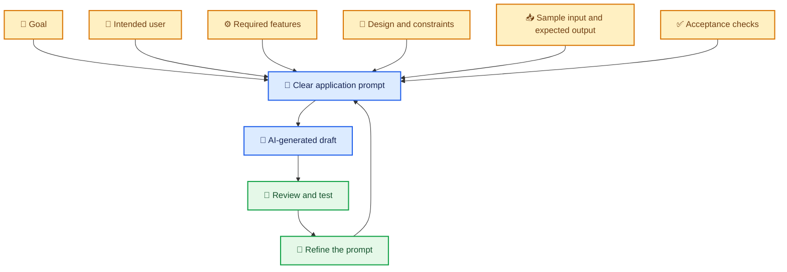
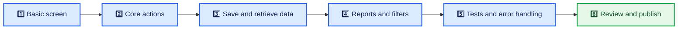

# ✍️ Prompting for Application Development

> Learn to turn an idea into clear instructions that an AI coding assistant can act on.

[⬅️ Previous: How AI Understands Your Ideas](02-how-ai-understoods.md) ·

---

## 🎯 Learning Objectives

- Identify the ingredients of a useful application prompt.
- Turn a vague request into specific, testable instructions.
- Ask AI to work in manageable stages.
- Provide feedback that improves the result without creating unnecessary changes.

## 💡 1. What Is a Prompt?

A **prompt** is the instruction or request you give an AI tool. In Vibe Coding, a prompt can describe a new application, ask for a feature, explain a bug, request a design change, or ask the assistant to review code.

A good prompt does not need complicated technical vocabulary. It should explain the goal, who will use the application, what the user should be able to do, and how you will know the result is correct.

## 🧱 2. The Six Building Blocks of a Strong Prompt

1. 🎯 **Goal:** What problem should the app solve?
2. 👥 **User:** Who will use it, and what do they need?
3. ⚙️ **Features:** What actions should be possible?
4. 🎨 **Constraints:** What design, device, privacy, or technology requirements matter?
5. 📥 **Examples:** What input should the app accept, and what output is expected?
6. ✅ **Acceptance checks:** How can you verify that it works?

You do not need to include every detail in every prompt. Add the details that matter for the current task.

## 🧑‍🏫 3. Real-Life Scenario: A Tuition Teacher's Attendance App

### The problem

A tuition teacher tracks attendance on paper and spends time calculating monthly percentages. They want a simple digital tool.

### Prompt 1: Too vague

> Build an attendance app.

The AI must guess the student fields, attendance options, report format, and storage behavior.

### Prompt 2: More useful

> Create a simple attendance app for a tuition teacher. Allow me to add student names, choose a date, and mark each student Present or Absent. Show the number present and absent for the selected day. Use a clear layout that works on phones and computers. Start with sample students and explain how attendance data will be stored.

### Prompt 3: A focused improvement

> Add a monthly report for each student. Show the number of days marked Present and the attendance percentage. Define the denominator clearly: count only dates on which attendance was recorded for that student. Keep the daily attendance screen unchanged and add tests for a student with all-present records and a student with no recorded attendance.

The third prompt is stronger because it defines an important calculation and tells the AI what existing behavior must not change.

## 🪜 4. Build in Stages Instead of Asking for Everything at Once

A staged approach helps you understand what changed, identify errors earlier, and keep each request focused. For a very small task, several stages may be unnecessary; use judgment.

## 🧰 5. Reusable Prompt Templates

### 🆕 Create a new feature

> I want to solve **[problem]** for **[type of user]**. Create **[feature or screen]** that lets users **[actions]**. Use **[design or technical constraints]**. Treat **[sample data or assumptions]** as examples only. The result is acceptable when **[observable checks]** pass. Ask me about any important missing decision before making major assumptions.

### 🎨 Improve the interface

> Improve **[specific screen or component]** so that **[desired user experience]**. Change **[specific visual details]**. Keep **[existing features and layout elements]** working. Check the result at **[target screen sizes]** and tell me what changed.

### 🐛 Investigate a bug

> When I **[steps to reproduce]**, I see **[actual behavior]**. I expected **[expected behavior]**. Please investigate the relevant code, explain the likely cause, make the smallest appropriate fix, and add or update a test. Do not change **[unrelated behavior]**.

### 🧪 Ask for tests

> Create tests for **[feature]**. Include a normal case, missing or invalid input, a boundary case, and an expected failure. Explain what each test checks and report any assumptions. Do not claim the tests pass unless they have actually been run.

### 🔎 Request a review

> Review this change for correctness, usability, accessibility, privacy, and security issues relevant to **[feature]**. List findings by severity and explain how to reproduce or verify each one. Do not make unrelated changes without asking.

## 🔁 6. How to Refine a Prompt

Use this feedback loop:

1. **Observe:** Identify what is missing or incorrect.
2. **Be specific:** Point to the screen, action, value, or behavior.
3. **Set a boundary:** State what should remain unchanged.
4. **Request verification:** Ask for a test or a repeatable check.
5. **Review:** Confirm that the change worked and did not break something else.

Avoid sending several contradictory requests at once. If the assistant's proposed solution changes many unrelated files, ask it to explain why those changes are needed before proceeding.

## ⚠️ 7. Common Prompting Mistakes

- **Too broad:** “Build a complete business platform.” Start with the most important user journey.
- **Missing definitions:** Explain terms such as “active customer” or “monthly attendance.”
- **Unclear design feedback:** Replace “make it attractive” with specific improvements, such as stronger contrast or clearer action buttons.
- **No constraints:** Tell AI what must remain working when modifying an existing project.
- **No acceptance checks:** Define observable behavior instead of relying only on appearance.
- **Unverified claims:** Ask for evidence, tests, or steps to reproduce; do not assume an explanation proves the fix.

## 🔑 Key Takeaways

- A prompt is a practical specification, not just a question.
- Goals, users, features, constraints, examples, and acceptance checks make instructions clearer.
- Build complex applications in stages and use focused follow-up prompts.
- Specify what must not change, and verify changes with observable tests.
