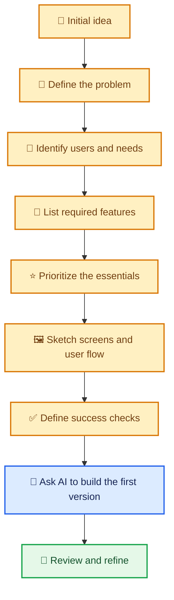
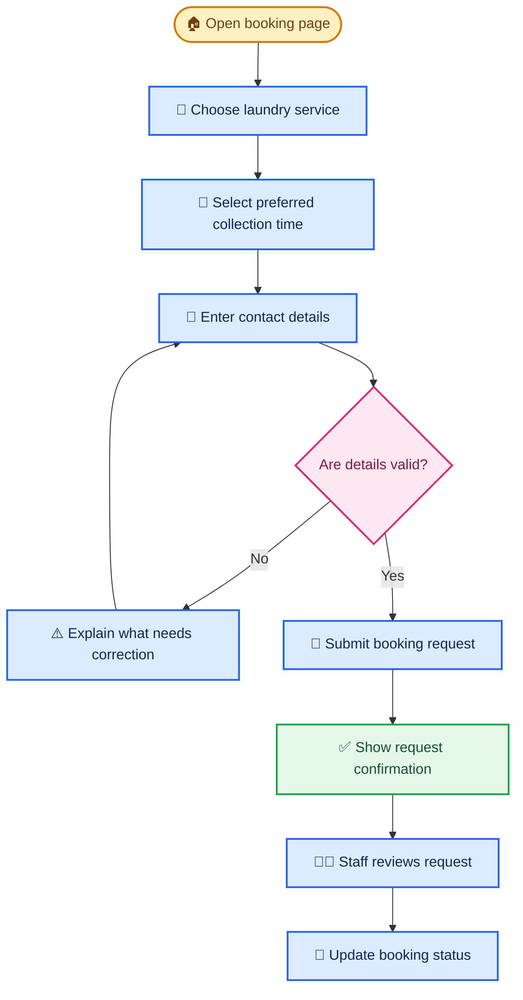
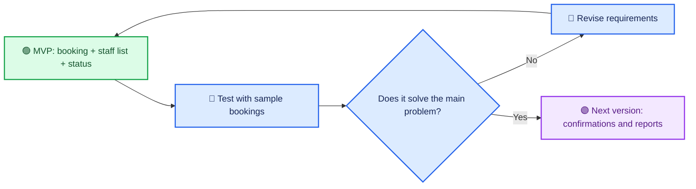

# 🗺️ Planning an Application

> Turn a broad idea into a clear, manageable plan before asking AI to build it.

[⬅️ Previous: Prompting for Application Development](03-prompting-for-app.md) ·

---

## 🎯 Learning Objectives

- Identify the problem an application should solve.
- Describe intended users and their main tasks.
- Separate essential features from optional improvements.
- Sketch a basic user journey and screen plan.
- Define simple success criteria before building with AI.

## 💡 1. Why Plan Before You Prompt?

An application idea often begins as a broad wish: “I want a booking app” or “I need a dashboard.” If you immediately ask AI to build everything, it must guess how the app should work. That can lead to missing features, unnecessary complexity, and repeated changes.

Planning means deciding **who the application is for, what problem it solves, which features are essential, and how you will judge success**. The plan can be short; its purpose is to reduce avoidable guesswork.

## 🧭 2. From Idea to Buildable Plan

## 🧺 3. Real-Life Scenario: A Neighborhood Laundry Booking App

### The situation

A laundry shop takes bookings through phone calls and messages. Staff sometimes miss collection times or forget which services a customer selected. The owner wants a simple booking application.

### Step 1: Define the problem

Bookings arrive through several channels, and staff need one consistent list of requested services and collection times.

### Step 2: Identify users

- **Customer:** chooses a service and requests a collection time.
- **Shop staff:** reviews requests and updates booking status.
- **Owner:** checks the day's bookings and outstanding requests.

### Step 3: List and prioritize features

| Priority | Feature | Why it matters |
|---|---|---|
| Must have | Service selection and booking request | Captures the essential customer request. |
| Must have | Booking list with date and status | Helps staff organize work. |
| Must have | Contact details and input validation | Makes it possible to follow up and reduces incomplete requests. |
| Should have | Booking confirmation message | Reassures customers that a request was received. |
| Later | Loyalty points and promotional offers | Useful, but not necessary to validate the first version. |

### Step 4: Sketch the main user journey

This is a planning diagram, not a guarantee that any generated app will include these behaviors automatically. Each step must be requested, implemented, and tested.

### Step 5: Ask AI for a first version

> Help me plan a simple laundry booking web application. There are two user groups: customers who submit booking requests and shop staff who review and update them. For the first version, include service selection, a preferred collection time, customer contact details, input validation, a booking list, and booking statuses. First propose the screens, data fields, and user flow. Identify any important decisions I need to make before generating the application. Do not add payments or loyalty points in this first version.

The owner can review the proposed plan before asking the assistant to create the screens and data handling.

## 🧱 4. Separate Requirements from Design Preferences

It helps to distinguish what the app **must do** from how it should **look and feel**.

### Functional requirements — what it does

- Customers can submit a booking request.
- Staff can view requests and update statuses.
- Invalid or missing required details are rejected with a clear explanation.
- The application retains booking records according to the chosen storage design.

### Non-functional requirements — how well it should work

- The interface should be easy to use on a phone.
- Customer information should only be visible to authorized users.
- The application should show understandable errors if saving fails.
- The system should be maintainable and reasonably responsive.

### Design preferences — how it should look

- Use a calm, clean color palette.
- Make the primary booking action easy to find.
- Use readable typography and clear status labels.

Design preferences matter, but they do not replace functional or security requirements.

## ⭐ 5. Define the MVP

An **MVP (minimum viable product)** is the smallest useful version that lets you test whether the main idea solves the problem. It is not an excuse to ignore basic security or correctness.

For the laundry app, the MVP might include booking submission, a staff booking list, status updates, and persistent storage. Payment processing, loyalty rewards, and advanced analytics can wait until the core flow has been validated.

## 📋 6. Create Acceptance Criteria

Acceptance criteria are simple statements that define what success looks like. They should describe behavior that can be observed or tested.

For the laundry booking app:

- A customer can submit a request with all required details.
- A request with a missing phone number displays a helpful validation message.
- A valid request appears in the staff booking list after it is saved.
- Staff can update a request from “New” to “Confirmed.”
- A customer cannot open the staff-only booking management page without appropriate authorization.

These criteria can later become manual checks or automated tests.

## ⚠️ 7. Common Planning Mistakes

- **Starting with technology instead of the problem:** Decide what users need before choosing tools.
- **Adding every imaginable feature:** Prioritize the core workflow first.
- **Ignoring roles:** Decide who can view, create, edit, or delete each type of information.
- **Leaving storage unclear:** Specify whether data must survive refreshes, be shared across devices, or be backed up.
- **Treating a sketch as a working app:** A diagram describes the intended behavior; implementation and testing are still required.
- **Skipping edge cases:** Consider missing data, duplicate requests, unavailable times, and failed saves.

## 🧠 8. Planning Worksheet

Before asking AI to build your own idea, answer these questions:

1. What problem am I trying to solve?
2. Who will use the application?
3. What are the three most important things users must be able to do?
4. What information must be saved, and who can access it?
5. Which features can wait until a later version?
6. How will I test whether the first version works?

## 🔑 Key Takeaways

- A short plan makes Vibe Coding more focused and reduces unnecessary rework.
- Start with users, problems, essential features, and a clear user journey.
- Distinguish functional requirements from design preferences.
- Build an MVP, then improve it using feedback and test results.
- Include data storage, permissions, error handling, and acceptance criteria in the plan.
