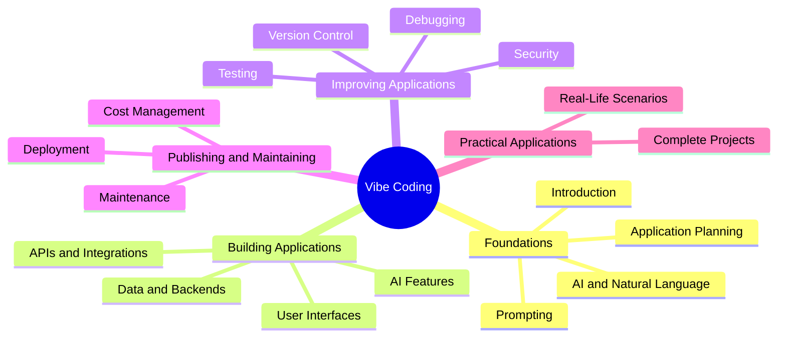

# 🎨 Vibe Coding — Learning Modules

> Learn how to turn ideas into applications using AI, one step at a time.

## 📋 Overview & Navigation

Welcome to the Vibe Coding learning modules. Explore how natural-language
instructions and AI coding tools can help you design, build, improve,
test, and publish useful applications.

## 🧠 Vibe Coding Concepts

## 📘 Introduction & Foundations

- [Introduction to Vibe Coding](./Introduction/01-introduction-to-vibe-coding.md)
- [How AI Understands Your Ideas](./Introduction/02-how-ai-understoods.md)
- [Prompting for Application Development](./Introduction/03-prompting-for-app.md)
- [Planning an Application](./Introduction/04-planning-an-application.md)

## 🎨 Application Development

- [Building User Interfaces](./Application-development/01-user-interface.md)
- [Connecting Data and Backends](./Application-development/02-connect-data-and-backend.md)
- [Adding AI Features and Automation](./Application-development/03-adding-ai-and-automation.md)
- [Debugging and Iteration](./Application-development/04-debugging-and-iteration.md)

## 🛡️ Quality, Security & Deployment

- [Testing and Quality](./quality-security-deployement/09-testing-quality.md)
- [Security and Privacy](./quality-security-deployement/10-security-privacy.md)
- [Git and Version Control](./quality-security-deployement/11-git-version-control.md)
- [Deployment and Hosting](./quality-security-deployement/12-deployement-hosting.md)

## 🔗 Integrations & Advanced Concepts

- [APIs and Integrations](./integration-and-advanced/13-integrations-and-apis.md)
- [Full-Stack Applications](./integration-and-advanced/14-building-full-stack-applications.md)
- [AI Agents and Workflows](./integration-and-advanced/15-ai-agents-and-multi-step-workflows.md)
- [Maintaining Applications](./integration-and-advanced/16-maintaining-and-improving-applications.md)

## 🌍 Practical Use Cases

- [Choosing Tools and Managing Costs](./practical-use-cases/17-costs-and-tool-selection.md)
- [Responsible Vibe Coding](./practical-use-cases/18-responsible-vibe-coding.md)
- [Real-World Applications](./practical-use-cases/19-real-world-projects.md)
- [End-to-End Application Example](./practical-use-cases/20-capstone-project.md)
