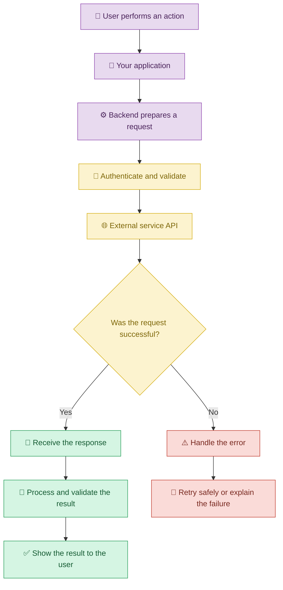
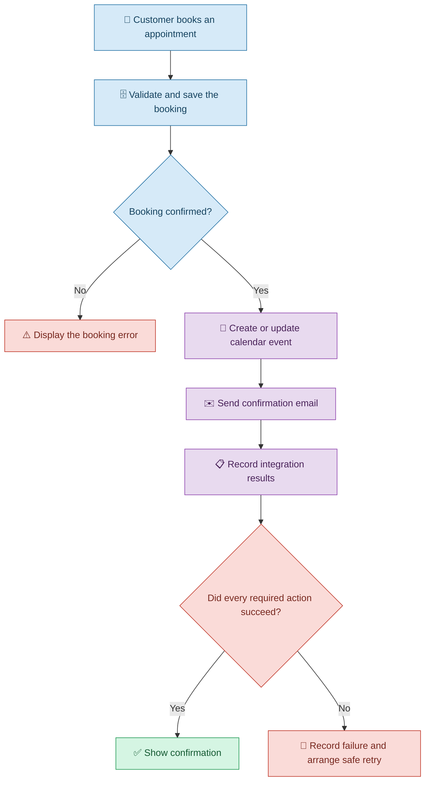

# 🔗 APIs and Integrations with Vibe Coding

[⬅️ Back to Learning Modules](../README.md) · 

> Connect your application to existing services and extend its capabilities without building every feature from scratch.

## 📋 1. Introduction

Imagine creating a salon booking application using Vibe Coding. Customers can select appointment times, but the salon owner also wants appointment confirmations by email and bookings added to a calendar.

Instead of building an email service or calendar system from scratch, you can connect the application to existing services.

This is where **APIs and integrations** become useful.

An API (Application Programming Interface) is a defined way for one software system to communicate with another. An integration connects systems so they can exchange information or trigger actions.

With Vibe Coding, you can describe the services you want to connect and ask an AI coding assistant to implement the necessary communication, configuration, and error handling.

The AI can generate integration code, but you still need appropriate service accounts, credentials, permissions, and testing.

## 🧠 2. Understanding APIs and Integrations

Think of an API as a waiter in a restaurant. You place an order, the waiter passes it to the kitchen, and the result comes back to you.

Similarly, an application sends a request to another service, which processes it and returns a response.

| Concept | Simple explanation | Example |
|---|---|---|
| API | A defined way for software to communicate | Request information from a weather service |
| API request | A message sent to a service | Request available appointment times |
| API response | The result returned by a service | A list of available times |
| API key | A credential used by some services | Authenticate an AI service request |
| Webhook | A notification sent when an event occurs | Receive notice of a payment event |
| Integration | A connection between systems | Send booking confirmations through email |
| Rate limit | A limit on request frequency | Restrict repeated requests to a service |
| OAuth | A protocol used for delegated authorization | Allow access to a calendar with user consent |

## 🔄 3. How an Integration Works

## 💡 4. Real-Life Scenario: A Salon Booking Integration

### The problem

A salon owner uses Vibe Coding to create an appointment booking website. The application records bookings, but the owner must manually send confirmation emails and add appointments to a calendar.

The owner wants these tasks to happen automatically.

### Step 1: Describe the integration

**Example prompt**

> Extend my existing salon booking application so a successfully confirmed appointment can be added to an authorized calendar and a confirmation email can be sent to the customer. Use appropriate APIs or integrations. Preserve the existing booking workflow, handle failed requests, and avoid sending duplicate confirmations.

### Step 2: Configure the services

The AI coding assistant can help implement the integration, but the owner must configure the selected email and calendar providers.

Depending on the provider, this may require an API key, OAuth authorization, a service account, or other approved credentials.

**Follow-up prompt**

> Explain the authentication requirements for the chosen calendar and email services. Keep credentials on the server where appropriate, request only the permissions needed, and document the required environment variables without including secret values.

### Step 3: Decide when the integration runs

The owner specifies that confirmations should be sent only after a booking has been successfully confirmed.

**Follow-up prompt**

> Trigger the calendar and email integrations only after a booking is confirmed. Handle partial failures, record the delivery status, and provide a safe way to retry unsuccessful operations without creating duplicate bookings or sending duplicate messages.

### Step 4: Test the complete flow

Test successful bookings, rejected bookings, unavailable calendar services, email failures, and retry behavior using test accounts and data.

### 🔄 Integration workflow

## 🧰 5. Common Types of Integrations

### 5.1 Email and messaging

Applications can send account notifications, booking confirmations, and approved business communications.

**Prompt:**

> Integrate an email provider to send appointment confirmations after successful bookings. Use the provider's supported authentication method, handle delivery failures, and never expose credentials in frontend code.

### 5.2 Payment services

A shopping application may use a payment provider to process transactions.

**Prompt:**

> Integrate the payment provider's official test environment. Verify payment status on the backend using the provider's supported mechanisms, handle unsuccessful transactions, and never treat a browser redirect alone as proof of payment.

Use the provider's official integration guidance, and do not store raw payment-card details unless the applicable compliance requirements and architecture explicitly support it.

### 5.3 Calendar and scheduling services

A booking application may read availability or create calendar events.

**Prompt:**

> Connect the booking application to an authorized calendar service. Check availability, handle time zones correctly, and avoid exposing private calendar information to unauthorized users.

### 5.4 Maps and location services

A delivery application may display a location or estimate a route using a mapping service.

**Prompt:**

> Add a map integration that displays the user's selected delivery location. Use the provider's documented API, handle invalid locations, and request location access only when needed.

### 5.5 AI services

An application can connect to an AI provider to generate text, summarize documents, or classify messages.

**Prompt:**

> Integrate an AI service through a backend endpoint. Validate inputs, protect credentials, handle provider errors and usage limits, and explain how AI-generated results are reviewed before important actions.

## ⚠️ 6. Common Mistakes

| Mistake | Better approach |
|---|---|
| Assuming AI-generated code automatically grants API access | Configure accounts, permissions, and credentials |
| Using undocumented or outdated endpoints | Follow official provider documentation |
| Exposing API keys in frontend code | Keep secret credentials in appropriate server-side configuration |
| Retrying every failed request blindly | Use safe retry policies and idempotency where appropriate |
| Assuming a request succeeded because the button was clicked | Verify the service response and resulting state |
| Ignoring rate limits | Implement suitable throttling and backoff |
| Giving an integration excessive permissions | Request only the access it needs |
| Assuming a webhook is always delivered exactly once | Verify events and handle duplicate deliveries safely |

## ✅ 7. Best Practices

1. Identify the exact service and purpose of each integration.
2. Check official API documentation before implementation.
3. Configure credentials and permissions securely.
4. Validate incoming and outgoing data.
5. Handle timeouts, rate limits, and unsuccessful responses.
6. Design retries to avoid duplicate side effects.
7. Test integrations with sandbox accounts where available.
8. Monitor failures without logging sensitive information.
9. Explain data-sharing implications to users when appropriate.
10. Review provider costs, usage limits, and terms.

## 🎯 8. Key Takeaways

- APIs allow different software systems to communicate.
- Integrations help applications reuse existing services.
- Vibe Coding can help implement these connections from natural-language requirements.
- Credentials, permissions, errors, retries, and testing are essential.
- AI-generated integration code must be verified against the provider's actual API.
