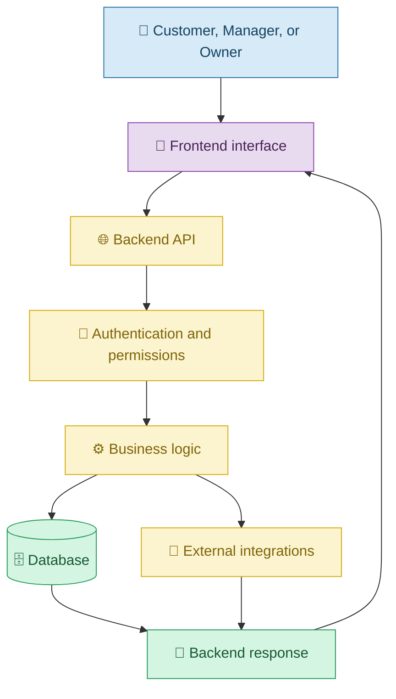
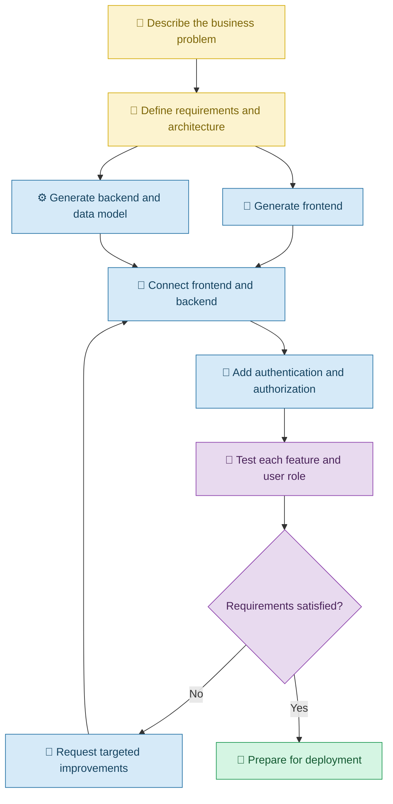

# 🏗️ Building Full-Stack Applications with Vibe Coding

[⬅️ Previous:](13-integrations-and-apis.md) ·

> Turn an idea into a complete application by connecting the interface, business logic, and data storage with help from AI.

## 📋 1. Introduction

A website may display products and buttons, but a complete business application often needs much more. It may need login, data storage, permissions, calculations, and communication with external services.

A **full-stack application** brings together the frontend, backend, and usually a data-storage layer to provide a complete experience.

With Vibe Coding, you can describe the application you want to build and ask an AI coding assistant to develop it in stages. The AI can help create the interface, backend endpoints, database structure, and connections between them.

The key is to build and verify each part rather than assuming that one large prompt will produce a complete, secure, production-ready system.

## 🧠 2. Understanding Full-Stack Development

| Layer | Responsibility | Boutique example |
|---|---|---|
| Frontend | What users see and interact with | Product catalog and login page |
| Backend | Applies business rules and processes requests | Checks permissions and updates inventory |
| Database | Stores persistent records | Products, users, orders, and stock |
| Integrations | Connects external services | Email notifications or payment provider |
| Hosting and infrastructure | Runs the application | Public website and backend service |

### 🏗️ Full-stack architecture

## 💡 3. Real-Life Scenario: Building a Boutique Management System

### The problem

A boutique owner wants to move from spreadsheets and social-media messages to a single application.

The required features are:

- Customers can browse products and view details.
- Managers can add products, upload images, and update inventory.
- Owners can access financial reports.
- Product information is stored persistently.
- Users see only the features they are authorized to access.

The owner does not need to write every line of code manually, but must clearly describe the requirements and verify the generated application.

### Step 1: Define the application

**Example prompt**

> Help me build a full-stack boutique management application. It needs a public product catalog, customer accounts, a manager dashboard for catalog and inventory management, and an owner dashboard for financial reports. Use a suitable frontend, backend, and database. First propose the architecture, data model, user roles, and implementation plan. Do not generate the entire application in one step.

### Step 2: Build the frontend

> Create the product catalog, login page, manager dashboard, and owner dashboard using a consistent responsive design. Use realistic sample data initially, clearly separating it from the eventual live database. Make the navigation reflect the user's role without relying on frontend navigation as the security boundary.

### Step 3: Build the backend and database

> Implement the backend endpoints and database schema required for products, users, inventory, and orders. Validate incoming data, handle errors, and enforce permissions on every protected operation. Explain the schema and any required setup before applying database migrations.

### Step 4: Connect the application

> Connect the frontend to the backend APIs. Replace temporary sample data with persisted records where appropriate. Add loading states, empty states, and clear error messages. Preserve the existing layout and test each data operation.

### Step 5: Test every role

The owner signs in as a customer, manager, and owner using separate test accounts. Each role is tested against its permitted and prohibited actions.

### 🔄 Full-stack development workflow

## 🧰 4. Building a Full-Stack Application in Stages

### 4.1 Define the data model

List the main records and their relationships before generating database code.

For example, an order may contain multiple order items, and each item refers to a product.

**Prompt:**

> Propose a database model for products, users, orders, and order items. Explain each field, the relationships between records, and the constraints needed to maintain data consistency. Identify any sensitive information that should not be stored unnecessarily.

### 4.2 Implement business rules

Business rules define what the application is allowed to do.

For example, a manager may update product quantities, but only an authorized owner may access financial reports.

**Prompt:**

> Implement the documented business rules in the backend. Enforce permissions on every relevant endpoint, validate data, and prevent invalid inventory updates. Add tests for both allowed and denied operations.

### 4.3 Connect the frontend to real data

**Prompt:**

> Replace the product catalog's sample data with records retrieved from the backend. Add loading indicators, empty states, and error messages. Ensure that adding or updating a product refreshes the displayed data correctly.

### 4.4 Handle authentication and authorization

**Prompt:**

> Implement secure sign-in and session management using an appropriate approach for this stack. Enforce role-based authorization on the backend and prevent users from accessing other users' private records. Explain how test accounts and credentials should be configured.

### 4.5 Verify the complete application

**Prompt:**

> Create a test plan covering registration, login, product management, inventory updates, order creation, financial reports, and unauthorized access. Run the available tests and identify failures before deployment.

## ⚠️ 5. Common Mistakes

| Mistake | Better approach |
|---|---|
| Generating the entire system in one prompt | Build it in defined stages |
| Mixing sample data with production data | Keep development and production configurations separate |
| Treating the frontend as the security boundary | Enforce authorization on the backend |
| Creating database tables without understanding relationships | Review the data model first |
| Assuming separate components automatically work together | Test the actual data flow |
| Allowing AI to rewrite working modules unnecessarily | Request targeted changes |
| Deploying before testing all roles | Verify authorized and unauthorized actions |
| Ignoring backups and migrations | Plan database changes and recovery procedures |

## ✅ 6. Best Practices

1. Start with requirements and architecture.
2. Build a minimum viable product before adding optional features.
3. Generate the frontend, backend, and data model in manageable stages.
4. Review database structure and relationships.
5. Use persistent storage for data that must survive restarts or be shared.
6. Enforce authentication and authorization on the backend.
7. Keep credentials and private configuration secure.
8. Test integrations and complete user journeys.
9. Track changes with Git.
10. Deploy only after appropriate testing and security review.

## 🎯 7. Key Takeaways

- A full-stack application combines user interfaces, backend logic, and data storage.
- Vibe Coding can help build each layer and connect them.
- Clear requirements and staged development improve the quality of results.
- Authentication, authorization, validation, and persistence require explicit implementation.
- A complete application must be tested across its layers and user roles.
