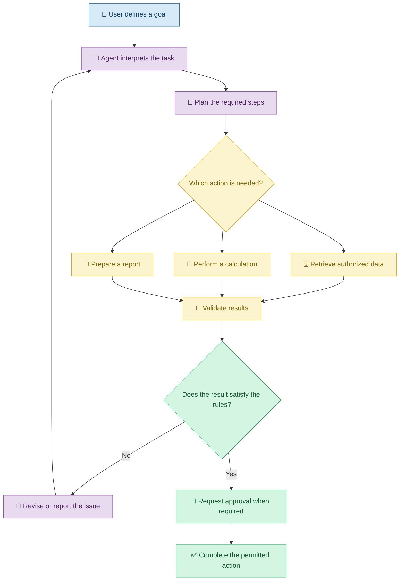
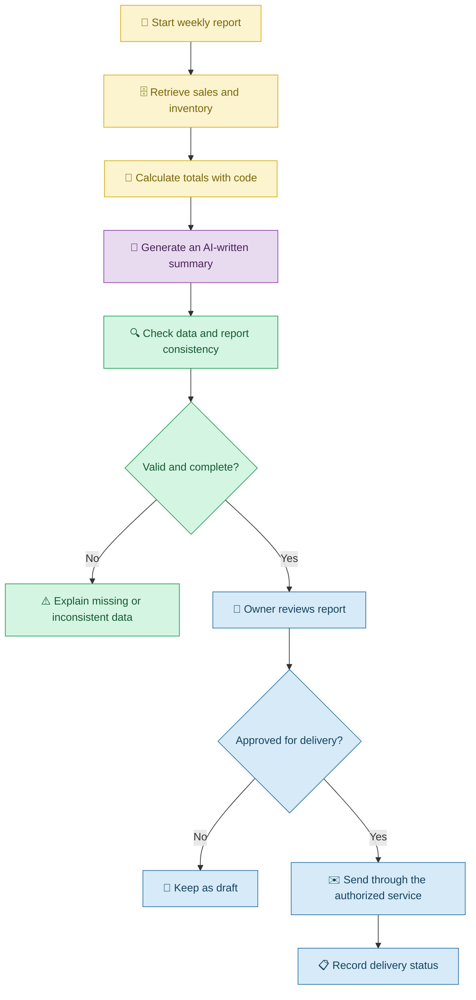

# 🤖 AI Agents and Multi-Step Workflows with Vibe Coding

[⬅️ Previous:](14-building-full-stack-applications.md) ·

> Go beyond simple prompts by building applications that can plan tasks, use tools, and coordinate multiple steps with appropriate human oversight.

## 📋 1. Introduction

Imagine asking an AI assistant to prepare a weekly sales report for a small shop.

A simple chatbot might explain how to create a report. An AI-powered application could retrieve authorized sales data, calculate totals, identify best-selling products, and prepare a summary.

An **AI agent** is a system that uses an AI model to help decide what steps to take toward a goal, often using tools or external services. A **workflow** defines how tasks, decisions, and actions are organized.

With Vibe Coding, you can describe the outcome you want and ask an AI coding assistant to implement the workflow, connect the necessary tools, and add checks for failures and permissions.

Not every workflow needs an AI agent. Simple, predictable tasks are often better handled by ordinary program logic.

## 🧠 2. Understanding Assistants, Agents, and Workflows

| Concept | Simple explanation | Example |
|---|---|---|
| AI assistant | Helps answer questions or complete a request | Explain weekly sales figures |
| AI agent | Can choose steps and use tools to pursue a goal | Retrieve sales data and prepare a report |
| Tool | A capability the agent can invoke | Read an authorized sales report |
| Workflow | An organized sequence of tasks and decisions | Retrieve, analyze, review, and publish a report |
| Orchestration | Coordinates multiple tasks or components | Run data retrieval before report generation |
| Human-in-the-loop | A person reviews or approves a step | Approve a report before it is emailed |
| Guardrail | A rule limiting unsafe or unwanted behavior | Prevent an agent from deleting records |

### 🔄 How an AI agent workflow operates

## 🏪 3. Real-Life Scenario: An Automated Weekly Sales Report

### The problem

A shop owner maintains sales records and inventory data. Every week, they manually calculate total sales, identify popular products, and prepare a report.

They want an application that automates most of this work while keeping the owner in control of important decisions.

### Step 1: Describe the goal

**Example prompt**

> Build a weekly sales-reporting workflow for my shop. Retrieve sales records for the selected week, calculate total sales using the defined business rules, identify the best-selling products, check for low-stock items, and prepare a concise report. Use only authorized data sources. Do not send emails, modify inventory, or place orders without explicit approval.

### Step 2: Define the tools

The workflow might use separate tools to:

- Retrieve sales records.
- Retrieve inventory quantities.
- Calculate sales totals.
- Generate a readable report.
- Display the report for approval.

The application should use deterministic calculations for financial totals rather than asking a language model to estimate them.

**Follow-up prompt**

> Separate data retrieval, numerical calculations, AI-generated summaries, and final delivery into distinct steps. Use programmatic calculations for totals and validate the data before generating the narrative summary.

### Step 3: Add safeguards

The owner requests:

> Restrict the workflow to read-only access for reporting. Require approval before sending the report externally or making any inventory changes. Add timeouts, error handling, and a record of the actions performed.

### Step 4: Test the workflow

The owner tests a normal week, an empty sales period, missing inventory records, unavailable data sources, and an incomplete report.

They also verify that the workflow does not send emails or change records without approval.

### 🔄 From a request to a completed workflow

## 🧰 4. Important Concepts

### 4.1 Tool use

A tool allows an agent to perform a specific action through an explicitly defined interface.

For example, a sales-reporting agent may call a read-only function that retrieves sales data for a specified date range.

**Prompt:**

> Design a limited set of tools for the reporting workflow. Define each tool's inputs, outputs, permissions, and failure behavior. Give the agent read-only access to the required reporting data.

### 4.2 Planning and orchestration

Planning breaks a goal into manageable tasks. Orchestration coordinates those tasks in the correct order.

**Prompt:**

> Break the weekly reporting task into explicit steps with defined inputs, outputs, and dependencies. Validate each step before proceeding, and explain what should happen if a required step fails.

### 4.3 Deterministic rules versus AI decisions

Not every step should be left to an AI model.

For example:

- Calculate revenue totals using ordinary code.
- Validate permissions using explicit authorization rules.
- Use AI to summarize the results in readable language.

**Prompt:**

> Identify which workflow steps require AI and which can be implemented with deterministic program logic. Use code for exact calculations and permission checks. Reserve AI for tasks such as summarization and interpretation.

### 4.4 Human approval

Human approval is important when a workflow can affect money, records, customers, or external systems.

**Prompt:**

> Add an approval step before any external message is sent or any consequential record is changed. Show the proposed action and relevant details, verify the approver's permissions, and execute only the approved action.

### 4.5 Reliability and monitoring

Agents may select unsuitable tools, receive incomplete information, or fail midway through a task.

**Prompt:**

> Add timeouts, bounded retries, clear failure states, and action logs. Prevent repeated side effects, validate tool outputs, and stop the workflow safely when required information is unavailable.

## ⚠️ 5. Common Mistakes

| Mistake | Better approach |
|---|---|
| Using an AI agent for a simple fixed rule | Use ordinary program logic where possible |
| Giving an agent unrestricted access | Provide narrowly scoped permissions |
| Allowing AI to invent financial totals | Calculate totals programmatically |
| Letting a workflow perform irreversible actions automatically | Add authorization and approval steps |
| Assuming every tool call succeeds | Validate responses and handle failures |
| Retrying an action without checking whether it already happened | Use safe retry and idempotency mechanisms |
| Ignoring how decisions were made | Keep appropriate logs and workflow records |
| Building an agent before defining the workflow | Define tasks, tools, boundaries, and success criteria first |

## ✅ 6. Best Practices

1. Start with a clearly defined business goal.
2. Break the workflow into small, testable steps.
3. Use AI only where its flexibility adds value.
4. Give tools the minimum required permissions.
5. Validate inputs, tool responses, and generated outputs.
6. Use deterministic code for exact calculations and critical rules.
7. Require approval for consequential actions.
8. Add limits on execution time, retries, and resource use.
9. Test failures and partial completion.
10. Monitor outcomes and refine the workflow over time.

## 🎯 7. Key Takeaways

- AI agents can use tools and coordinate multiple steps toward a goal.
- Workflows organize those steps and their dependencies.
- Vibe Coding can help implement agentic applications from natural-language requirements.
- Deterministic logic is preferable for exact calculations and security rules.
- Permissions, validation, monitoring, and human approval help keep workflows reliable.
