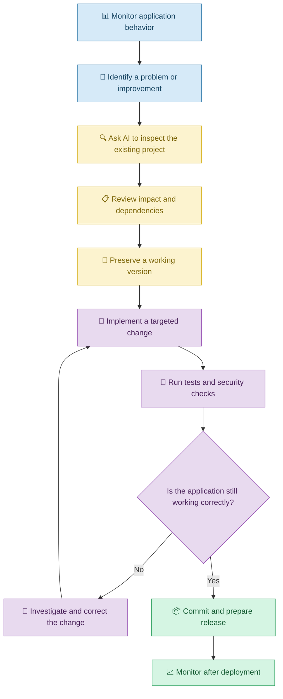

# 🔧 Maintaining and Improving Applications with Vibe Coding

[⬅️ Previous:](15-ai-agents-and-multi-step-workflows.md) ·

> Keep your application useful, reliable, and secure by using AI to understand existing code, introduce improvements, and resolve problems over time.

## 📋 1. Introduction

Building an application is not the end of software development.

Imagine creating a boutique management application with Vibe Coding. Initially, it manages products and inventory successfully. A few months later, the business wants barcode scanning, improved sales reports, and a new customer loyalty feature.

At the same time, a software dependency needs updating, and users have reported occasional errors.

Rather than rebuilding the application from scratch, you can use Vibe Coding to understand the existing project, plan improvements, fix defects, and test each change.

**Application maintenance** means keeping software working correctly and adapting it as requirements, technologies, and business needs change.

## 🧠 2. Types of Application Maintenance

| Type | Meaning | Example |
|---|---|---|
| Corrective maintenance | Fixing existing defects | Correcting an inaccurate stock calculation |
| Adaptive maintenance | Adjusting to a changed environment | Updating an integration after an API change |
| Perfective maintenance | Improving features or usability | Adding product search and filters |
| Preventive maintenance | Reducing future problems | Updating a dependency and removing obsolete code |

These categories help explain why software needs ongoing attention, even when its main features already work.

## 🔄 3. The Maintenance Workflow

## 🏪 4. Real-Life Scenario: Improving an Existing Inventory Application

### The problem

A shop owner already has an inventory application built with Vibe Coding. The application can add products, update quantities, and display stock levels.

The owner now wants:

- Barcode-based product lookup.
- Low-stock reports.
- Faster product search.
- Better error messages.
- Improved performance when the catalog grows.

The owner wants these features without losing existing product records or breaking current workflows.

### Step 1: Understand the existing application

**Example prompt**

> Inspect my existing inventory application before making changes. Explain its architecture, identify the files responsible for product management and data storage, and summarize how the main features work. Identify relevant dependencies and tests. Do not modify anything yet.

This step is important because the AI must work with the actual project rather than assume how it is structured.

### Step 2: Prioritize the improvements

The owner asks:

> Review the requested enhancements and group them by business value, implementation effort, and risk. Recommend an implementation order that preserves existing functionality. Identify which features need additional hardware, external services, or configuration.

For example, barcode lookup may require a compatible scanner or camera integration, while low-stock reporting may be achievable using existing inventory data.

### Step 3: Implement one improvement at a time

The owner starts with low-stock reporting.

**Prompt**

> Add a low-stock report to the existing inventory application. Allow authorized staff to set a threshold and display products whose quantities fall below it. Reuse the existing product data model where appropriate, preserve current inventory operations, and add tests for boundary values.

Once the report works, the owner moves to the next feature.

### Step 4: Update dependencies carefully

The coding assistant identifies a dependency that needs updating.

The owner asks:

> Inspect the dependency update and explain the version changes, known compatibility concerns, and required code modifications. Apply the update in a separate change, run the existing tests, and report any unresolved vulnerabilities or compatibility issues.

Updates should be based on relevant security advisories, compatibility requirements, and official release information rather than automatically upgrading every package.

### Step 5: Verify and release

The owner tests product creation, editing, stock adjustments, low-stock alerts, search, and report generation.

After reviewing the changes, they commit the verified version and deploy it through the project's established release process.

### 🎯 Expected outcome

The inventory application gains useful features while retaining its original capabilities and data.

## 🧰 5. Important Maintenance Activities

### 5.1 Understanding unfamiliar code

When an application grows, it may become difficult to remember how every component works.

**Prompt:**

> Explain the existing application's main components and their relationships. Trace the product update flow from the user interface to the backend and database. Identify the relevant files and avoid making changes during this explanation.

### 5.2 Refactoring code

Refactoring means restructuring code without intentionally changing its external behavior.

For example, several components may contain duplicate validation logic that could be consolidated.

**Prompt:**

> Identify duplicated logic in the product management module and propose a refactoring plan. Preserve existing behavior and public interfaces. Add or run regression tests before and after the refactoring.

### 5.3 Improving performance

Performance problems may appear when the amount of data increases or when requests become more frequent.

**Prompt:**

> Investigate why the inventory page loads slowly with a large product catalog. Measure or identify likely bottlenecks before recommending changes. Consider pagination, database query efficiency, and unnecessary rendering. Preserve correctness and verify improvements with repeatable measurements.

### 5.4 Updating dependencies

Libraries and frameworks may receive security fixes, bug fixes, and new features.

**Prompt:**

> Review the project's dependencies and identify outdated packages that warrant attention. Explain compatibility and security implications, recommend a safe update sequence, and run relevant tests after each significant update.

### 5.5 Monitoring and resolving production problems

Once an application is live, monitoring helps identify failures and performance changes.

**Prompt:**

> Review sanitized production error logs and identify recurring failures. Group related errors, distinguish confirmed causes from hypotheses, and recommend the next diagnostic steps. Do not expose personal information or credentials in the analysis.

### 5.6 Database changes and backups

When an application changes its data model, database migrations may be necessary.

**Prompt:**

> Propose a migration plan for adding a barcode field to existing product records. Explain how existing records will be handled, how the migration can be tested, and what backup and rollback procedures are required before production deployment.

## ⚠️ 6. Common Mistakes

| Mistake | Better approach |
|---|---|
| Rebuilding an existing application unnecessarily | Inspect the project and reuse working components |
| Asking AI to change many unrelated features at once | Implement focused, reviewable changes |
| Updating dependencies without checking compatibility | Review release notes, advisories, and tests |
| Refactoring without regression tests | Verify that existing behavior remains intact |
| Optimizing without measuring the problem | Establish a baseline and compare results |
| Changing a database without a backup plan | Test migrations and prepare recovery procedures |
| Ignoring production errors | Monitor logs and investigate recurring failures |
| Trusting AI-generated fixes without reviewing them | Inspect changes and verify expected behavior |

## 🔐 7. Best Practices

1. Maintain a clear record of application requirements and architecture.
2. Use version control to preserve known working versions.
3. Inspect the current implementation before requesting changes.
4. Prioritize improvements by impact, cost, and risk.
5. Implement changes in small increments.
6. Run regression tests after fixes and refactoring.
7. Update dependencies using a controlled process.
8. Back up important data before risky migrations.
9. Monitor performance, failures, and resource consumption.
10. Document significant changes and recovery procedures.
11. Review security and privacy implications after adding features.
12. Verify that the deployed application behaves as expected.

## 🎯 8. Key Takeaways

- Applications require ongoing maintenance after their initial release.
- Vibe Coding can help explain existing code, fix defects, and implement enhancements.
- Small, controlled changes are easier to review and test.
- Dependency updates, database migrations, and performance improvements require careful verification.
- Monitoring, version control, testing, and backups support long-term reliability.
