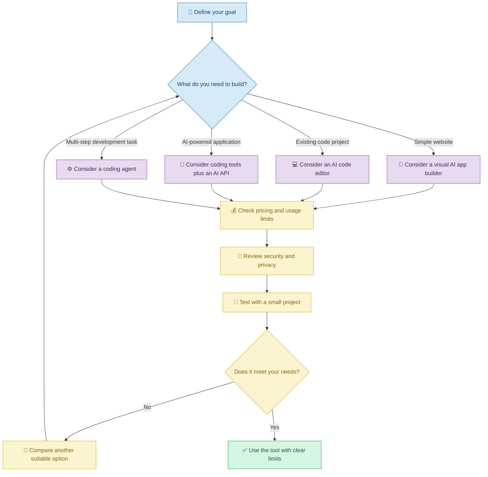
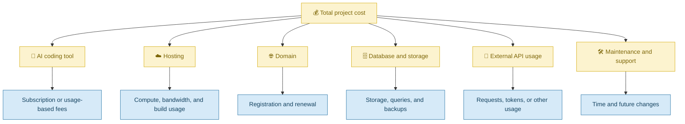

# 🧰 Choosing Vibe Coding Tools and Managing Costs

[⬅️ Back to Learning Modules](../README.md) · 

> Choose the right AI coding assistant for your needs, understand the costs, and build applications without unnecessary complexity or spending.

## 📋 1. Introduction

Imagine that a student wants to create a personal portfolio website. They discover several AI coding tools, each offering different features, usage limits, and pricing plans.

One tool may generate a website from a text description. Another may work directly inside a code editor. A third may help modify an existing project or troubleshoot errors.

Which should the student choose?

The answer depends on the project, the student's experience, the amount of control required, and the available budget.

**Vibe Coding tools** help people create or modify software through natural-language instructions and AI assistance. Some tools generate applications inside a visual environment, while others work with source code in an existing project.

With Vibe Coding, the goal is not to select the most expensive or most popular tool. It is to choose a tool that fits the task and provides an appropriate balance of ease of use, control, cost, and reliability.

## 🧠 2. Types of Vibe Coding Tools

| Tool category | What it helps you do | Suitable example |
|---|---|---|
| AI app builders | Generate applications from descriptions | A small business landing page |
| AI code editors | Create and modify code inside a project | Adding features to an existing React application |
| Chat-based coding assistants | Discuss requirements and generate code or guidance | Planning an application or debugging an error |
| Design-to-code tools | Turn designs or visual references into interfaces | Converting a page design into frontend components |
| Terminal-based coding agents | Work with files and development commands | Implementing and testing a multi-file feature |
| Deployment platforms | Publish applications online | Hosting a portfolio website |
| AI model APIs | Add AI capabilities to an application | Generating product descriptions |

A single platform may provide several of these capabilities.

## 🔍 3. How to Choose a Tool

## 🧑‍🎓 4. Real-Life Scenario: A Student Building a Portfolio

### The problem

A student wants a portfolio containing a profile, education details, projects, skills, a downloadable resume, and contact information.

They have limited experience with frontend development and want to create the website without spending unnecessarily.

### Step 1: Define the requirements

The student asks an AI coding assistant:

> Help me create a responsive personal portfolio with a home page, education, skills, projects, and contact sections. I want to understand the generated code, maintain the project locally, and publish it online. Recommend an approach that suits a beginner and avoids unnecessary paid services.

### Step 2: Compare suitable tools

The student evaluates potential tools against the actual requirements.

| Criterion | Questions to ask |
|---|---|
| Ease of use | Can I describe features in everyday language? |
| Code ownership and export | Can I access and maintain the generated source code? |
| Existing project support | Can the tool modify files already in my repository? |
| Usage limits | How many requests or operations are included? |
| Deployment | Does it support the intended hosting setup? |
| Privacy | How are prompts, uploaded files, and source code handled? |
| Cost | Are there additional charges for hosting, AI APIs, or databases? |
| Reliability | Can I test, debug, and recover from failed changes? |

### Step 3: Build a small prototype

Before committing to a paid subscription, the student asks the selected tool to create the home page and one project card.

The student checks the output, tests the layout on a phone, and determines whether the tool is suitable for the larger project.

### Step 4: Estimate ongoing costs

The student considers not only the initial development cost but also hosting, domain registration, AI usage, database storage, and potential usage overages.

**Follow-up prompt:**

> Prepare a monthly cost checklist for this portfolio. Separate one-time expenses from recurring charges, identify which services are optional, and highlight usage limits that could create unexpected costs. Do not assume that a free trial or free tier will remain free indefinitely.

## 💰 5. Understanding Vibe Coding Costs

A Vibe Coding project may have several cost categories.

### 5.1 Free tiers and paid plans

Free tiers can be useful for learning and prototypes, but they may have request limits, restricted features, or limited hosting resources.

**Prompt:**

> Compare the available plans for the tools I am considering using their current official pricing information. Identify request limits, code export options, hosting restrictions, and potential additional charges. Clearly distinguish verified pricing from estimates.

Pricing changes frequently, so verify it with the relevant provider before making a purchasing decision.

### 5.2 Usage-based costs

Some AI services charge according to model usage or the number of requests. Other providers use subscriptions or a combination of both.

**Prompt:**

> Help me estimate AI usage for my application using expected daily requests, average input and output sizes, and the selected provider's published pricing. Show the assumptions and calculate low, typical, and high usage scenarios.

### 5.3 Hidden or indirect costs

Even when code generation is free, a project may need paid hosting, database services, a domain, or an external API.

**Prompt:**

> Review my planned application architecture and identify recurring services, usage-based charges, and optional paid components. Suggest a simpler design if it meets the same requirements with fewer operational costs.

## ⚠️ 6. Common Mistakes

| Mistake | Better approach |
|---|---|
| Choosing a tool only because it is popular | Match the tool to the project |
| Assuming free means unlimited | Check quotas, restrictions, and overages |
| Ignoring future maintenance costs | Estimate the full lifecycle cost |
| Committing to a subscription before testing | Build a small prototype first |
| Assuming generated code can always be exported | Check ownership, export, and licensing terms |
| Ignoring privacy and data handling | Review provider policies before sharing sensitive material |
| Using several tools without a clear reason | Minimize unnecessary complexity |

## ✅ 7. Best Practices

1. Define your requirements before comparing tools.
2. Test a small project before committing to a platform.
3. Verify current pricing and usage limits.
4. Estimate recurring and usage-based expenses.
5. Consider code export, portability, and long-term maintenance.
6. Protect credentials and confidential project data.
7. Track actual usage against the budget.
8. Reassess the tool when the project grows.

## 🎯 8. Key Takeaways

- The best Vibe Coding tool depends on the project and the user.
- Different tools support different stages of application development.
- Free tiers and paid subscriptions have different limitations.
- Hosting, APIs, databases, and maintenance can create additional costs.
- Small prototypes help evaluate a tool before making a larger commitment.
