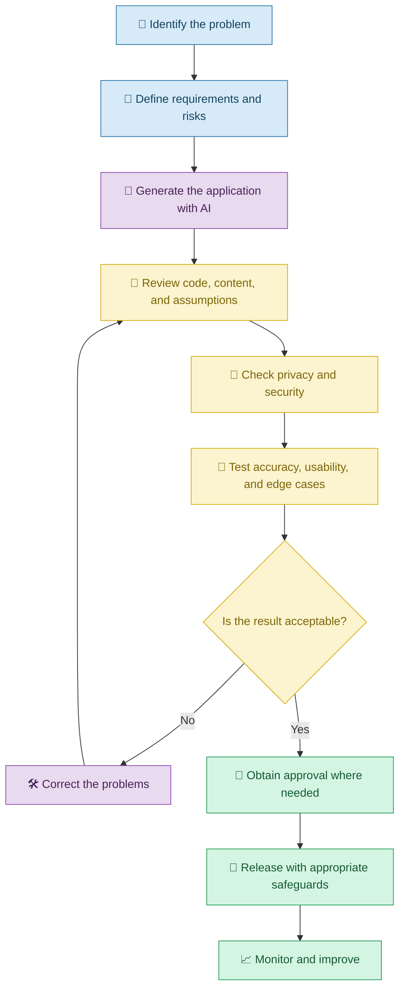
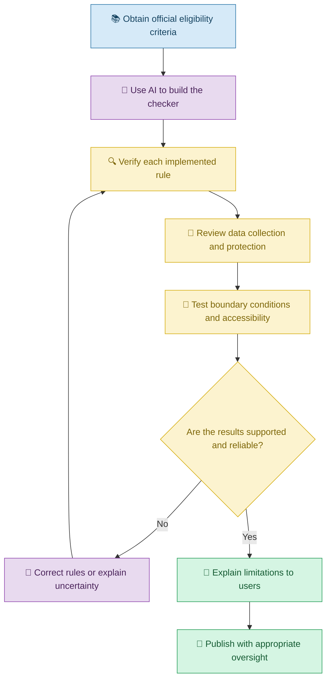

# 🧭 Responsible Vibe Coding

[⬅️ Previous:](17-costs-and-tool-selection.md) ·

> Use AI to build applications thoughtfully, protect users, verify results, and remain accountable for the software you create.

## 📋 1. Introduction

Vibe Coding makes it easier to turn ideas into software. A person can describe an application, ask an AI coding assistant to generate it, and refine the result through conversation.

However, creating an application quickly does not mean every generated feature is correct, safe, fair, or appropriate.

Imagine building a scholarship eligibility checker. AI can help create the interface and implement eligibility rules, but an incorrect rule could mislead a student into believing they are eligible or ineligible for financial assistance.

Responsible Vibe Coding means using AI productively while understanding its limitations, protecting information, respecting others' work, and verifying important results.

**The central principle is simple: AI can help create the application, but people remain responsible for how it is reviewed, used, and maintained.**

## 🧠 2. What Does Responsible Vibe Coding Mean?

Responsible Vibe Coding combines practical software development with appropriate human oversight.

| Principle | Meaning | Example |
|---|---|---|
| Accuracy | Check whether the application produces correct results | Verify scholarship eligibility calculations |
| Security | Protect systems against unauthorized access | Restrict access to private records |
| Privacy | Handle personal information appropriately | Avoid collecting unnecessary personal details |
| Transparency | Explain important limitations to users | Tell users when a result is an AI-generated suggestion |
| Fairness | Identify and reduce unjustified differences in treatment | Test whether eligibility rules are applied consistently |
| Accountability | Assign responsibility for decisions and actions | Require authorized approval for consequential actions |
| Intellectual property | Respect licenses and rights associated with code and content | Check the license before reusing a library |
| Accessibility | Make the application usable by people with different needs | Support keyboard navigation and readable contrast |

## 🛡️ 3. A Responsible Vibe Coding Workflow

## 🎓 4. Real-Life Scenario: Building a Scholarship Eligibility Checker

### The problem

A student wants to create an application that helps other students understand whether they may meet the requirements for different scholarships.

The application asks about course level, academic performance, income criteria where applicable, and other eligibility conditions.

The student uses Vibe Coding to generate the application but must ensure that it does not invent eligibility rules or expose personal information.

### Step 1: Define the boundaries

**Example prompt**

> Build a scholarship information application that explains eligibility criteria using verified information from official scholarship sources. Display the relevant requirements and the source of each rule. Clearly distinguish an informational eligibility estimate from an official decision. Do not invent missing requirements or automatically reject an applicant when information is incomplete.

### Step 2: Verify the information

The student asks:

> Review the eligibility rules implemented in the application and compare them with the supplied official criteria. Identify unsupported assumptions, missing conditions, and conflicting rules. Show which source supports each rule before changing the implementation.

This is important because AI-generated text may sound convincing even when it is incorrect.

### Step 3: Protect user information

**Follow-up prompt**

> Review the information collected by the application. Remove unnecessary personal data, explain why each required field is needed, and prevent private application details from being exposed through logs or public endpoints.

### Step 4: Test edge cases and accessibility

The student asks AI to test missing values, users close to an eligibility threshold, different permitted applicant categories, keyboard navigation, and screen-reader labels.

### Step 5: Explain limitations

The application includes a clear statement that its output is informational and that applicants must consult the official scholarship authority for final eligibility and application decisions.

### 🔄 Responsible development in practice

## 🔍 5. Important Responsible Coding Practices

### 5.1 Verify AI-generated information

AI may misunderstand requirements, use outdated information, or generate plausible but incorrect explanations.

**Prompt:**

> Review the generated implementation against the supplied requirements. Identify unsupported assumptions, incorrect calculations, and missing conditions. Do not claim that a requirement is satisfied unless the code or test evidence supports it.

### 5.2 Protect privacy

Do not upload confidential documents, customer records, passwords, or production credentials to an AI tool unless the data handling arrangements and permissions explicitly allow it.

**Prompt:**

> Review the application for unnecessary collection or exposure of personal information. Identify data sent to external services, recommend data minimization, and explain how sensitive information should be protected.

### 5.3 Respect intellectual property

AI-generated code may use third-party libraries or patterns that have licensing requirements. You should understand the terms that apply to your project.

**Prompt:**

> Identify third-party packages, assets, fonts, and other external resources used by the application. Provide their known licenses or sources where available and flag items that require manual verification. Do not assume that generated content is automatically free of restrictions.

### 5.4 Make the application accessible

A usable application should accommodate a range of devices, abilities, and interaction methods.

**Prompt:**

> Review the interface for keyboard navigation, visible focus, readable contrast, form labels, alternative text, and clear error messages. Recommend improvements and test the relevant interactions.

### 5.5 Keep humans responsible for important decisions

AI-generated suggestions should not automatically determine high-impact outcomes without suitable review.

**Prompt:**

> Identify actions in this application that could materially affect a person's finances, opportunities, privacy, or access to services. Add appropriate review, confirmation, and appeal or correction mechanisms where relevant.

## ⚠️ 6. Common Mistakes

| Mistake | Better approach |
|---|---|
| Assuming AI-generated code is automatically correct | Review and test the implementation |
| Publishing unverified information | Check authoritative sources |
| Uploading confidential data without considering privacy | Minimize data and review tool policies |
| Reusing assets without checking their licenses | Verify applicable rights and terms |
| Hiding important limitations from users | Communicate uncertainty clearly |
| Allowing unrestricted AI actions | Apply permissions and approval steps |
| Ignoring accessibility | Test usability with different interaction methods |
| Treating a successful demonstration as proof of production readiness | Conduct appropriate testing and review |

## ✅ 7. Best Practices

1. Define the application's purpose and limits.
2. Use reliable sources for factual requirements.
3. Review AI-generated code and content.
4. Protect secrets and personal information.
5. Test for correctness, accessibility, and security.
6. Respect software, content, and asset licenses.
7. Make important limitations clear to users.
8. Require appropriate human oversight for consequential actions.
9. Document important assumptions and decisions.
10. Continue reviewing the application after release.

## 🎯 8. Key Takeaways

- Responsible Vibe Coding combines speed with careful verification.
- AI output can be wrong even when it looks convincing.
- Security, privacy, accessibility, and licensing matter throughout development.
- Human review is especially important for high-impact applications.
- Responsible development continues after deployment.

