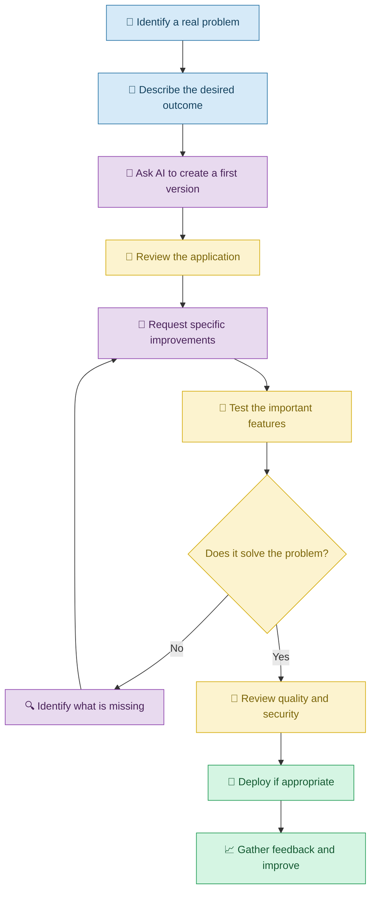
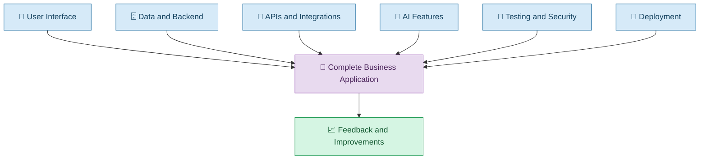

# 🌍 Real-World Applications of Vibe Coding

[⬅️ Previous:](18-responsible-vibe-coding.md) ·

> Discover how people can use natural-language instructions and AI coding assistants to create practical applications for everyday problems.

## 📋 1. Introduction

Vibe Coding is most useful when it helps someone solve a real problem.

A teacher may want to automate attendance reports. A shop owner may need an inventory dashboard. A student may want a portfolio website. A small business may need an appointment booking system.

In each case, the person begins with a goal, explains the requirements to an AI coding assistant, reviews the generated application, and requests improvements until the result meets the intended needs.

The examples in this module demonstrate how Vibe Coding can be applied across different industries and personal projects.

**Important:** These are illustrative scenarios. They show how the development process could work; they do not claim that any specific application has been built, tested, or deployed.

## 🧠 2. Where Can Vibe Coding Be Used?

| Area | Example application | How Vibe Coding helps |
|---|---|---|
| Education | Attendance and marks dashboard | Generate forms, reports, and charts |
| Retail | Inventory management system | Create product records, search, and stock alerts |
| Personal productivity | Expense tracker | Build categories, totals, and budgets |
| Healthcare administration | Appointment scheduler | Generate booking workflows and reminders |
| Hospitality | Reservation management | Create availability views and booking forms |
| Agriculture | Crop activity tracker | Record farm activities and visualize trends |
| Job searching | Personal portfolio | Create project pages and a resume download |
| Customer support | FAQ chatbot | Build a conversational interface connected to approved information |
| Data analysis | Interactive CSV dashboard | Generate filters, charts, and summary tables |
| Small business | Marketing website | Create responsive pages and contact forms |

The suitability of Vibe Coding depends on the application's complexity, security requirements, available data, and the consequences of mistakes.

## 🗺️ 3. A Common Vibe Coding Process

## 🎓 4. Real-Life Scenario 1: Student Performance Dashboard

### The problem

A teacher manages marks for multiple students across several subjects. Calculating averages and preparing charts manually takes time.

The teacher wants a dashboard that reads a spreadsheet, summarizes student performance, and allows filtering by subject or class.

### How Vibe Coding is used

**Example prompt**

> Build an interactive student performance dashboard that accepts a CSV file containing student identifiers, class, subject, and marks. Display subject-wise averages, individual performance, and charts. Add filters for class and subject. Validate missing or invalid marks and clearly explain how each calculation is performed.

### Iterative improvements

The teacher then asks:

> Add a comparison between the selected class average and the overall average. Keep the charts synchronized with the filters and show a helpful message when no records match.

The teacher verifies the calculations against the source spreadsheet before relying on the dashboard.

### Expected outcome

An interactive dashboard that reduces repetitive reporting and makes student performance easier to understand.

## 🛍️ 5. Real-Life Scenario 2: Small Business Inventory

### The problem

A shop owner tracks stock using handwritten notes. Products occasionally run out before anyone notices.

### Example Vibe Coding prompt

> Create an inventory application with product name, product code, category, price, and quantity. Allow authorized staff to add, edit, and search products. Show a low-stock warning when quantity falls below a configurable threshold. Store records persistently and validate all updates on the backend.

### Improvements

The owner asks AI to add category filters, downloadable reports, and a view of products that need restocking.

The owner tests whether quantity updates persist, whether invalid values are rejected, and whether unauthorized users are prevented from changing records.

### Expected outcome

A more organized inventory workflow with searchable records and useful stock alerts.

## 💸 6. Real-Life Scenario 3: Personal Expense Tracker

### The problem

A person wants to understand where their monthly income goes but finds manual expense tracking inconvenient.

### Example Vibe Coding prompt

> Build a personal expense tracker with date, amount, category, and description fields. Display monthly spending, category-wise totals, and the remaining budget. Add filters by date and category. Validate amounts and ensure totals update correctly when records are edited or deleted.

### Improvements

The user asks AI to add a monthly spending comparison and an alert when a category exceeds its budget.

They test the calculations using known sample expenses and check how the application behaves when no transactions exist.

### Expected outcome

An application that makes personal spending easier to monitor without manually calculating every total.

## 📅 7. Real-Life Scenario 4: Appointment Booking System

### The problem

A salon receives appointments through phone calls and messages. Staff sometimes overlook requests or schedule overlapping appointments.

### Example Vibe Coding prompt

> Build an appointment booking application that lets customers select a service, date, and available time slot. Save confirmed bookings, prevent conflicting reservations on the backend, and display a confirmation. Provide staff with a view of daily appointments and clear handling for failed requests.

### Improvements

The owner asks AI to add appointment reminders through an authorized messaging or email service.

The application is tested for simultaneous bookings, date handling, cancellations, and notification failures.

### Expected outcome

A more organized booking process that reduces manual work while keeping the staff in control of scheduling.

## 💬 8. Real-Life Scenario 5: Customer Support Assistant

### The problem

A small online store repeatedly answers questions about shipping, returns, and product availability.

### Example Vibe Coding prompt

> Create a customer-support chatbot that answers questions using the store's approved FAQ and policy documents. If the answer is unavailable, explain the limitation and offer a way to contact staff. Do not invent policy details or expose private customer records.

### Improvements

The owner asks AI to add a feedback option and test questions with ambiguous wording.

The chatbot is evaluated against a collection of known questions and expected answers before it is made available to customers.

### Expected outcome

A support assistant that handles common questions while directing uncertain or sensitive cases to a person.

## 📊 9. Real-Life Scenario 6: Interactive Data Analysis Dashboard

### The problem

A small business owner has sales data in a spreadsheet but finds it difficult to identify monthly trends and top-selling products.

### Example Vibe Coding prompt

> Build an interactive sales dashboard that accepts a CSV file with date, product, quantity, and sales amount. Display monthly sales, product rankings, and category summaries. Add date and product filters. Validate the input columns, handle missing data explicitly, and verify the totals against the source file.

### Improvements

The owner asks AI to add comparison periods and a downloadable summary report.

The dashboard is tested against independently calculated totals before the owner uses it for business decisions.

### Expected outcome

A visual, interactive way to explore sales data without manually preparing every chart.

## 🧩 10. How the Projects Connect to Vibe Coding Concepts

A real application may use only some of these concepts. For example, a static portfolio might not need a database, while a booking platform will usually need persistent storage and careful handling of simultaneous reservations.

## ⚠️ 11. Common Mistakes

| Mistake | Better approach |
|---|---|
| Choosing a project without identifying the actual problem | Define the intended user and outcome |
| Building every feature immediately | Start with a minimum viable product |
| Accepting AI-generated calculations without verification | Check results against known examples |
| Using real sensitive data too early | Start with synthetic or appropriately protected data |
| Ignoring the user's workflow | Ask intended users to review and test the application |
| Deploying before checking security and reliability | Test important failure cases and permissions |
| Continuing to add features without measuring value | Prioritize changes that solve demonstrated problems |

## ✅ 12. Best Practices

1. Start with a specific, practical problem.
2. Identify who will use the application.
3. Describe requirements in everyday language.
4. Build a small working version first.
5. Request targeted improvements through follow-up prompts.
6. Verify calculations and important outputs independently.
7. Protect data and credentials.
8. Test with realistic scenarios.
9. Gather feedback from intended users.
10. Expand the application only when the additional features provide value.

## 🎯 13. Key Takeaways

- Vibe Coding can be applied to many everyday problems.
- A useful application begins with a clear need, not a long feature list.
- Natural-language prompts can guide AI through planning, implementation, and improvement.
- Testing and user feedback are essential for validating the result.
- The right project is one that solves a real problem reliably and responsibly.

