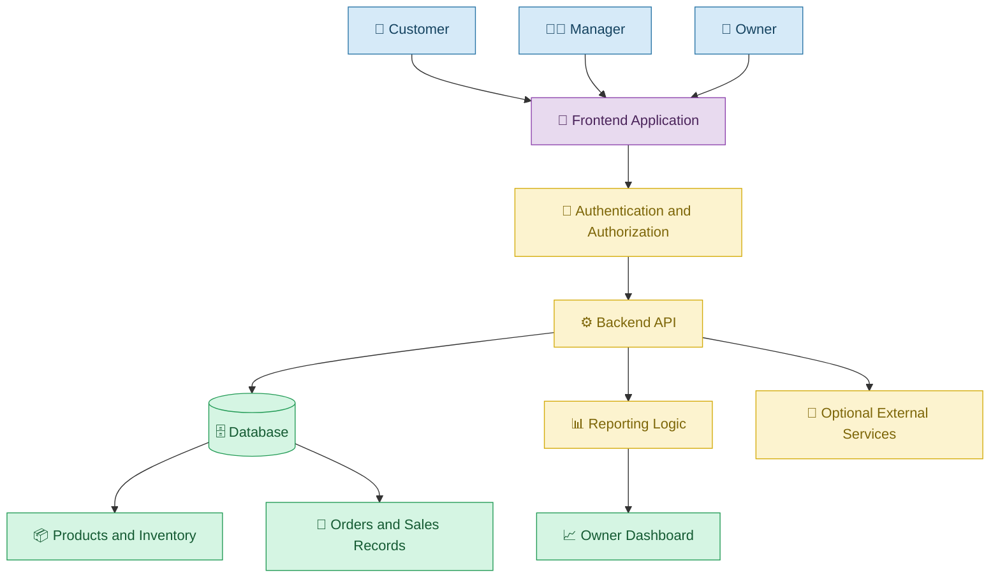
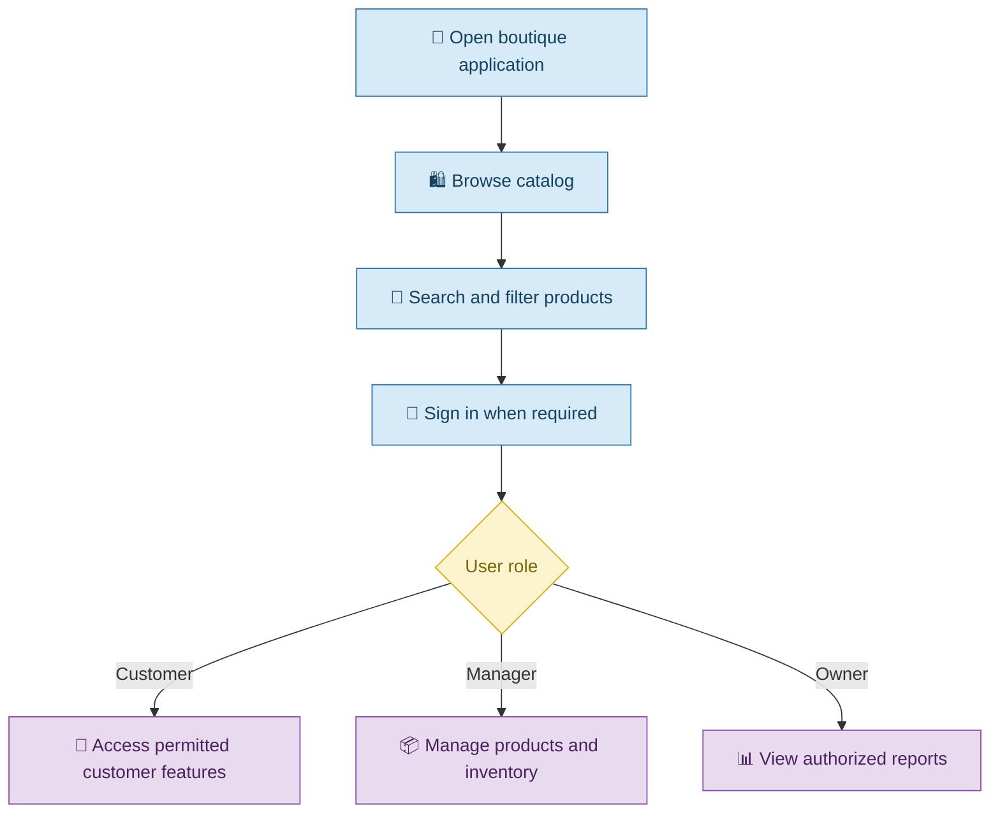
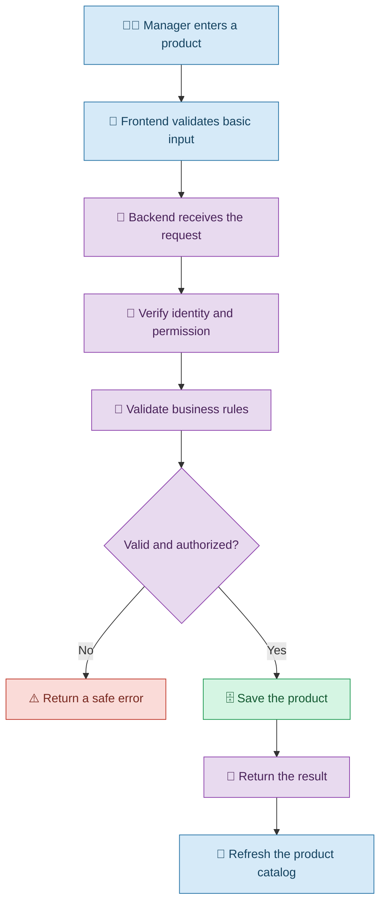
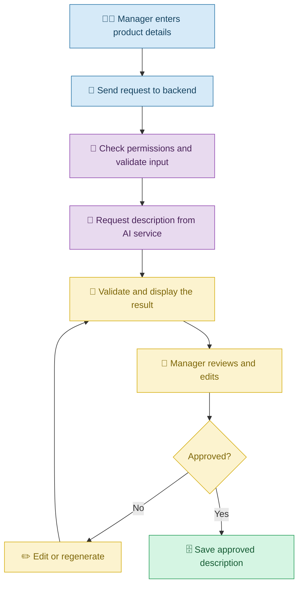
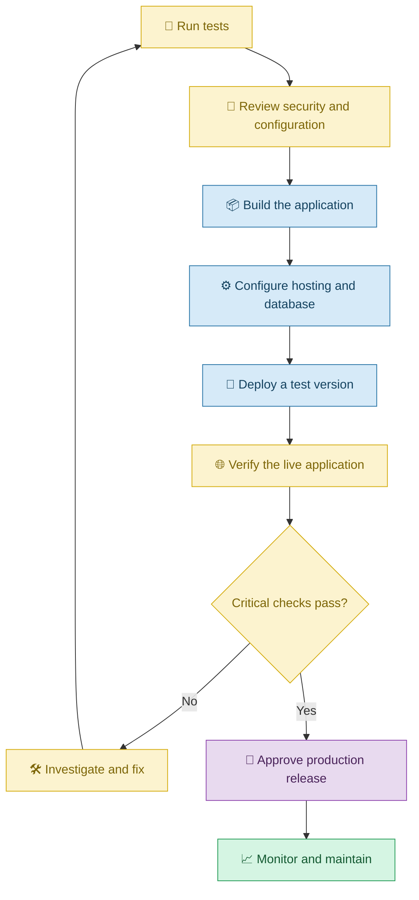

# 🚀 End-to-End Vibe Coding Capstone Project

[⬅️ Previous:](19-real-world-projects.md) ·

> Apply the complete Vibe Coding learning path to plan, build, test, and deploy a practical application using natural-language instructions and AI assistance.

## 📋 1. Introduction

Throughout this masterclass, we have explored how Vibe Coding can help people create user interfaces, connect databases, integrate external services, test applications, improve security, and deploy software.

This capstone brings those concepts together in one realistic project.

You will follow a fictional boutique business as it moves from manual product management to a digital management application.

The objective is not to build the most complicated application possible. It is to demonstrate how a real problem can be transformed into a working solution through clear requirements, AI-assisted development, iterative improvement, and independent verification.

**Capstone project:** Boutique Management System

**Primary goal:** Create an application that allows customers to browse products, managers to maintain the catalog, and owners to review business reports.

## 🎯 2. Project Requirements

### The business problem

A boutique manages products through spreadsheets and receives customer enquiries through social media. Product details are difficult to maintain, stock levels are not always accurate, and the owner spends time preparing reports.

The business wants a centralized application with separate features for customers, managers, and owners.

### Functional requirements

| Feature | Expected behavior |
|---|---|
| Product catalog | Display products with images, prices, and available sizes |
| Product search | Find products by name or category |
| Customer access | Allow customers to browse products and use permitted account features |
| Manager dashboard | Add, edit, and manage products and stock |
| Owner dashboard | View authorized business and financial summaries |
| Persistent storage | Preserve product and business records |
| Input validation | Reject invalid prices, quantities, and incomplete data |
| Reporting | Calculate sales and inventory summaries from verified records |
| Responsive interface | Work on desktop, tablet, and mobile screens |
| Security | Enforce authentication and role-based authorization |
| Error handling | Explain failures without exposing sensitive details |

### Non-functional requirements

- The interface should be readable and easy to navigate.
- The application should respond appropriately to invalid inputs and service failures.
- User permissions should be enforced on the backend.
- Sensitive credentials should not be exposed.
- Important changes should be tracked in Git.
- The application should be tested before deployment.
- The architecture should be maintainable as the business grows.

## 🗺️ 3. Application Architecture



The exact technologies can vary. For example, a project might use React for the frontend, FastAPI or Node.js for the backend, and a suitable relational database for persistent records.

The important goal is to understand how the components work together, not to use a particular technology without a reason.

## 📝 4. Phase One: Plan the Application

Before generating code, define the users, features, data, and boundaries.

### Step 1: Ask AI to create a project plan

**Example prompt**

> Help me plan a boutique management application. It needs a public product catalog, customer access, manager inventory management, and an owner dashboard. Identify the main screens, user roles, data entities, security requirements, and dependencies. Propose a phased implementation plan and identify which features should be included in the first working version.

### Step 2: Define the minimum viable product

Start with the essential features:

1. Display the product catalog.
2. Allow authorized managers to add and update products.
3. Store product information persistently.
4. Enforce role-based access.
5. Show an initial owner report.

Features such as automated marketing descriptions, advanced analytics, and third-party notifications can be added after the core workflow works.

### Step 3: Plan the user journeys



## 🎨 5. Phase Two: Build the User Interface

Start by creating the visible parts of the application.

### Example prompt

> Build a responsive boutique website with a public homepage, product catalog, search, category filters, and product details. Use an elegant design with clear typography, consistent spacing, and accessible buttons. Create separate dashboard layouts for customer, manager, and owner experiences. Use realistic sample products during the initial UI stage and clearly identify any temporary data.

### Review the result

Check that:

- Product cards display readable information.
- Search and category filters work.
- Navigation links lead to the correct pages.
- Layouts adapt to different screen sizes.
- Loading, empty, and error states are understandable.
- Existing features are preserved when changes are made.

### Request a targeted improvement

> Improve the product cards by increasing image visibility and making prices and available sizes easier to read. Preserve the existing navigation and functionality. Check the result on mobile and desktop widths.

## 🗄️ 6. Phase Three: Add Data and Backend Logic

The interface now needs a reliable way to store and retrieve business records.

### Example prompt

> Implement the backend and database for products, users, inventory, orders, and order items. Define appropriate relationships and validation rules. Store records persistently and expose only the API operations required by the application. Enforce authentication and role-based authorization on the backend. Explain the data model and required configuration before making changes.

### Verify the data workflow



### Important checks

- Product data remains available after a page refresh.
- Invalid prices and quantities are rejected.
- Only authorized users can modify inventory.
- Database failures produce appropriate error messages.
- Updates appear correctly in the catalog.
- Secrets remain outside public frontend code.

## 🤖 7. Phase Four: Add an AI Feature

For the capstone, add an optional AI-powered product description generator.

### Example prompt

> Add an AI-powered product description feature for authorized managers. Use the supplied product name, category, material, color, and sizes to generate a concise description. Do not invent product properties or availability. Show the generated description in an editable preview and require the manager to approve it before saving. Keep AI credentials on the server and handle service failures gracefully.

### How the feature works



This feature may require an external AI provider, API credentials, and usage costs. It should be tested using non-sensitive sample data before production use.

## 🧪 8. Phase Five: Test the Application

Before release, create a test plan that covers the main requirements.

### Example prompt

> Create and run tests for the boutique application. Cover product creation, product editing, inventory validation, search, persistent storage, customer access, manager permissions, owner reports, and the AI description feature. Include invalid inputs, failed requests, unauthorized actions, and boundary cases. Report actual test results and unresolved failures without claiming success for tests that were not run.

### Capstone test checklist

- [ ] Products display correctly.
- [ ] Search and filters return the expected products.
- [ ] Authorized managers can add and edit products.
- [ ] Invalid product data is rejected.
- [ ] Product updates persist after refreshing.
- [ ] Customers cannot access manager-only or owner-only operations.
- [ ] Managers cannot access owner-only financial reports.
- [ ] Financial summaries match the underlying test records.
- [ ] AI-generated descriptions can be reviewed before saving.
- [ ] Errors are displayed without revealing secrets.
- [ ] The application works at mobile and desktop widths.
- [ ] Existing features continue to work after changes.

Testing should use dedicated test accounts and sample records. If the application is intended for real financial or customer data, obtain appropriate security and privacy review before deployment.

## 🌿 9. Phase Six: Track Changes with Git

Version control helps preserve working versions during AI-assisted development.

### Example workflow

```bash
git status
git add .
git commit -m "Save working boutique application"
```

Before staging, inspect the files and ensure that credentials, private configuration files, and sensitive data are excluded.

For a new feature, use a separate branch:

```bash
git switch -c feature/ai-product-descriptions
```

After implementing and testing the feature, review the changes, commit the verified work, and merge it according to the project's workflow.

### Ask AI to review the changes

> Review the current Git diff. Summarize the files changed, identify unrelated modifications, and flag possible regressions or security concerns. Do not automatically discard or overwrite existing work.

## 🚀 10. Phase Seven: Deploy the Application

Deployment makes the application available in its intended environment.

### Example prompt

> Prepare the boutique application for deployment. Identify the build commands, frontend and backend hosting requirements, database configuration, environment variables, and required external services. Explain how to deploy a test version first, verify the live application, protect credentials, and recover from a failed release. Do not assume that a successful build means the production application is fully functional.

### Deployment workflow



The exact hosting configuration depends on the selected frontend framework, backend technology, database, and hosting provider.

## 📈 11. Phase Eight: Maintain and Improve

After deployment, gather feedback and monitor the application.

Possible future improvements include:

- Inventory alerts and downloadable reports.
- Better product search and filtering.
- Barcode scanning.
- Sales analytics and charts.
- Customer notifications.
- AI-assisted marketing content.
- Improved accessibility and performance.

### Example prompt

> Review the existing boutique application and propose the next three improvements based on user value, implementation effort, and risk. Preserve working features, identify dependencies, and explain how each proposed change will be tested before implementation.

## 🏁 12. Final Project Acceptance Criteria

The project can be considered ready for its intended demonstration when:

1. The documented core requirements have been implemented.
2. The main customer, manager, and owner workflows have been tested.
3. Important data is stored persistently where required.
4. Permissions are enforced on the backend.
5. Relevant tests pass and unresolved issues are documented.
6. Credentials and sensitive information are handled appropriately.
7. Git history preserves the significant development changes.
8. The application is deployed and verified if public access is part of the project.
9. Known limitations are documented clearly.

These criteria demonstrate readiness for the specified scope; they do not guarantee that the application is free of every defect or ready for every production environment.

## 🎓 13. What You Have Learned

By completing this capstone, you have brought together the major concepts of Vibe Coding:

- Turning a real problem into clear requirements.
- Using natural-language prompts to generate an application.
- Creating and refining user interfaces.
- Connecting data, backend logic, and databases.
- Integrating AI capabilities and external services.
- Testing functionality and investigating failures.
- Protecting credentials and enforcing permissions.
- Tracking changes with Git.
- Preparing and verifying deployments.
- Maintaining and improving software over time.

## 🎯 14. Final Takeaways

Vibe Coding is not simply asking AI to create an application in one step. It is a collaborative development process in which people define the goal, guide the AI, evaluate its output, and improve the result through evidence and feedback.

A successful project is not measured only by how quickly code is generated. It is measured by whether the application solves the intended problem, behaves reliably, protects users, and can be maintained as requirements change.

**Start small, provide clear instructions, review every important change, and let real requirements guide the next step.**

