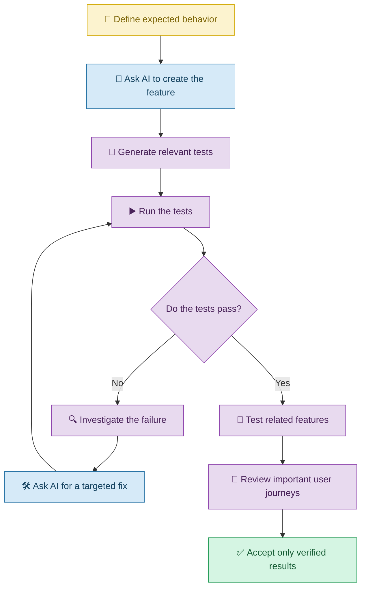

# 🧪 Testing and Quality with Vibe Coding

[⬅️ Back to Learning Modules](../README.md) · 

> Build applications with confidence by asking AI to test features, find weaknesses, and verify that changes work as expected.

## 📋 1. Introduction

Imagine asking an AI coding assistant to build an online shopping application. The homepage looks beautiful, the product cards appear correctly, and the Add to Cart button is visible.

But what happens if the button adds the wrong product? What if the checkout accepts an invalid quantity? What if the application crashes when the shopping cart is empty?

These problems show why an application must be tested before it is trusted.

**Software testing** means checking whether an application behaves as expected. **Quality assurance** is the broader effort to prevent problems and ensure the application meets its requirements.

With Vibe Coding, you can ask an AI coding assistant to create tests, explain possible failure cases, identify bugs, and improve existing test coverage.

However, AI-generated tests can also be incomplete or incorrect. You must verify that the tests check the intended behavior and actually run.

## 🧠 2. Understanding Software Testing

Testing is similar to checking a newly built house before moving in. You would verify that the doors open, the lights work, and the plumbing functions rather than assuming everything is correct because the house looks attractive.

Likewise, software testing checks whether individual features and the complete application work reliably.

| Testing concept | Simple explanation | Example |
|---|---|---|
| Manual testing | A person tries the application | Click the checkout button |
| Automated testing | Code runs checks automatically | Verify that cart totals are correct |
| Unit testing | Check one small part | Test a discount calculation |
| Integration testing | Check connected components | Verify that a booking is saved to a database |
| End-to-end testing | Check a complete user journey | Register, sign in, book, and view confirmation |
| Regression testing | Check that old features still work | Confirm checkout after a UI redesign |
| Usability testing | Check whether people can use the application easily | Ask a customer to complete a booking |

## 🔄 3. The Vibe Coding Testing Workflow

## 🛒 4. Real-Life Scenario: Testing an Online Shopping Application

### The problem

A small clothing business uses Vibe Coding to create an online store. Customers can view products, select quantities, add items to a cart, and proceed to checkout.

Before launching the store, the owner wants to make sure that the important features work correctly.

### Step 1: Ask AI to identify test cases

**Example prompt**

> Review my online shopping application and identify important test cases for product selection, shopping cart calculations, quantity validation, checkout, and order confirmation. Include normal usage, invalid inputs, and unexpected situations. Do not modify the application yet; first provide a test plan.

### Step 2: Generate tests for cart calculations

The owner asks:

> Create automated tests for the shopping cart. Verify that the subtotal is calculated correctly for multiple products, quantities are valid, and removing a product updates the total. Include empty-cart and invalid-quantity cases. Use the testing framework already configured in the project.

For example, if a customer selects two products priced at ₹500 each and one product priced at ₹300, the subtotal should be ₹1,300 before any taxes, shipping, or discounts.

### Step 3: Investigate a failed test

Suppose the cart total remains unchanged after a product is removed.

The owner asks:

> The cart removal test fails because the displayed subtotal is not updated. Trace the state update and calculation logic, identify the cause, and apply a targeted fix without changing the existing design.

### Step 4: Verify the complete shopping journey

The owner tests product selection, cart updates, invalid quantities, checkout validation, and confirmation behavior.

Payment integrations, if present, must also be tested safely using the provider's approved test environment rather than unverified real transactions.

## 🧩 5. What Should You Ask AI to Test?

### 5.1 Normal cases

Check whether the feature works when the user provides valid information.

**Prompt:**

> Test the registration form with valid information. Verify that a successful registration produces the expected result and that the user sees a clear confirmation.

### 5.2 Invalid inputs

Check what happens when users provide incorrect or incomplete information.

**Prompt:**

> Test empty fields, invalid email addresses, negative quantities, and malformed input. Verify that invalid data is rejected appropriately and useful error messages are displayed.

### 5.3 Edge cases

Edge cases are situations that occur near the limits of expected behavior.

Examples include an empty cart, a product with zero stock, an extremely long product name, or a booking made at the last available time slot.

**Prompt:**

> Identify boundary conditions for the current feature. Add tests for empty data, minimum and maximum permitted values, duplicate submissions, and unavailable resources where relevant.

### 5.4 Integration and end-to-end behavior

**Prompt:**

> Test the complete user journey from registration through login and the main application workflow. Verify frontend behavior, backend responses, data persistence, and authorization. Use test data and avoid changing production records.

## ⚠️ 6. Common Mistakes

| Mistake | Better approach |
|---|---|
| Assuming a good-looking interface is correct | Test actual application behavior |
| Asking AI to write tests without defining expected results | Describe requirements and acceptance criteria |
| Trusting tests that merely repeat the implementation's mistakes | Independently verify expected outcomes |
| Testing only successful inputs | Include invalid data and edge cases |
| Ignoring existing features after a change | Run regression tests |
| Testing payments using real transactions unnecessarily | Use an approved sandbox or test environment |
| Accepting an application because all tests pass | Review whether the tests cover important requirements |

## ✅ 7. Best Practices

1. Define what success means before generating a feature.
2. Ask AI to prepare a test plan before changing complicated code.
3. Include normal, invalid, boundary, and failure cases.
4. Run tests rather than relying on AI's explanation.
5. Review test coverage and verify the expected results independently.
6. Test the complete user journey for important workflows.
7. Run regression tests after significant changes.
8. Use realistic but non-sensitive test data.
9. Keep test environments separate from production.
10. Treat passing tests as evidence of quality, not a guarantee that every bug has been eliminated.

## 🎯 8. Key Takeaways

- Testing checks whether an application works as intended.
- Vibe Coding can help generate test plans, test cases, and fixes.
- Good tests check expected outcomes, including failure cases.
- Regression testing helps prevent new changes from breaking old features.
- An application should be tested before it is trusted with real users and data.
