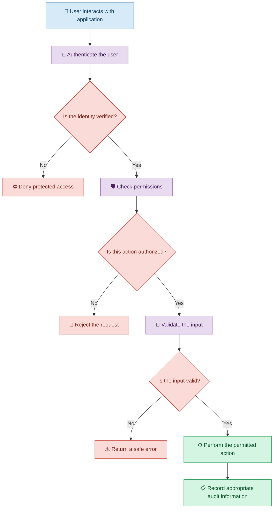

# 🔐 Security and Privacy in Vibe Coding

[⬅️ Previous:](09-testing-quality.md) ·

> Build applications that protect users, information, and credentials instead of focusing only on features and appearance.

## 📋 1. Introduction

Imagine using Vibe Coding to create a boutique management application. Customers can browse products, managers can upload new items, and owners can view financial reports.

The application may work perfectly, but what happens if a customer can access the owner's financial dashboard simply by changing a URL? What if an API key is accidentally included in the public source code?

These are security and privacy problems.

**Security** protects applications, accounts, and data from unauthorized access or misuse. **Privacy** concerns how personal information is collected, used, stored, and shared.

Vibe Coding can help implement security features, identify potential weaknesses, and generate security tests. However, generated code must be reviewed and verified, especially when it handles sensitive information.

## 🧠 2. Important Security Concepts

| Concept | Simple explanation | Example |
|---|---|---|
| Authentication | Verifying who someone is | Signing in with an account |
| Authorization | Deciding what someone can access | Only owners can view financial reports |
| API key protection | Keeping service credentials secret | Store an AI key on the backend |
| Input validation | Checking submitted information | Reject malformed form input |
| Encryption | Protecting information using cryptographic methods | Use HTTPS for data transmitted to a website |
| Data minimization | Collecting only necessary information | Do not request a customer's date of birth without a valid need |
| Secure session management | Protecting a signed-in user's session | Expire sessions appropriately |
| Privacy controls | Managing access and handling of personal data | Restrict access to customer records |

## 🛡️ 3. Security in a Vibe Coded Application

## 🏪 4. Real-Life Scenario: Securing a Boutique Management Application

### The problem

A boutique owner uses Vibe Coding to build an application with three roles:

- **Customer:** Browses products and manages their own account.
- **Manager:** Adds products and updates inventory.
- **Owner:** Views financial reports and manages privileged settings.

The owner notices that hiding a dashboard link does not necessarily prevent someone from accessing the underlying page or API directly.

### Step 1: Describe the access requirements

**Example prompt**

> Review my existing boutique application. Customers should only access public product information and their own permitted account features. Managers should manage the product catalog and inventory. Owners should access financial reports and privileged settings. Implement role-based authorization on the backend as well as suitable frontend navigation. Do not rely on hiding buttons as the security mechanism.

### Step 2: Protect API credentials

The application uses an external AI service to generate product descriptions.

The owner asks:

> Inspect how API credentials are configured. Move any exposed secrets into appropriate server-side environment variables, remove secrets from tracked source files, and ensure that frontend bundles and API responses do not reveal them. Explain any required credential rotation.

If a real credential has already been exposed, removing it from the latest version of the code is not sufficient. The exposed credential should be revoked or rotated, and the exposure should be investigated.

### Step 3: Protect customer information

**Follow-up prompt**

> Review the customer data collected by the application. Identify information that is unnecessary, restrict access to private records, validate incoming requests, and avoid exposing personal data in error messages or logs. Explain any security-sensitive changes before applying them.

### Step 4: Verify the security controls

Test each role separately. Attempt to access restricted pages and backend endpoints directly, including by changing identifiers in requests. Confirm that users cannot read or modify information they are not authorized to access.

## 🔍 5. Security Reviews You Can Request from AI

### 5.1 Review authentication and authorization

> Audit the login, session, and role-based access logic. Identify paths where an unauthenticated or unauthorized user might access protected resources. Explain each finding and recommend a targeted fix.

### 5.2 Review secret handling

> Search the project for hardcoded API keys, passwords, tokens, and database credentials. Report locations without reproducing the secret values. Recommend a secure configuration approach and explain how to handle any credentials that may already have been exposed.

### 5.3 Review input handling

> Review forms and backend endpoints for unsafe input handling, injection risks, and missing validation. Recommend appropriate protections for the existing technology stack and add tests for rejected input.

### 5.4 Review data privacy

> Document what personal information the application collects, where it is stored, which roles can access it, and whether it is sent to external services. Recommend data minimization and appropriate access restrictions.

## ⚠️ 6. Common Mistakes

| Mistake | Better approach |
|---|---|
| Assuming a hidden button protects a restricted feature | Enforce authorization on the backend |
| Storing API keys in frontend code | Keep secret credentials in server-side configuration |
| Believing AI-generated security code is automatically safe | Review and test security-sensitive logic |
| Logging passwords or authentication tokens | Exclude secrets and unnecessary personal information from logs |
| Collecting more personal information than necessary | Minimize data collection |
| Leaving exposed credentials active after deleting them from code | Revoke or rotate exposed credentials |
| Using real customer data during development without appropriate safeguards | Use synthetic or properly protected test data |
| Relying only on an AI security review | Perform independent verification and suitable security testing |

## ✅ 7. Best Practices

1. Define user roles and permissions before generating authentication features.
2. Enforce access control on the backend for every protected operation.
3. Keep credentials out of frontend bundles and source control.
4. Validate untrusted input on the server.
5. Use HTTPS and appropriate secure session settings.
6. Collect and retain only necessary personal information.
7. Review the security and privacy practices of external AI services.
8. Test unauthorized access, invalid requests, and account boundaries.
9. Keep dependencies updated and investigate known vulnerabilities.
10. Obtain qualified security review for sensitive or high-impact applications.

## 🎯 8. Key Takeaways

- A functional application is not necessarily a secure application.
- Authentication and authorization solve different problems.
- AI can help implement security controls, but those controls must be tested.
- Protecting credentials and personal information is essential.
- Human oversight and independent verification remain necessary.
