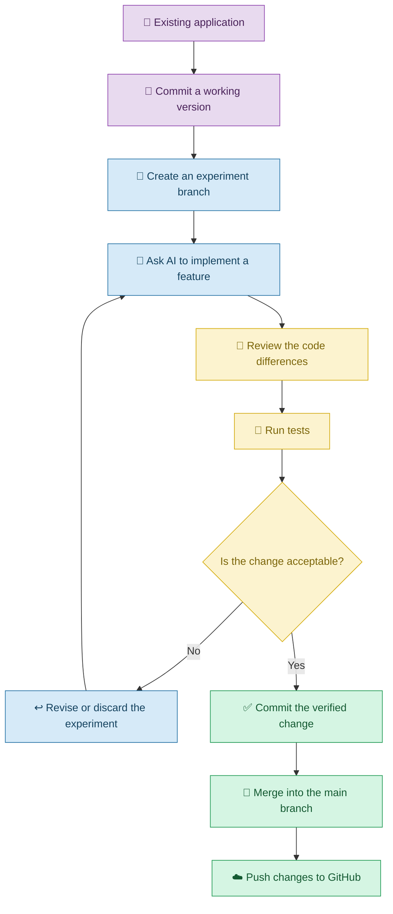

# 🌿 Git and Version Control with Vibe Coding

[⬅️ Previous:](10-security-privacy.md) ·

> Experiment with AI-generated changes while keeping a history of your work and a way to recover from mistakes.

## 📋 1. Introduction

Imagine asking an AI coding assistant to redesign your portfolio website. The new colors look better, but the contact form stops working.

You ask AI to fix the form, but another feature breaks. After several changes, you are no longer sure which version worked correctly.

This is where **version control** becomes valuable.

Version control records changes to project files over time. It helps you understand what changed, compare versions, collaborate with others, and recover from mistakes.

**Git** is a version control system. **GitHub** is an online platform that hosts Git repositories and supports collaboration.

With Vibe Coding, version control is particularly useful because AI can generate many changes quickly. You need a reliable way to review, preserve, and manage those changes.

## 🧠 2. Understanding Git and GitHub

| Term | Simple explanation | Example |
|---|---|---|
| Repository | A project's tracked files and history | Your portfolio website project |
| Commit | A recorded snapshot of changes | Save a working version of the login feature |
| Branch | An independent line of development | Experiment with a new dashboard design |
| Merge | Combine changes from different branches | Add an approved redesign to the main branch |
| Push | Send local commits to a remote repository | Upload commits to GitHub |
| Pull | Retrieve remote changes | Get the latest project updates |
| Diff | A comparison of changes | See which lines AI modified |
| Revert | Create a new change that reverses an earlier commit | Undo an unwanted change while preserving history |

### 🌳 How version control supports Vibe Coding



## 💻 3. Real-Life Scenario: Recovering a Broken Portfolio Website

### The problem

A student has created a portfolio website using Vibe Coding. The website contains a project gallery, a downloadable resume, and a contact form.

The student asks AI to add animations and redesign the project cards. After the change, the contact form stops submitting correctly.

### Step 1: Preserve the working version

Before starting the redesign, the student records the current project state.

If Git is already configured, the commands might be:

```bash
git status
git add .
git commit -m "Save working portfolio before redesign"
```

Review the files before staging them, and never commit API keys, passwords, private configuration files, or other secrets.

### Step 2: Ask AI to implement the redesign

> Improve the portfolio's project cards with subtle animations and responsive spacing. Preserve the existing contact form, resume download, navigation, and routes. Do not remove existing functionality.

### Step 3: Review the changes

The student checks the changed files and asks:

> Explain the files and functions changed by the redesign. Identify whether the contact form or its dependencies were modified. Do not make further changes until the impact is clear.

The student tests the contact form and discovers the regression.

### Step 4: Correct or reverse the change

The student asks AI to investigate the affected form. If the fix is unsuccessful, they can use Git to compare the changes and restore the appropriate code from the last working version.

The goal is to preserve the useful redesign while recovering the broken functionality.

### Step 5: Save and publish the verified result

After the form and redesigned cards pass their tests, the student commits the change and pushes it to GitHub.

## 🧰 4. Essential Git Commands for Vibe Coding

### Check the current state

```bash
git status
```

Shows modified, new, and staged files.

### Review changes

```bash
git diff
```

Displays unstaged differences. To review staged changes, use:

```bash
git diff --staged
```

### Create a commit

```bash
git add .
git commit -m "Improve portfolio project cards"
```

Before `git add .`, inspect the working tree and ensure sensitive or generated files are excluded.

### Create a branch for experiments

```bash
git switch -c feature/dashboard-redesign
```

This creates and switches to a separate branch for the redesign.

### Push a branch to GitHub

```bash
git push -u origin feature/dashboard-redesign
```

This assumes a remote named `origin` is already configured and authenticated.

### Inspect recent history

```bash
git log --oneline
```

Displays a compact history of commits.

### Important recovery note

Avoid using destructive commands such as `git reset --hard` or `git clean -fd` without understanding their consequences. They can discard uncommitted work or delete untracked files.

## 🤖 5. How to Use AI Alongside Git

### Review AI-generated changes

> Review the current Git diff. Summarize the functional changes, flag unrelated modifications, and identify possible regressions or security risks. Do not modify files during the review.

### Create a focused commit

> Help me identify the files related only to the completed login feature. Explain which files should be included in the commit and which unrelated changes should remain unstaged.

### Investigate a regression

> The application worked before the latest change. Compare the current implementation with the previous working version and identify the smallest likely cause of the regression. Recommend a fix without discarding unrelated work.

## ⚠️ 6. Common Mistakes

| Mistake | Better approach |
|---|---|
| Allowing AI to make many untracked changes | Review changes frequently |
| Committing API keys or secrets | Use `.gitignore` and secret scanning |
| Working directly on the main branch for risky experiments | Use a feature branch |
| Committing without testing | Run appropriate checks first |
| Using destructive recovery commands without reviewing them | Inspect status and diffs before recovery |
| Assuming GitHub automatically runs or validates the application | Configure CI and tests where appropriate |
| Overwriting another person's changes | Review shared branch history and coordinate merges |

## ✅ 7. Best Practices

1. Commit a known working state before major changes.
2. Ask AI to make small, focused changes.
3. Review the Git diff before accepting generated code.
4. Use branches for substantial experiments.
5. Write meaningful commit messages.
6. Run tests before merging changes.
7. Keep secrets and local environment files out of Git.
8. Push important work to a remote repository.
9. Use pull requests and code reviews when collaborating.
10. Keep backups of important data; Git history is not a substitute for database backups.

## 🎯 8. Key Takeaways

- Git records the history of your project.
- GitHub hosts repositories and supports collaboration.
- Version control makes Vibe Coding safer by preserving known working states.
- Branches allow experimentation without immediately changing the main version.
- Reviewing diffs and testing changes helps catch AI-generated regressions.
