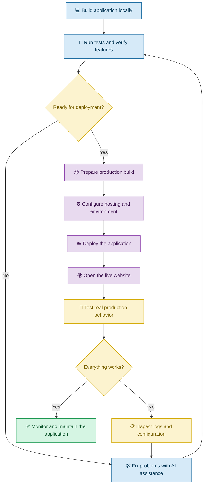

# 🚀 Deployment and Hosting with Vibe Coding

[⬅️ Previous:](11-git-version-control.md) ·

> Take an application from your computer to a live website that other people can access.

## 📋 1. Introduction

Imagine creating a beautiful website for a local bakery using Vibe Coding. The website works on your laptop, displays the menu, and shows the bakery's contact details.

But when you share your local development address with a customer, the customer cannot open it.

Why? Because an application running on your own computer is not automatically available on the internet.

**Deployment** is the process of preparing and releasing an application into an environment where its intended users can access it. **Hosting** provides the infrastructure where the application runs or its files are served.

With Vibe Coding, you can ask an AI coding assistant to help prepare the application for deployment, configure hosting, diagnose build errors, and verify the live website.

However, generating deployment instructions does not guarantee that the application is ready for production. Configuration, credentials, security, testing, and hosting requirements must also be addressed.

## 🧠 2. Local Development vs. Deployment

| Term | Simple explanation | Example |
|---|---|---|
| Local development | Running an application on your computer | Testing a website at `localhost` |
| Build | Preparing application files for release | Generating optimized frontend files |
| Hosting | Providing an environment to serve or run the application | A cloud hosting service |
| Domain | A human-readable website address | `example.com` |
| Environment variables | Configuration values supplied outside ordinary source code | An API endpoint or server-side API key |
| Production | The environment used by actual users | The live bakery website |
| Logs | Records that help explain application behavior | A failed database connection |

## 🌐 3. How Deployment Works



## 🥐 4. Real-Life Scenario: Publishing a Bakery Website

### The problem

A bakery owner uses Vibe Coding to create a website containing:

- A bakery introduction.
- Cake and pastry photos.
- A menu with prices.
- Opening hours and contact details.
- A form for customer enquiries.

The owner can open the website on their laptop but wants customers to access it from their phones without installing anything.

### Step 1: Ask AI to check deployment readiness

**Example prompt**

> Review my existing bakery website and prepare a deployment checklist for the technology stack already used in the project. Identify the build command, required environment variables, external services, hosting requirements, and any problems that should be fixed before publishing. Do not change the application yet.

This allows the owner to understand the requirements before choosing a hosting provider.

### Step 2: Prepare the production build

The owner asks:

> Help me create and verify a production build using the project's existing configuration. Explain any build errors, identify missing dependencies, and preserve the current application features.

The AI may recommend commands such as these for a typical Node.js frontend project:

```bash
npm install
npm run build
```

The exact commands depend on the project's package scripts and framework. A successful build is an important check, but it does not prove that the live application will work correctly.

### Step 3: Configure hosting

The owner asks:

> Explain how to deploy this application using a hosting provider compatible with its framework. Identify the build command, output directory, required environment variables, and any backend or database services that must also be deployed.

A static frontend may be hosted separately from a backend API. A full-stack application may need a running server, database, and additional configuration.

### Step 4: Configure the domain

The owner chooses a domain and asks:

> Explain how to connect my domain to the deployed website. Identify the required DNS records based on my hosting provider's instructions, explain how to verify the configuration, and ensure HTTPS is enabled.

DNS records must match the actual hosting provider's configuration. Do not guess record values.

### Step 5: Verify the live website

The owner checks:

- The website opens from another device.
- Images and styles load correctly.
- Navigation and contact links work.
- Forms behave as expected.
- HTTPS is enabled.
- No secret credentials are exposed.
- Backend requests and persistent data work, if applicable.

### 🎯 Expected outcome

The bakery has a publicly accessible website that customers can visit without needing access to the owner's computer.

## 🧰 5. Important Deployment Concepts

### 5.1 Production build

A production build prepares the application for release. Depending on the framework, it may optimize files, bundle assets, and detect some types of errors.

**Vibe Coding prompt:**

> Inspect the project's package scripts and deployment configuration. Explain how to build the application for production, run the available checks, and resolve build failures without removing existing functionality.

### 5.2 Environment configuration

An application may require different configuration in development and production.

For example, a local frontend may connect to a local backend, while the live frontend must connect to a deployed backend.

**Prompt:**

> Review how this application obtains its backend URL and other environment-specific settings. Configure the appropriate production values without hardcoding secrets or exposing server-side credentials in frontend code.

Remember that frontend environment variables are often embedded in publicly accessible browser assets. Never treat a frontend variable as secret merely because it is called an environment variable.

### 5.3 Frontend and backend hosting

A website with only static files may need a different hosting arrangement from an application with a server and database.

**Prompt:**

> Identify which parts of my application are static frontend assets, which parts require a running backend, and which external services are required. Recommend a compatible deployment arrangement and explain the responsibilities of each service.

### 5.4 Continuous deployment

Continuous deployment automates the release process after changes meet the required checks and approval conditions.

For example, a developer can configure a GitHub-based workflow that builds and tests the application before publishing approved changes.

**Prompt:**

> Propose a CI/CD workflow for this repository. Run automated checks on proposed changes and deploy only after the configured checks and approval requirements are satisfied. Keep production credentials in the hosting platform's secure configuration.

### 5.5 Logs and monitoring

Logs help identify problems after deployment. Monitoring can help detect errors, downtime, and performance problems.

**Prompt:**

> Add appropriate error logging and health checks for the deployed application. Record useful diagnostic details without exposing passwords, API keys, tokens, or unnecessary personal information. Explain how to investigate failed requests and service outages.

## ⚠️ 6. Common Deployment Problems

| Problem | What to investigate |
|---|---|
| Build fails | Dependencies, scripts, compiler errors, and configuration |
| Website displays a blank page | Browser console, asset paths, and runtime errors |
| Frontend cannot reach backend | API URL, CORS, network access, and backend availability |
| Application works locally but not in production | Environment differences and production configuration |
| Images or styles are missing | Asset paths, build output, and hosting configuration |
| Database connection fails | Credentials, network access, migrations, and service status |
| Domain does not resolve | DNS records and provider configuration |
| HTTPS fails | Domain verification and hosting certificate configuration |
| Deployment succeeds but features fail | Production logs, external integrations, and end-to-end tests |

## 🔐 7. Deployment Best Practices

1. Run the project's available tests before deploying.
2. Verify the production build locally when practical.
3. Configure production environment variables correctly.
4. Keep API keys and database credentials out of public frontend code.
5. Deploy the backend and database if the application requires them.
6. Use HTTPS for public applications.
7. Verify domain and DNS settings using the hosting provider's instructions.
8. Test the live application from a separate device or network.
9. Monitor logs and application health after release.
10. Maintain a rollback plan for failed deployments.
11. Back up important production data before risky migrations.
12. Review hosting costs, usage limits, and access permissions.

## 🎯 8. Key Takeaways

- Deployment makes an application available in its intended environment.
- Hosting provides the infrastructure needed to serve or run it.
- AI can help prepare builds, configure deployments, and investigate errors.
- Local success does not guarantee production success.
- Environment configuration, security, testing, and monitoring remain essential.
- A successful deployment should be followed by verification and ongoing maintenance.
